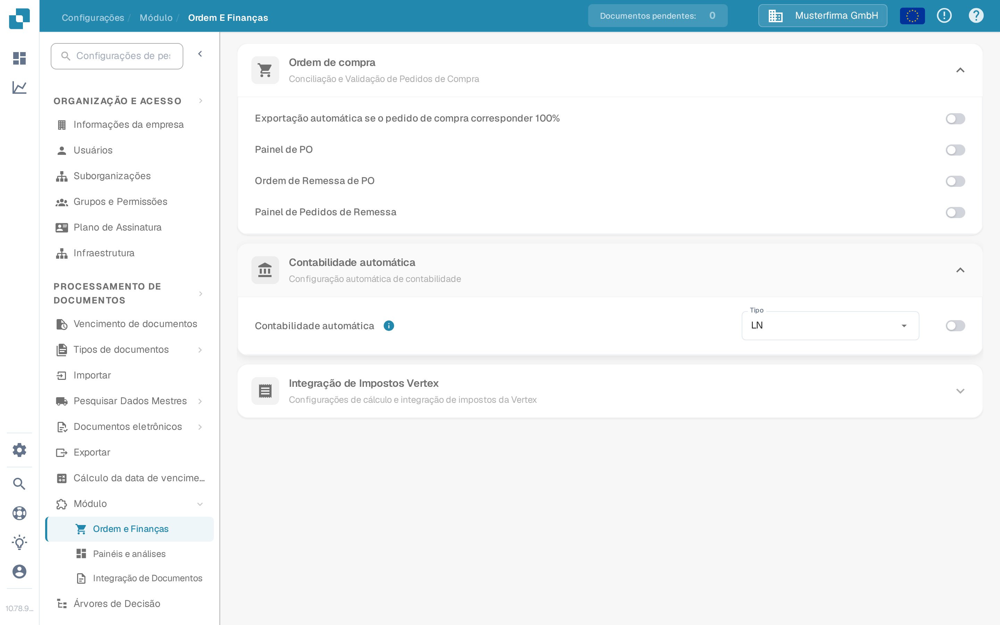
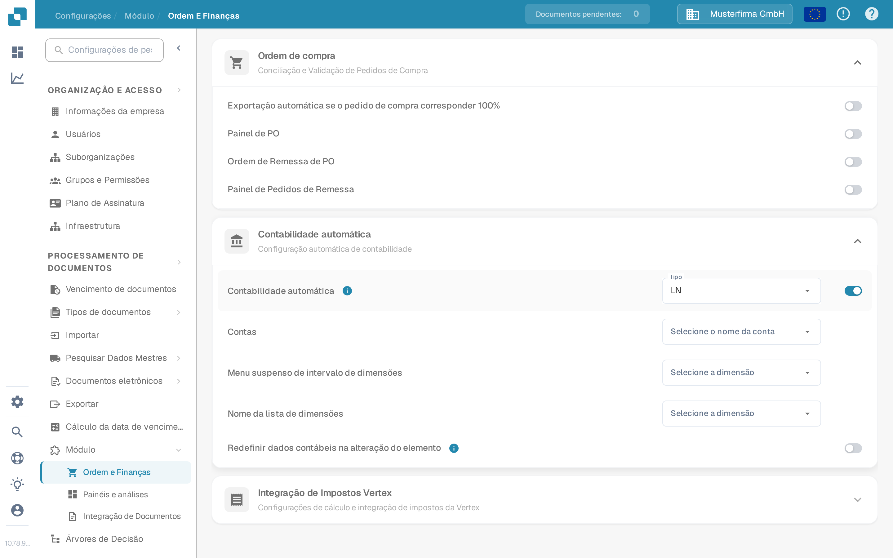

# Contabilidade automática — teste

Auto Accounting precisa de um módulo ativado, dados mestres contábeis e uma fatura com valores ou itens de linha utilizáveis. Este guia separa as configurações que você pode verificar antes de abrir uma fatura das verificações que exigem uma conexão LN ou M3 configurada.

## Verificar as configurações do módulo

1. Abra **Configurações → Módulo → Ordem e Finanças** e expanda **Contabilidade automática**. O caminho mais antigo **Processamento de Documentos → Módulo → Purchase Order / Auto Accounting** não é mais o caminho exibido na aplicação atual.
2. Escolha o **Tipo** do seu sistema conectado (**LN** ou **M3**). Ative a **Contabilidade automática** somente quando os dados mestres necessários e a conexão estiverem prontos.
3. Quando ativado, selecione a lista **Contas** e as listas de dimensões apropriadas ao seu sistema. Para LN, os campos visíveis incluem **Menu suspenso de intervalo de dimensões** e **Nome da lista de dimensões**. O M3 tem campos diferentes. Use **Redefinir dados contábeis na alteração do elemento** apenas se o recálculo após a alteração de um elemento for intencional.

<figure><figcaption>
A Contabilidade automática está desativada na organização de teste do Sandbox em português.
</figcaption></figure>

<figure><figcaption>
Os campos exibidos quando a configuração está ativada. Ela foi desativada novamente após esta captura; nenhuma conta ou dimensão foi configurada.
</figcaption></figure>

## Testar com uma fatura configurada

Use uma fatura cujos itens de linha e dados mestres contábeis estejam disponíveis. Abra-a na tela de validação e selecione **Contabilidade automática**. Se a ação estiver ausente, verifique a configuração do módulo e se esta fatura é elegível. Valide a fatura antes de navegar; a aplicação salva e valida quando a ação é selecionada.

Na tela de contabilidade, verifique o seguinte com seus próprios dados LN ou M3:

1. Execute **Validate Setup** onde disponível e resolva a configuração ausente de contas ou dimensões antes de prosseguir. Um resultado verde descreve apenas as verificações do seu ambiente.
2. Verifique se a fatura deve ser atribuída pelo **total** ou por **itens de linha individuais**. Compare os valores contábeis com a fatura original.
3. Se você dividir um valor, selecione a conta pretendida para cada linha da divisão. Insira valores ou porcentagens e verifique se os valores alocados somam o valor principal. Adicione ou remova uma linha apenas quando necessário.
4. Revise qualquer **Unsettled amount** ou aviso de validação e corrija-o antes de salvar ou exportar. Confirme o resultado no sistema conectado separadamente.

A organização de teste do Sandbox usada para as capturas de tela acima não tem listas de contas e dimensões configuradas nem itens de linha de fatura para este fluxo. A tela de contabilidade, a divisão e a exportação, portanto, **não foram testadas ou mostradas aqui**. Não use as capturas de tela de configurações como prova de que a contabilização ou a exportação foi bem-sucedida.

Para a configuração específica do sistema, continue com o [guia LN](ln.md) ou o [guia M3](m3.md).
