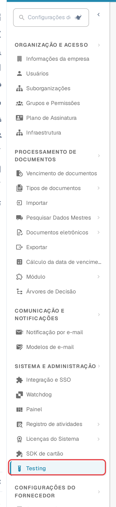
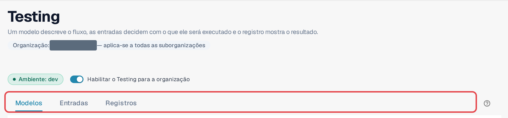
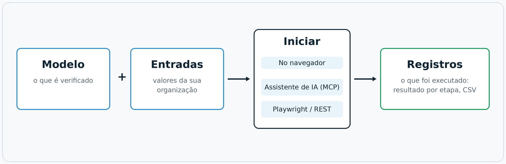
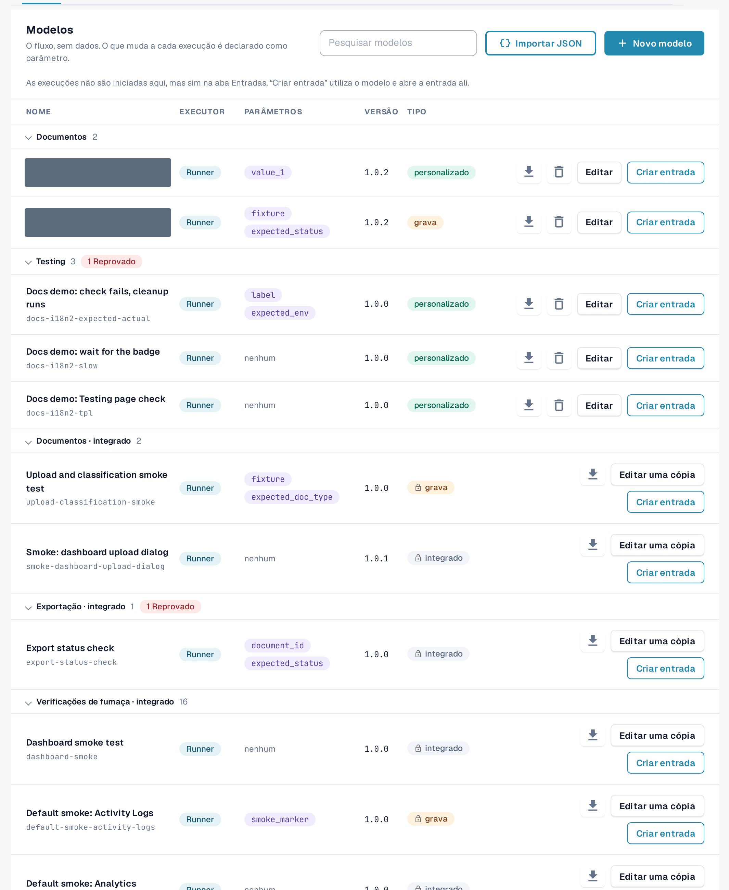

# Módulo Testing

## Vídeo: executar o primeiro teste no navegador



[Abrir o vídeo em português com legendas, capítulos e transcrição](https://docbits-videos.fra1.cdn.digitaloceanspaces.com/settings-assistant/testing-module-overview-preview-admin/v1/pt.html).

**Duração: 2:17.** Interface, narração e legendas em português.

A demonstração utiliza o **Live testing self-check** integrado no ambiente de desenvolvimento: analisar os três passos, criar e guardar uma entrada com nome, iniciar o teste no navegador e abrir o registo guardado dessa mesma execução. O modelo não precisa de parâmetros nem altera dados de negócio. Um resultado aprovado confirma estas três verificações; não comprova a extração de faturas, a aprovação nem a exportação para o ERP.

**Versão para revisão:** a escuta humana completa e a aceitação funcional continuam pendentes.


**Verifique o resultado guardado.** Nas gravações inglesa e alemã da versão 11.21.2, o indicador de uma entrada apresentava um bloqueio, embora a execução e o registo guardado indicassem aprovação. Voltar a abrir a entrada repunha o indicador correspondente. Perante uma diferença, consulte o registo dessa mesma execução. A reabertura é uma solução provisória observada, não uma correção confirmada.


## Para que serve o módulo Testing

O módulo **Testing** executa testes de navegador dentro da sua própria sessão do DocBits, na qual você já fez login. Um teste conduz as telas
reais, e não uma simulação: ele abre o painel, carrega uma fatura de exemplo, verifica se um novo documento chega à
validação ou confirma que uma exportação informa o status esperado. Ele verifica se o DocBits se comporta corretamente
**na sua organização** e registra o resultado de cada etapa.

O módulo fica em **Configurações → Testing**. Ele se destina a administradores que cuidam das suítes de teste de uma
organização.

Use-o quando quiser:

* confirmar que tudo continua funcionando depois de uma versão, de uma alteração de configuração ou de uma importação de configurações;
* repetir a mesma verificação de aceitação para várias organizações durante uma implantação;
* dar à equipe de QA uma lista de verificações que qualquer pessoa pode iniciar e cujos resultados todos podem ler;
* deixar que a sua automação de testes ou um assistente de IA inicie as mesmas verificações e leia os resultados.

## Quem pode usar

O módulo está disponível para os **administradores da organização** (veja [Privilégios de administrador](https://docs.docbits.com/administration-and-setup/settings/global-settings/groups-users-and-permissions/users/admin-privileges)).
Ele fica desativado em todas as organizações até que um administrador da organização o ative.

1. Abra **Configurações**. Na barra lateral, em **Sistema e administração**, selecione **Testing**.
2. Ative **Habilitar o Testing para a organização**.

<figure><figcaption>
Barra lateral de Configurações com a entrada Testing destacada.
</figcaption></figure>

<figure><figcaption>
Cabeçalho da página Testing com o selo de ambiente, o interruptor e as três abas.
</figcaption></figure>

Sob o título, **Organização: … — aplica-se a todas as suborganizações** mostra a organização para a qual esta página funciona. O que você configura aqui vale para essa organização e para todas as suas suborganizações.

Enquanto o interruptor estiver desativado, a página mostra apenas *O Testing está desativado. Nada será executado até que um administrador da organização o ative.* Desativá-lo novamente também encerra todas as abas do navegador que estavam registradas para inícios a partir de fora.

O selo **Ambiente** mostra onde você está. Em um ambiente de cliente (sandbox ou produção), ele fica vermelho,
e o DocBits aplica uma proteção adicional: os testes que alteram dados precisam de uma confirmação explícita, e as etapas de
exportação, exclusão ou aprovação são bloqueadas, a menos que o modelo declare que grava dados.

## Como funciona: modelo, entrada, início, registro

A página tem três abas: **Modelos**, **Entradas** e **Registros**. Um modelo descreve o fluxo, uma entrada decide
com o que ele será executado e o registro mostra o resultado.

<figure><figcaption>
Diagrama: modelo mais entrada resulta em um teste; ele é iniciado no navegador, por um assistente de IA ou de fora; toda execução termina nos Registros.
</figcaption></figure>

| Parte | Aba | O que é |
|---|---|---|
| **Modelo** | **Modelos** | Uma definição de teste reutilizável: *o que* é verificado, etapa por etapa. Ela não contém dados da sua organização. Tudo o que muda de uma organização para outra é um **parâmetro**. |
| **Entrada** | **Entradas** | Os valores salvos da sua organização para os parâmetros de um modelo, por exemplo o documento a abrir. **Modelo + entrada = um teste que você pode iniciar.** |
| **Início** | **Entradas** | O módulo executa e conduz o teste. Há três formas equivalentes de iniciá-lo: no navegador, a partir de um assistente de IA via MCP, ou de fora com Playwright ou uma chamada REST. |
| **Registro** | **Registros** | O que realmente foi executado, seja qual for a forma de início: o resultado, cada etapa, os parâmetros usados. Um gráfico de histórico mostra os resultados ao longo do tempo; você pode exportar os registros como CSV. |

O DocBits fornece **modelos padrão** (seus IDs começam com `default-smoke-`) e alguns modelos integrados. Eles são
iguais para todas as organizações e não podem ser alterados nem excluídos. Um modelo padrão pode ser executado em qualquer organização; a
entrada fornece o que é específico da sua. Você também pode criar seus próprios modelos e excluí-los novamente.

## Início rápido: executar um teste padrão

1. Abra **Configurações → Testing**, aba **Modelos**.
2. No grupo **Testes de fumaça**, localize um modelo padrão sem parâmetros (a coluna **Parâmetros** mostra *nenhum*), por exemplo *Default smoke: log metrics*.
3. Selecione **Criar entrada**. A aba **Entradas** abre com uma nova entrada para este modelo.
4. Informe um **Nome da entrada** e selecione **Salvar entrada**.
5. Selecione **Iniciar**. O teste é executado nesta aba do navegador; não recarregue nem feche a aba enquanto ele estiver em execução.
6. Abra a aba **Registros**. A linha mais recente mostra o resultado: **Aprovado**, **Reprovado** ou **Bloqueado**.

<figure><figcaption>
Aba Modelos com o grupo Testes de fumaça.
</figcaption></figure>

Continue lendo:

* [Modelos](templates.md): padrão, seus próprios modelos, importação e exclusão
* [Etapas e blocos prontos](steps-and-blocks.md): grupos de etapas, configurações avançadas, limpeza, valores memorizados
* [Escolher um elemento no aplicativo](pick-in-app.md): escolha um elemento apontando para ele
* [Recarregar e retomar](reload-and-resume.md): recarregue a página no meio de um teste
* [Entradas](inputs.md): salve os valores da sua organização
* [Iniciar um teste](start-a-test.md): no navegador, a partir de um assistente de IA ou do Playwright
* [Registros e histórico](logs.md): resultados, gráfico e exportação em CSV
* [Solução de problemas](troubleshooting.md)
* [Para desenvolvedores](for-developers.md)
