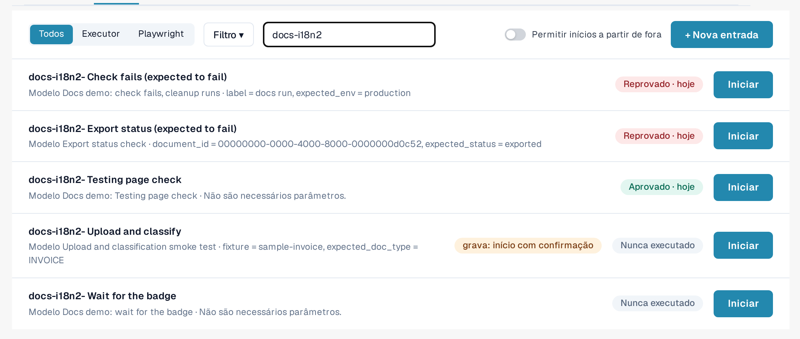
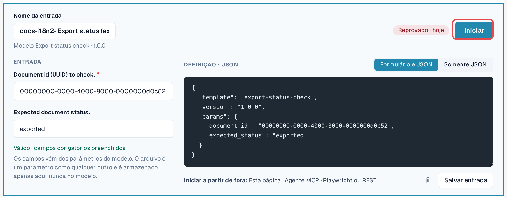
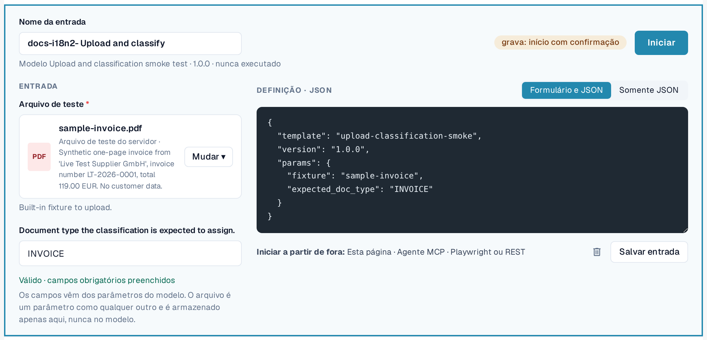

# Entradas

Uma entrada guarda **os valores da sua organização** para os parâmetros de um modelo, sob um nome de sua escolha.
Um modelo mais uma entrada é um teste que você pode iniciar quantas vezes quiser, manualmente ou de forma automática.

Exemplo: o modelo padrão *Default smoke: validation contract* abre um documento e verifica o seu status e o
tipo de documento. Ele precisa de um ID de documento. A sua entrada *Fatura LT-2026-0001 pronta para validação* guarda o ID de um
documento da sua organização e o status que você espera.

Abra **Configurações → Testing**, aba **Entradas**.

<figure><figcaption>
Aba Entradas com as entradas salvas e seus últimos resultados.
</figcaption></figure>

Cada linha mostra o nome da entrada, o seu modelo e versão, o último resultado e **Iniciar**. **Atualização disponível**
significa que o modelo tem uma versão mais recente do que aquela para a qual esta entrada foi salva. Um selo
**grava: iniciar com confirmação** marca as entradas cujo modelo altera dados.

## Criar uma entrada

1. Na aba **Modelos**, selecione **Criar entrada** no modelo. (Ou, na aba **Entradas**, selecione
   **+ Nova entrada** e escolha o modelo.)
2. Informe um **Nome da entrada**, por exemplo a finalidade e a organização.
3. Preencha os parâmetros. Os campos obrigatórios são marcados com um asterisco. Você pode alternar entre **Formulário e JSON**
   e **Somente JSON**; os dois permanecem sincronizados.
4. Confira a linha abaixo do formulário: *Válido · campos obrigatórios preenchidos* significa que a entrada pode ser iniciada.
5. Selecione **Salvar entrada**.

<figure><figcaption>
Editor de entradas com nome, parâmetros e linha de validade.
</figcaption></figure>

### Arquivos como parâmetros

Alguns modelos carregam um documento. O parâmetro de arquivo deles oferece **Arquivos da organização** (PDF, PNG ou JPEG de até 10 MB
que a sua organização carregou para testes) e **Arquivos de teste do servidor** (arquivos de teste sintéticos fornecidos pelo DocBits).
O arquivo é armazenado na sua organização, nunca no modelo.

<figure><figcaption>
Parâmetro de arquivo com arquivos da organização e arquivos de teste do servidor.
</figcaption></figure>

### Valores que nunca são salvos

Os parâmetros marcados como sensíveis (por exemplo, a senha de um sistema externo) nunca são armazenados. A entrada
lembra apenas que o valor é necessário; você o informa a cada início (*Enviado somente no início; nunca salvo.*).
Os registros mostram esses valores como *Informado no início*.

## Alterar ou excluir uma entrada

Abra a entrada na lista, altere-a e selecione **Salvar entrada**. Para excluí-la, selecione o ícone de lixeira no
editor e confirme. Excluir uma entrada não exclui os seus registros.


Se a sua organização mantém **casos de teste**, o link **Casos de teste** no menu de filtro da aba Entradas lista os
casos e mostra quais têm um modelo. Um caso sem modelo pode ser confirmado manualmente por uma pessoa autorizada.

