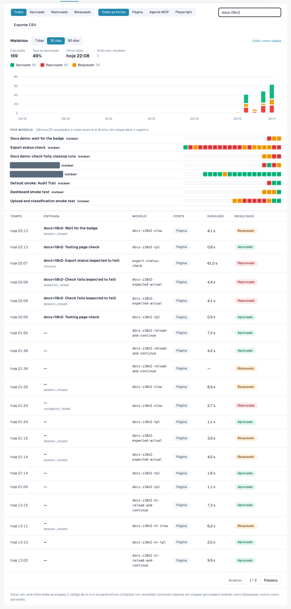
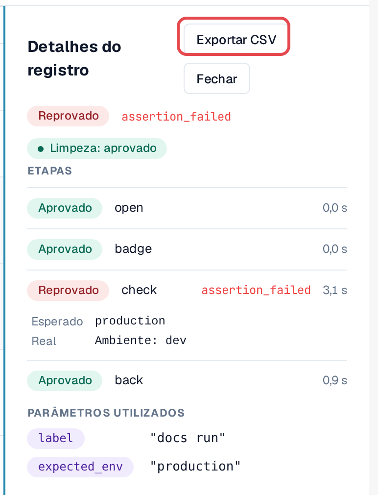
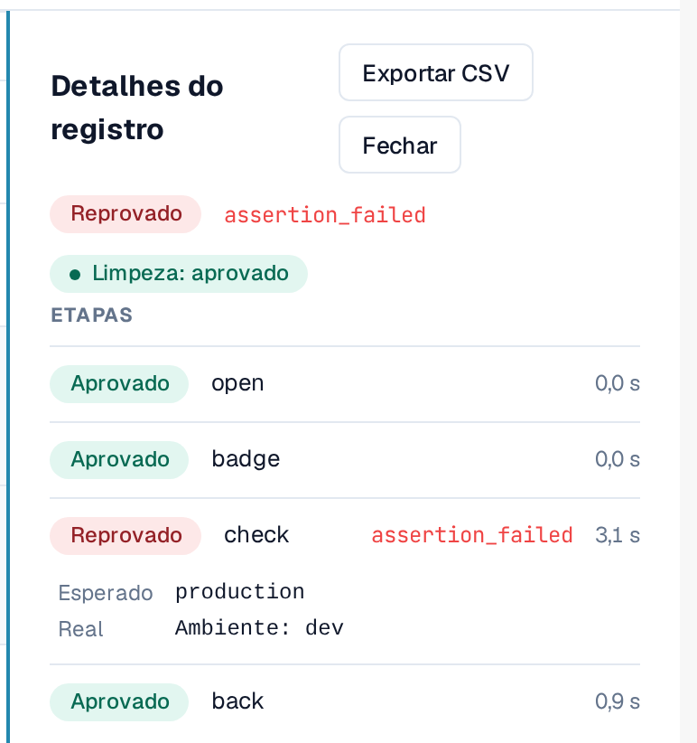
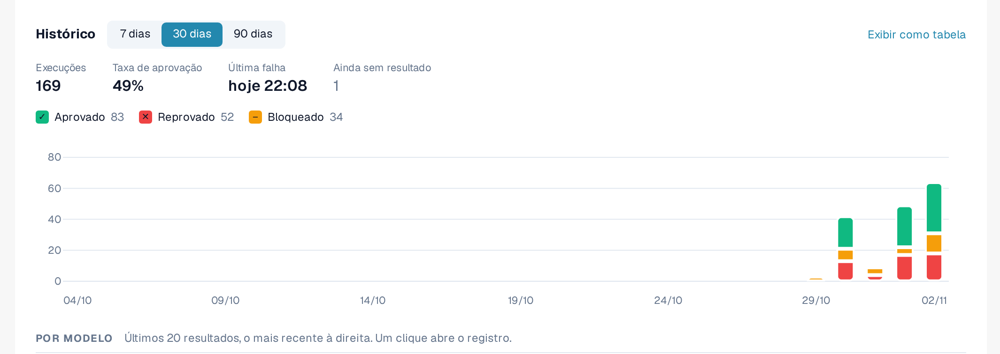
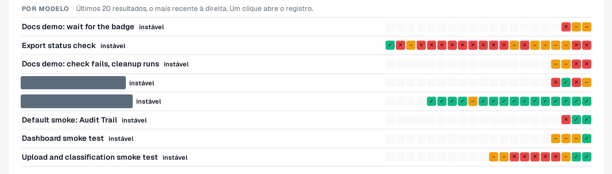

# Registros e histórico

Toda execução, seja qual for a forma de início, termina na aba **Registros**: o resultado, as etapas, o código de erro de uma etapa
com falha e os parâmetros usados. Os registros não armazenam conteúdo de página nem capturas de tela.

Abra **Configurações → Testing**, aba **Registros**.

<figure><figcaption>
Aba Registros com resultados e fontes variados.
</figcaption></figure>

## Ler a lista

| Coluna | Significado |
|---|---|
| **Hora** | Quando a execução começou. |
| **Entrada** | A entrada que foi iniciada (ou o caso do plano de testes). |
| **Modelo** | O ID do modelo. |
| **Fonte** | **Página** (iniciado no navegador), **Agente MCP**, **Playwright**, **Manual** (um caso confirmado manualmente). |
| **Duração** | Quanto tempo a execução levou. |
| **Resultado** | **Aprovado**: todas as etapas foram aprovadas. **Reprovado**: uma etapa falhou. **Bloqueado**: a execução não pôde ser avaliada, por exemplo porque etapas foram ignoradas; uma execução composta apenas de etapas ignoradas nunca é mostrada como aprovada. |

Filtre com **Todos / Aprovado / Reprovado / Bloqueado**, com **Todas as fontes / Página / Agente MCP / Playwright** ou com
**Pesquisar registros**.

## Abrir um registro

Selecione uma linha. **Detalhes do registro** mostra cada etapa com o seu resultado, o código de erro de uma etapa com falha e os
**Parâmetros usados** (valores sensíveis apenas como *Informado no início*). **Abrir caso** leva ao caso do plano de testes, se
houver um.

<figure><figcaption>
Detalhes do registro de uma execução com falha.
</figcaption></figure>

### Valor esperado e valor real

Sob uma verificação que falhou, **Detalhes do registro** mostra o que a verificação esperava e o que ela encontrou:

* **Esperado**: o valor que o modelo pede.
* **Real**: o valor que estava na página.

Ambos aparecem apenas em **ambientes de desenvolvimento e de teste**, são abreviados para 120 caracteres e são omitidos quando a
etapa usa um valor sensível. Em um ambiente de cliente (sandbox, produção), o registro mantém apenas o código de erro.

### Limpeza

Se o modelo tiver [etapas de limpeza](steps-and-blocks.md), o selo ao lado do resultado mostra como elas terminaram:
**Limpeza: aprovada**, **Limpeza: reprovada** ou **Limpeza: ignorada** (por exemplo, porque a execução foi interrompida). As etapas de limpeza
são executadas mesmo depois de uma verificação com falha. Uma limpeza com falha não altera o resultado da execução, mas dados de teste, por exemplo um
documento carregado, podem ficar para trás. Abra o registro para ver qual etapa de limpeza falhou.

<figure><figcaption>
Detalhes do registro: a verificação com falha com Esperado e Real, e o selo Limpeza: aprovada.
</figcaption></figure>

## Gráfico de histórico

Acima da lista, **Histórico** mostra como os testes foram executados ao longo do tempo. Alterne entre **Mostrar como gráfico** e **Mostrar como tabela**.

* **Resultados por dia**: quantas execuções foram aprovadas, reprovadas ou bloqueadas em cada dia, no seu fuso horário. Escolha o
  **Período** (7 a 90 dias, padrão 30). Selecione um dia para filtrar a lista por ele; **Mostrar todos os dias novamente** remove o filtro.
* **Taxa de aprovação** e **Última falha** resumem o período. As execuções ainda em andamento contam como *sem resultado ainda*.
* **Por modelo**: os últimos 20 resultados de cada modelo, o mais recente à direita, com um rótulo: **estável** (apenas
  aprovados), **instável** (resultados mistos) ou **sem aprovação** (apenas reprovados ou bloqueados). Selecione um resultado para abrir o seu registro.
  Os modelos instáveis são listados primeiro.

<figure><figcaption>
Histórico: resultados por dia.
</figcaption></figure>

<figure><figcaption>
Por modelo: últimos 20 resultados e estabilidade.
</figcaption></figure>

## Exportar como CSV

Selecione **Exportar CSV** na barra de ferramentas para baixar os registros que correspondem ao resultado e à fonte selecionados (até 5.000;
o texto da pesquisa não é aplicado). Em **Detalhes do registro**, **Exportar CSV** baixa um único registro com todas as suas etapas.

O arquivo abre diretamente no Excel (UTF-8). Os horários estão em UTC. Ele contém as mesmas informações da página: nenhum
valor sensível, nenhum conteúdo de página.

<figure><figcaption>
Exportar CSV na barra de ferramentas de Registros.
</figcaption></figure>
