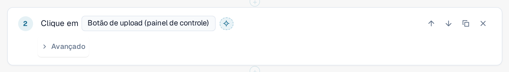
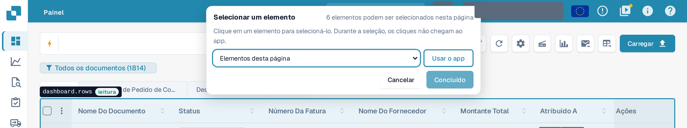
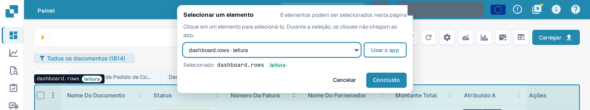
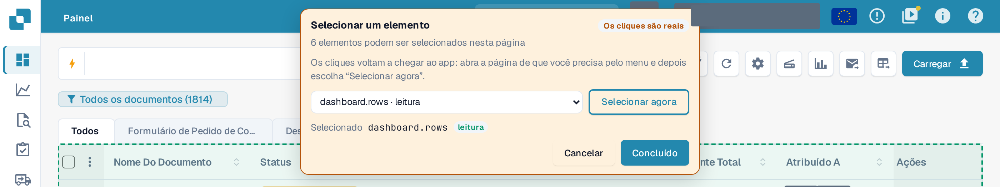

# Escolher um elemento no aplicativo

Toda etapa precisa saber **em qual elemento** da página ela atua: um botão, um campo, uma tabela. Em vez de procurá-lo
em uma lista longa, você pode apontar para ele no aplicativo real.

## Escolher um elemento

1. No editor de modelos, selecione o botão de mira **Escolher no aplicativo** ao lado do elemento de uma etapa.

<figure><figcaption>
O botão Escolher no aplicativo ao lado do elemento de uma etapa Clique
</figcaption></figure>

2. O DocBits abre a página em que o teste está nesta etapa: a página da etapa **Abrir página** anterior mais próxima.
   Se essa etapa usar um valor de entrada, o DocBits pergunta qual página abrir. O seu rascunho é mantido, sem salvar, e o
   aplicativo permanece nesta aba do navegador.
3. Uma barra **Escolher um elemento** aparece no alto. Ela informa quantos elementos podem ser escolhidos nesta página. Mova o
   mouse sobre a página: o DocBits contorna o elemento sob o ponteiro e o nomeia, junto com a sua classe:
   **leitura** (apenas lê), **altera dados**, **irreversível** ou **desconhecido**.

<figure><figcaption>
Ao passar o mouse sobre a lista de documentos: o contorno nomeia o elemento dashboard.rows e a sua classe leitura
</figcaption></figure>

4. Clique no elemento. A barra o mostra em **Selecionado**. Você também pode escolher um elemento na lista
   **Elementos nesta página** da barra, que funciona com o teclado e com um leitor de tela.

<figure><figcaption>
A barra depois de um clique: dashboard.rows está selecionado, Concluído está habilitado
</figcaption></figure>

5. Selecione **Concluído**. O editor abre novamente com o seu rascunho e o elemento na etapa. Selecione **Cancelar** para voltar
   sem alteração. Nos dois casos o rascunho permanece sem salvar: selecione **Salvar** no editor quando estiver satisfeito com ele.

Enquanto você escolhe, **o aplicativo não vê os seus cliques.** Escolher um botão **Excluir** não exclui nada. Saia do
seletor com **Concluído** ou **Cancelar**; nenhuma tecla (nem mesmo Esc) o fecha. O botão fica desativado enquanto um teste
é executado nesta aba.

## Escolher uma tabela, uma coluna ou uma ação de linha

As etapas do grupo **Tabela** (**Verificar linha da tabela**, **Clicar na linha da tabela**, **Memorizar valor** de uma célula de tabela) aceitam
somente tabelas. Clique em uma célula da tabela: o DocBits pega a tabela e oferece a coluna dessa célula e as outras
colunas da linha como sugestões para os campos de coluna da etapa. Em **Clicar na linha da tabela**, clique no botão
dentro da linha para usar essa ação de linha. **Verificar quantidade** aceita qualquer elemento, inclusive uma tabela.

## Usar o aplicativo durante a escolha

O elemento de que você precisa pode estar em outra página. Selecione **Usar o aplicativo**. A barra fica laranja e mostra **Os cliques são reais**:
a partir de agora os seus cliques voltam a chegar ao aplicativo, e você pode abrir a outra página pelo menu normal.
A barra permanece e a sua lista acompanha a página. Selecione **Escolher agora** para escolher novamente.

<figure><figcaption>
Modo Usar o aplicativo: os cliques são reais, Escolher agora volta à escolha
</figcaption></figure>


No modo **Usar o aplicativo**, um clique é um clique real: ele pode salvar, excluir ou enviar dados na sua organização.
Volte com **Escolher agora** antes de clicar em qualquer coisa que você não queira fazer.

