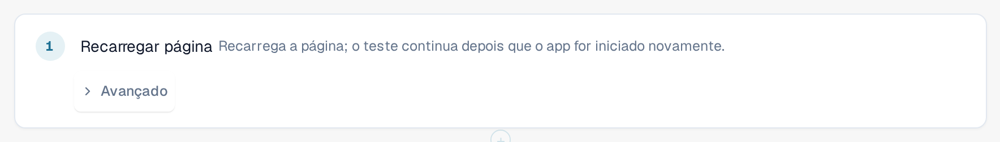

# Recarregar e retomar

Algumas coisas só podem ser verificadas depois de a página ser carregada novamente, por exemplo que uma configuração ainda existe
depois de um recarregamento. A etapa **Recarregar página** recarrega a página do navegador no meio de um teste, e o teste continua
depois.

## Adicionar uma etapa de recarregamento

1. No editor de modelos, selecione **+ Adicionar etapa**, depois o grupo **Página** e **Recarregar página**.
2. Coloque a etapa no ponto em que o recarregamento deve acontecer. As etapas seguintes são executadas na página recarregada.

<figure><figcaption>
A etapa Recarregar página no editor de modelos
</figcaption></figure>

## O que acontece durante uma execução

1. A aba salva o progresso do teste e depois recarrega a página.
2. Enquanto o aplicativo inicia novamente, um banner no alto exibe **Página recarregada, o teste continua**, seguido do
   nome do teste. Não feche a aba.
3. A página recarregada retoma a execução e segue para a próxima etapa. As etapas anteriores ao recarregamento mantêm os seus
   resultados, a etapa **Recarregar página** aparece como aprovada, e o relógio do teste continua correndo durante o recarregamento.

<figure><figcaption>
Banner depois de um recarregamento: Página recarregada, o teste continua
</figcaption></figure>

Os valores memorizados são mantidos durante o recarregamento, exceto os valores que você marcou como secretos (veja
[Etapas e blocos prontos](steps-and-blocks.md)). Verifique se nenhuma etapa posterior ao recarregamento precisa de um valor secreto.

## Bom saber

* Somente esta etapa recarrega a página sem encerrar o teste. Se você mesmo recarregar ou fechar a aba, a execução termina
  como **Cancelado**.
* A página precisa voltar em cerca de dois minutos. Caso contrário, a execução termina como **Cancelado** ou **Não entregue**.
* Um teste pode conter até cinco etapas de recarregamento.
* O teste continua na mesma aba do navegador e com o mesmo usuário. Se o navegador não deixar a aba salvar o
  progresso (por exemplo, porque o armazenamento está bloqueado), a etapa de recarregamento falha antes de a página ser recarregada.
* O teste exige o schema de modelo 1.3, que o editor define quando você adiciona a etapa.
