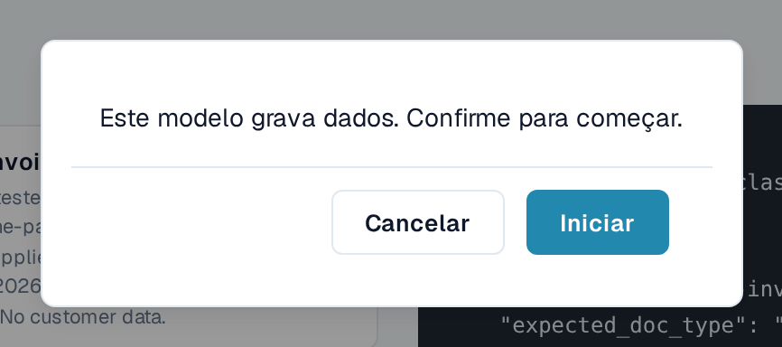
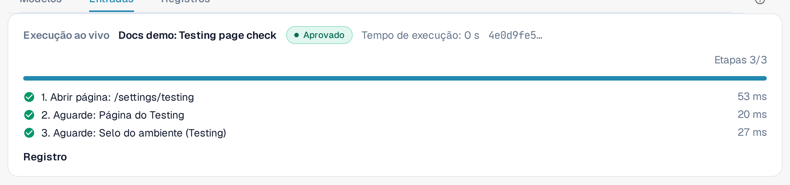
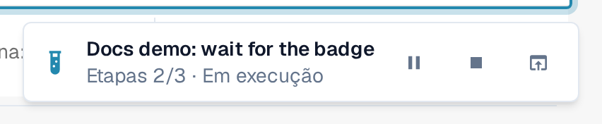
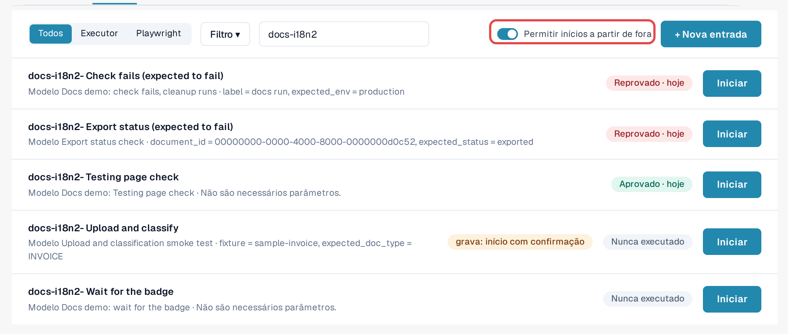
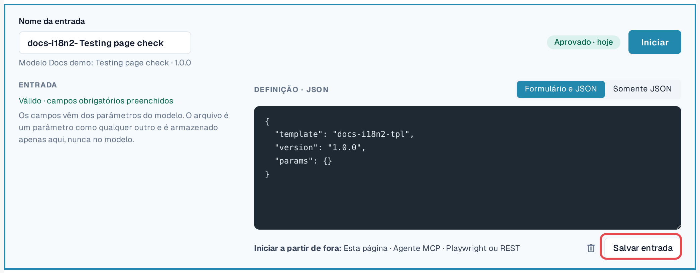

# Iniciar um teste

Um teste é um modelo mais uma entrada. O módulo Testing o executa e o conduz; você escolhe como iniciá-lo. As três
formas são equivalentes e toda execução termina nos [Registros](logs.md).

| Forma | Quando usar | Mostrado nos registros como |
|---|---|---|
| **No navegador** | Você quer executar uma verificação agora e acompanhá-la. | **Página** |
| **Assistente de IA (MCP)** | Você trabalha com um assistente de IA conectado ao DocBits e quer que ele execute e avalie verificações. | **Agente MCP** |
| **De fora (Playwright ou REST)** | A sua automação de testes ou o pipeline de CI inicia verificações, por exemplo depois de uma implantação. | **Playwright** |

Em todos os casos, os cliques acontecem em uma **aba do DocBits de um administrador da organização**, com as permissões
dessa pessoa. A aba deve permanecer aberta; recarregá-la ou fechá-la encerra a execução. A única exceção é uma etapa **Recarregar página** do
próprio teste (veja [Recarregar e retomar](reload-and-resume.md)).

## Iniciar no navegador

1. Abra **Configurações → Testing**, aba **Entradas**.
2. Selecione **Iniciar** na entrada (ou abra a entrada e selecione **Iniciar**).
3. Se o modelo alterar dados, o DocBits pergunta: *Este modelo grava dados. Confirme para iniciar.* Selecione **Iniciar** para continuar.
4. O teste é executado nesta aba. Na página Testing, o painel **Execução ao vivo** mostra o status, a **Ação atual**,
   o progresso das etapas e **Pausar**, **Retomar** e **Parar**. Quando o teste abre outra página, um pequeno indicador no
   canto inferior direito mostra o progresso ali. Quando o teste termina, o indicador mostra o resultado com
   **Abrir registro** e **Dispensar**.
5. Quando o teste terminar, abra a aba **Registros** para ler o resultado.

<figure><figcaption>
Confirmação antes de um teste que grava dados.
</figcaption></figure>

<figure><figcaption>
Painel Execução ao vivo depois de o teste ser aprovado.
</figcaption></figure>

<figure><figcaption>
Indicador de execução no canto inferior direito, em outra página.
</figcaption></figure>


**Uploads durante um teste:** se a sua organização tem suborganizações e o painel mostra todas elas, a caixa de diálogo
de upload normalmente pergunta a qual suborganização o documento pertence. Enquanto um teste é executado, o upload vai para a
**primeira suborganização que a caixa de diálogo oferece**, sem perguntar. Para carregar em uma suborganização específica, inicie o
teste a partir da visão dessa suborganização.


## Permitir inícios a partir de fora

Um assistente de IA ou um script do Playwright não consegue clicar sozinho; ele pede ao DocBits que execute um teste **em uma aba do navegador que
você registrou**:

1. Abra **Configurações → Testing**, aba **Entradas**, na aba do navegador que deve executar os testes.
2. Ative **Permitir inícios a partir de fora**. A aba passa a aceitar inícios e mostra o seu ID de sessão.
3. Deixe a aba aberta. O registro termina quando a aba é recarregada ou fechada.

<figure><figcaption>
Permitir inícios a partir de fora ativado, com o ID de sessão.
</figcaption></figure>

O editor de entradas lembra as três formas em **Comece de fora:** **Esta página**, **Agente MCP**,
**Playwright ou REST**.

<figure><figcaption>
Linha Comece de fora no editor de entradas.
</figcaption></figure>

## Iniciar a partir de um assistente de IA (MCP)

Se o seu assistente de IA estiver conectado ao DocBits (veja [DocBits MCP](https://docs.docbits.com/advanced-functions-and-tools/docbits-mcp)
e [Configurar o DocBits com Claude ou Codex](https://docs.docbits.com/advanced-functions-and-tools/docbits-mcp/configuration-with-claude-or-codex)):

1. Permita inícios a partir de fora em uma aba do navegador (veja acima).
2. Peça ao assistente, por exemplo: *"Liste as minhas entradas de teste do DocBits e inicie 'Fatura LT-2026-0001 pronta para validação'
   na minha aba de navegador registrada. Depois me diga o resultado."*
3. O assistente pergunta qual aba usar se mais de uma estiver registrada e pergunta a você antes de iniciar um teste que
   altera dados. Em seguida, ele lê o registro e informa o resultado.

## Iniciar a partir do Playwright ou de outra ferramenta (REST)

A sua automação de testes inicia uma entrada com uma chamada de API e depois lê o seu registro. Ela precisa de:

* um token de um administrador da organização (veja [Chave de API](https://docs.docbits.com/administration-and-setup/settings/global-settings/integration/api-key));
* o ID da entrada;
* o ID de sessão de uma aba do navegador com **Permitir inícios a partir de fora** ativado.

A chamada e um exemplo estão em [Para desenvolvedores](for-developers.md).

## Ambientes de cliente

Em sandbox e produção, o selo **Ambiente** fica vermelho. Os testes que alteram dados precisam de uma confirmação explícita a
cada início, e as etapas de exportação, exclusão ou aprovação são bloqueadas, a menos que o modelo declare que grava dados. Execute
testes que gravam dados em um ambiente de teste sempre que possível.
