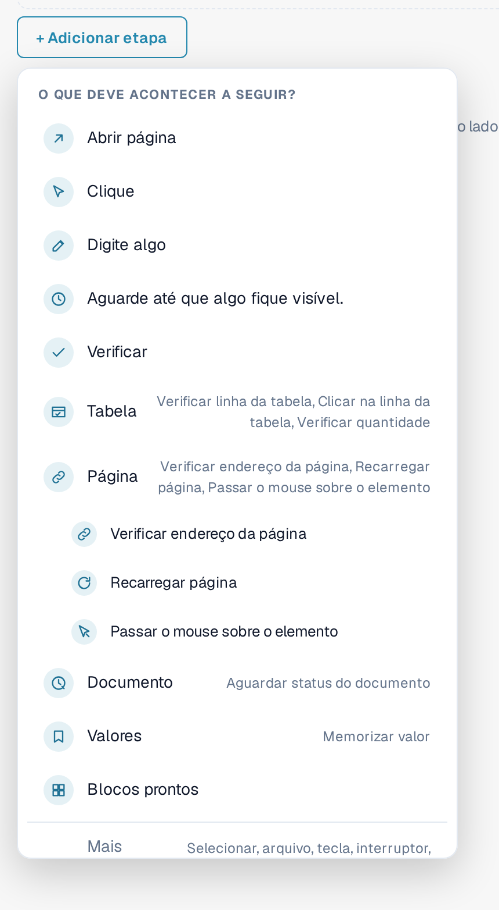
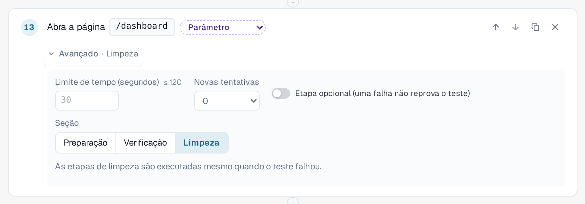
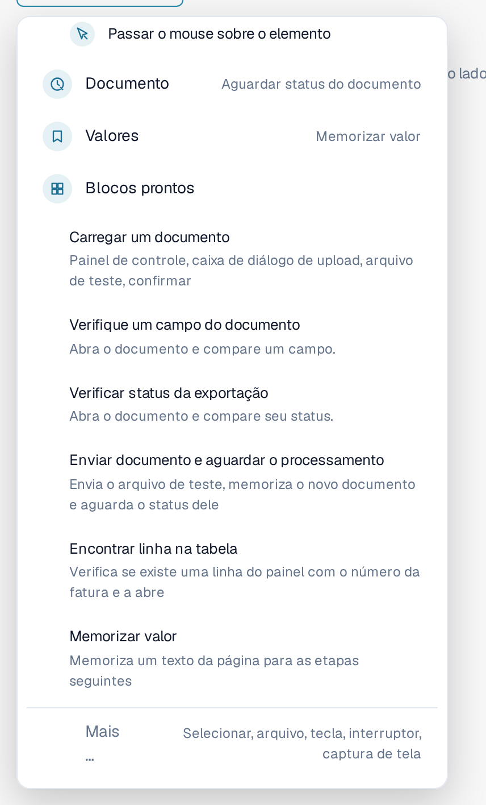
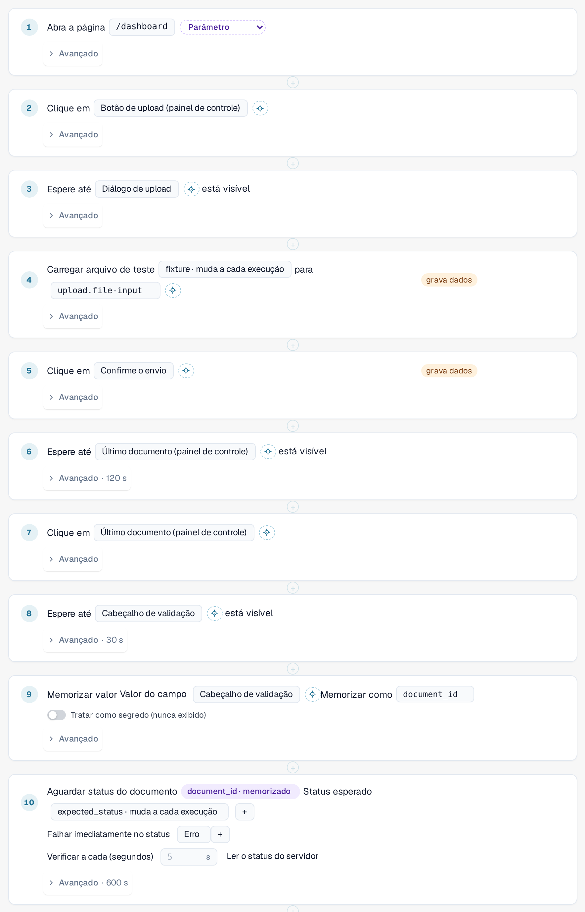
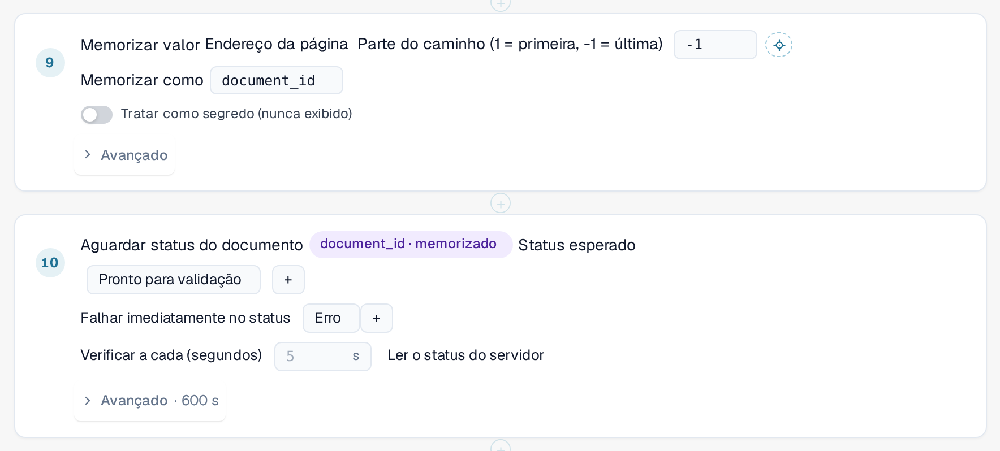
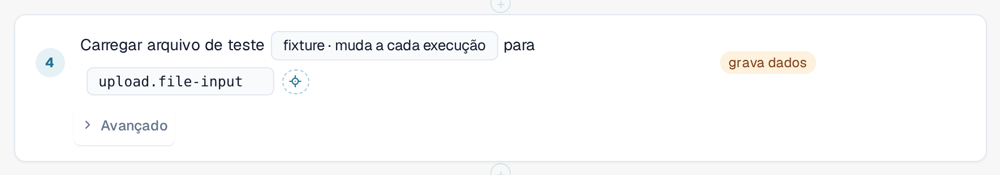

# Etapas e blocos prontos

Esta página explica como montar um modelo no editor ([Modelos](templates.md)): os grupos de etapas, as configurações
**Avançado** de uma etapa, os blocos prontos e como um teste passa valores de uma etapa para a seguinte.

## Adicionar uma etapa

No editor de modelos, selecione **+ Adicionar etapa**. O menu **O que deve acontecer a seguir?** lista as etapas. As cinco
etapas básicas são **Abrir página**, **Clique**, **Digite algo**, **Aguarde até que algo fique visível** e **Verificar**.
Quatro **grupos** reúnem as etapas mais especializadas. Selecione um grupo para ver as suas etapas:

| Grupo | Etapas |
|---|---|
| **Tabela** | **Verificar linha da tabela**, **Clicar na linha da tabela**, **Verificar quantidade**. Para listas como a lista de documentos no painel. |
| **Página** | **Verificar endereço da página**, **Recarregar página** (veja [Recarregar e retomar](reload-and-resume.md)), **Passar o rato sobre o elemento**. |
| **Documento** | **Aguardar status do documento**: aguarda até que um documento atinja um status, por exemplo *Pronto para validação*. |
| **Valores** | **Memorizar valor**: guarda um texto da página para as etapas seguintes. |

Os **Blocos prontos** adicionam várias etapas de uma só vez (veja abaixo). **Mais …** oferece outras etapas: selecionar uma opção, carregar um arquivo, pressionar uma tecla,
ligar ou desligar um interruptor e fazer uma captura de tela (as etapas de captura de tela são ignoradas pelo executor no navegador).

<figure><figcaption>
Menu Adicionar etapa com os grupos Tabela, Página, Documento e Valores; o grupo Página está aberto
</figcaption></figure>

Para apontar uma etapa para um elemento da página, selecione-o na lista ou use **Escolher no aplicativo**
([Escolher um elemento no aplicativo](pick-in-app.md)).

## Configurações avançadas de uma etapa

Toda etapa tem uma linha **Avançado**. Selecione-a para abrir as configurações dessa etapa. A linha recolhida mostra o que você
alterou, por exemplo *Avançado · 120 s* ou *Avançado · Limpeza*.

| Configuração | Significado |
|---|---|
| **Limite de tempo (segundos)** | Quanto tempo a etapa pode levar, até 120 segundos. Deixe vazio para usar o padrão de 30 segundos. As etapas que aguardam um documento têm o seu próprio limite, mais longo. |
| **Novas tentativas** | Quantas vezes o DocBits repete a etapa se ela falhar (0 a 3). |
| **Etapa opcional (a falha não reprova o teste)** | Se a etapa falhar, o registro a mostra como ignorada, com o seu erro, e o teste continua. |
| **Seção** | **Preparação**, **Verificação** ou **Limpeza**. **Verificação** é o padrão. |

As etapas de **Preparação** configuram o teste. As etapas de **Verificação** são o teste em si. As etapas de **Limpeza** removem o que o teste deixou
para trás, por exemplo um documento que ele carregou. **As etapas de limpeza são executadas mesmo quando o teste falhou** ou excedeu o tempo, e
uma etapa de limpeza que falha nunca altera o resultado do teste. Elas devem ser as últimas etapas do modelo; o editor informa um erro se uma
etapa normal vier depois de uma etapa de limpeza. Elas não são executadas se você parar o teste ou fechar a aba.
Um modelo com etapas de limpeza é salvo como schema 1.3 (veja [Para desenvolvedores](for-developers.md)).

<figure><figcaption>
Configurações avançadas de uma etapa: limite de tempo, novas tentativas, etapa opcional e seção, com Limpeza selecionada
</figcaption></figure>

## Blocos prontos

Selecione **+ Adicionar etapa** e depois **Blocos prontos**. Um bloco adiciona as etapas de uma sequência comum junto com os
parâmetros de que ela precisa. Você pode alterar cada etapa depois.

| Bloco | O que ele adiciona |
|---|---|
| **Carregar um documento** | Abre o painel, abre a caixa de diálogo de upload, seleciona o arquivo de teste e confirma. |
| **Verifique um campo do documento** | Abre um documento e compara um campo com um valor esperado. |
| **Verificar status da exportação** | Abre um documento e compara o seu status. |
| **Carregar documento e aguardar o processamento** | Carrega o arquivo de teste, memoriza o novo documento e aguarda o seu status. |
| **Localizar linha na tabela** | Verifica se existe uma linha da lista do painel com um determinado número de fatura e a abre. |
| **Memorizar valor** | Memoriza um texto da página para as etapas seguintes. |

<figure><figcaption>
Blocos prontos no menu Adicionar etapa
</figcaption></figure>

### Carregar documento e aguardar o processamento

Use este bloco quando uma etapa posterior precisar do documento que o teste acabou de carregar. Ele reconhece o novo documento
por conta própria, e não pela linha do topo da lista, de modo que um documento mais antigo nunca é escolhido por engano. Em seguida, ele lê o
ID do documento no endereço da página e aguarda até que o documento atinja o status esperado
(padrão *Pronto para validação*, por até 10 minutos; ele para imediatamente se o documento receber o status *Erro*).
Ele adiciona os valores de entrada **fixture** (o arquivo de teste) e **expected_status** e eleva o tempo de todo o teste para pelo menos 15 minutos.

<figure><figcaption>
Etapas do bloco Carregar documento e aguardar o processamento
</figcaption></figure>


**Para onde vão os uploads:** se a sua organização tem suborganizações e o painel mostra todas elas, a caixa de diálogo
de upload normalmente pergunta a qual suborganização o documento pertence. Um teste não consegue responder a essa pergunta. Enquanto um
teste é executado na aba, o upload vai para a **primeira suborganização que a caixa de diálogo oferece**, sem perguntar.
Fora de um teste, nada muda. Para carregar em uma suborganização específica, inicie o teste a partir da
visão dessa suborganização.


### Localizar linha na tabela

O bloco verifica se a lista do painel tem uma linha com o número de fatura indicado (o valor de entrada **row_value**)
e a abre. Para pesquisar por outra coluna, altere a coluna e o valor na etapa. As duas etapas pertencem ao
grupo **Tabela**; **Verificar quantidade** conta linhas ou qualquer outro elemento.

## Memorizar um valor e usá-lo depois

Um teste muitas vezes precisa de um valor que só existe enquanto ele é executado, por exemplo o ID de um documento que acabou de carregar.

1. Adicione **Memorizar valor** (grupo **Valores**). Escolha de onde vem o valor: um texto da página, o endereço da página
   (uma parte do caminho ou um parâmetro de consulta) ou uma célula de uma linha de tabela. Informe um nome em **Memorizar como**,
   por exemplo `document_id`. Ative **Tratar como secreto (nunca exibido)** para valores que não devem aparecer em lugar nenhum.
2. Em uma etapa posterior, escolha o valor memorizado em vez de digitar um. A etapa mostra um selo como
   *document_id · memorizado*. No JSON do modelo, ele é escrito como `{{vars.document_id}}`.

Dois tipos de valores podem ser usados em uma etapa:

| Tipo | Escrito como | Vem de | Exemplo |
|---|---|---|---|
| **Entrada** | `{{params.name}}` | Da [entrada](inputs.md) salva: é o mesmo em toda execução dessa entrada. Crie-a com o botão de parâmetro ao lado de um valor. | *fixture · muda a cada execução* |
| **Valor memorizado** | `{{vars.name}}` | De uma etapa **Memorizar valor** anterior da mesma execução. | *document_id · memorizado* |

<figure><figcaption>
Memorizar valor guarda o ID do documento; a etapa seguinte aguarda esse documento
</figcaption></figure>

<figure><figcaption>
Uma etapa que usa o valor de entrada fixture
</figcaption></figure>

Um valor memorizado existe somente para a execução atual e nunca é salvo no modelo nem no registro. Os valores memorizados
sobrevivem a um [recarregamento da página](reload-and-resume.md) dentro do teste, a menos que estejam marcados como secretos.
