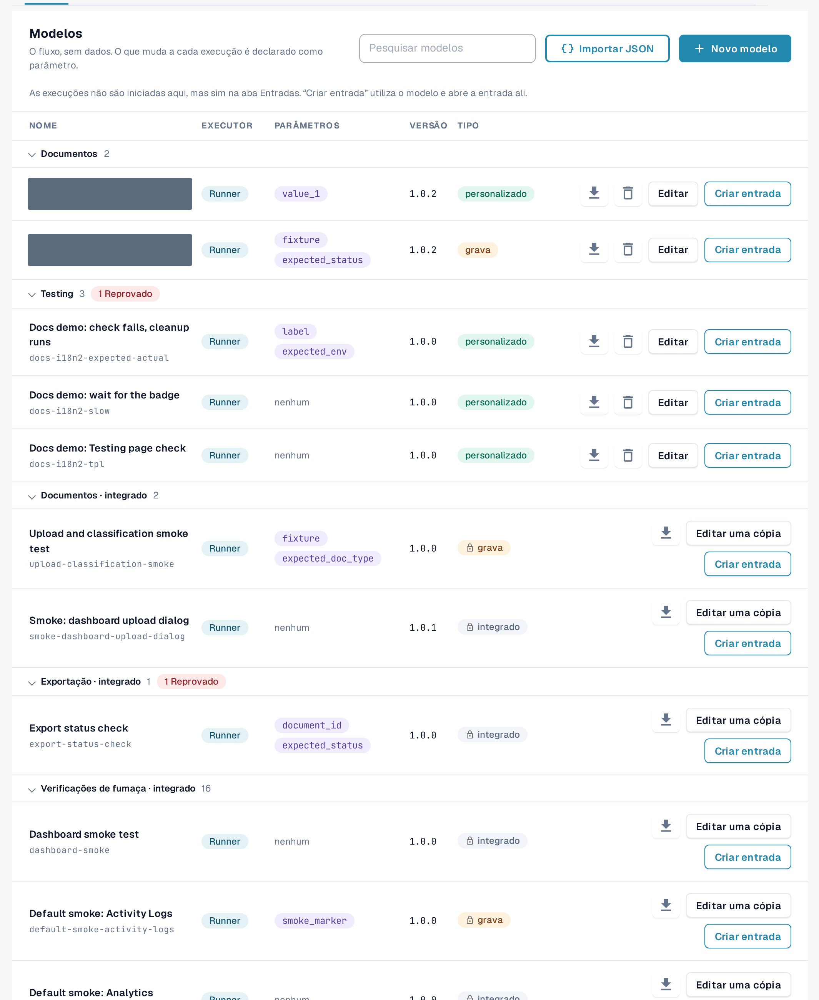
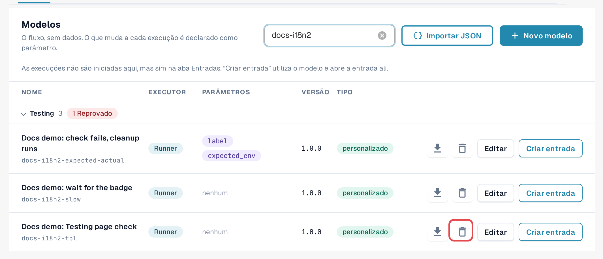
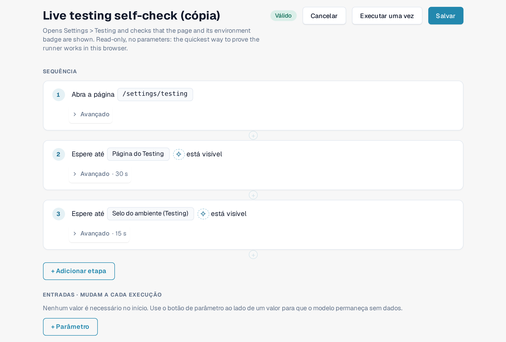
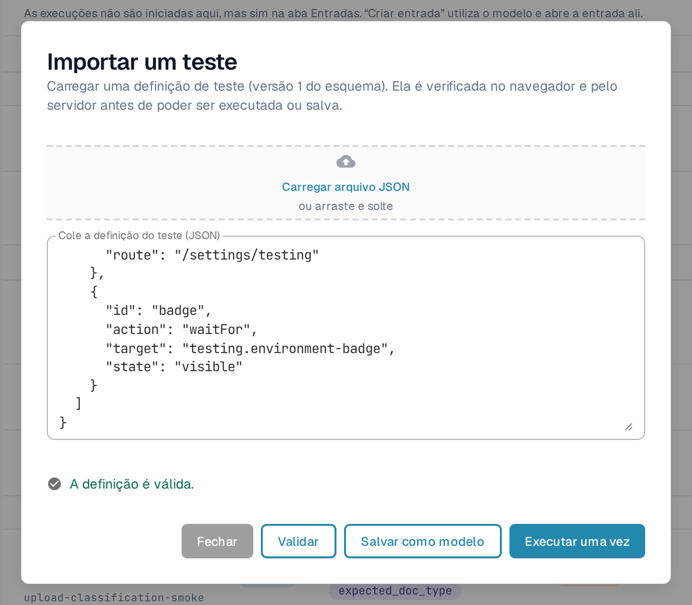
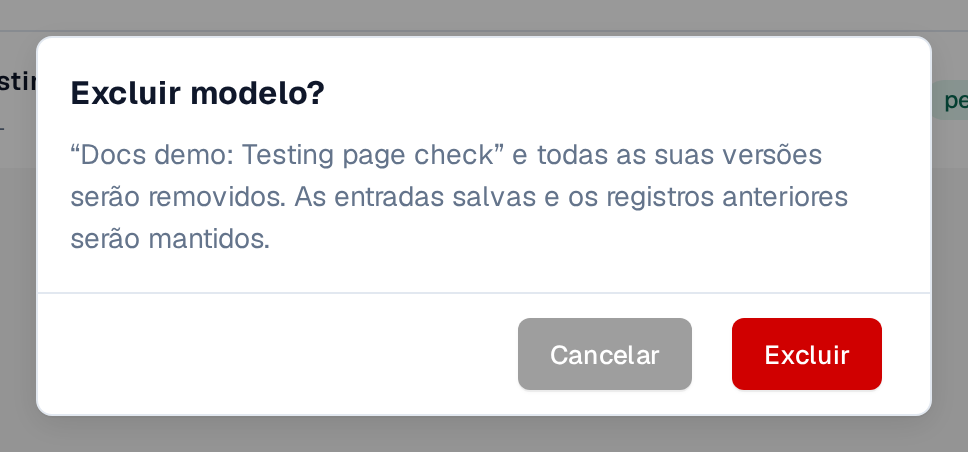

# Modelos

Um modelo descreve **o que** é verificado: qual página abre, o que é clicado ou preenchido e o que deve estar
visível ou ser verdadeiro no final. Ele não contém dados da sua organização. Os valores que diferem por organização ou por
execução, como o ID de um documento, são declarados como **parâmetros** e preenchidos por uma [entrada](inputs.md).

Abra **Configurações → Testing**, aba **Modelos**.

<figure><figcaption>
Aba Modelos: grupos, colunas e ações da linha.
</figcaption></figure>

## Ler a lista

Os modelos são agrupados por categoria (por exemplo **Testes de fumaça**, **Validação**, **Documentos**, **Exportação**).
Selecione o nome de um grupo para recolhê-lo; um selo vermelho no grupo conta os modelos cuja última execução falhou.
**Pesquisar modelos** filtra pelo nome.

| Coluna | Significado |
|---|---|
| **Nome** | O nome do modelo e, abaixo dele, o seu ID. |
| **Executado por** | **Executor**: é executado na aba do seu navegador a partir desta página. **Playwright**: uma verificação executada pela sua automação de testes; ela pode ser documentada aqui, mas não iniciada a partir desta página. |
| **Parâmetros** | Os valores que uma entrada deve fornecer. *nenhum* significa que o modelo é executado como está. |
| **Versão** | As versões salvas nunca mudam. Uma alteração é salva como uma nova versão. |
| **Tipo** | **integrado** (ícone de cadeado): faz parte do conjunto padrão, igual para todas as organizações, somente leitura. **personalizado**: o modelo próprio da sua organização. **grava**: o modelo altera dados (por exemplo, carrega um documento) e precisa de uma confirmação antes de iniciar. |

Ações da linha:

| Ação | O que ela faz |
|---|---|
| Ícone de download (**Exportar como JSON**) | Baixa a definição do modelo como um arquivo JSON, por exemplo para guardá-la ou para importá-la em outra organização. |
| **Editar uma cópia** (integrado) / **Editar** (personalizado) | Abre o editor de modelos com uma cópia que você pode alterar e salvar como seu próprio modelo. |
| **Criar entrada** | Abre a aba [Entradas](inputs.md) com uma nova entrada para este modelo. Os testes são iniciados lá, não aqui. |
| Ícone de lixeira (**Excluir modelo**) | Somente nos seus próprios modelos. Veja *Excluir o seu próprio modelo* abaixo. |

<figure><figcaption>
Uma linha de modelo padrão e uma linha de modelo próprio com suas ações.
</figcaption></figure>

## Criar o seu próprio modelo

Você precisa do seu próprio modelo quando nenhum modelo padrão verifica o que você precisa, ou quando quer uma cópia alterada de um modelo padrão.

**Começar a partir de um modelo padrão:** selecione **Editar uma cópia** na linha dele. **Começar do zero:** selecione **Novo modelo**.

No editor de modelos:

1. Informe um **Nome do modelo** e, opcionalmente, para que o modelo serve.
2. Selecione **+ Adicionar etapa** e escolha um bloco, por exemplo **Abrir página**, **Clique**, **Preencha**, **Selecione**,
   **Aguarde**, **Verifique o texto**, **Verifique o campo** ou **Verificar status**. Os **Blocos prontos** adicionam uma sequência comum de uma só vez, por exemplo
   **Carregar um documento** ou **Carregar documento e aguardar o processamento**. Veja [Etapas e blocos prontos](steps-and-blocks.md)
   para os grupos de etapas, as configurações **Avançado** e as etapas de limpeza.
3. Para cada valor que difere por organização ou por execução, use o botão de parâmetro ao lado do valor. O valor
   se torna um parâmetro em **Entradas · mudam a cada execução**, com um tipo (**Texto**, **Número**, **Sim/Não**,
   **Arquivo de teste do servidor**), um valor padrão e **Obrigatório** se precisar ser preenchido.
4. Selecione **Salvar**. Para testar o rascunho uma vez sem salvar, selecione **Executar uma vez**.

Para escolher o elemento de uma etapa apontando para ele no aplicativo, use **Escolher no aplicativo**
([Escolher um elemento no aplicativo](pick-in-app.md)).

As etapas que alteram dados (por exemplo, carregar um documento) são marcadas com **grava dados**. Um modelo com essas etapas
pede uma confirmação sempre que é iniciado.

<figure><figcaption>
Editor de modelos com duas etapas e um parâmetro.
</figcaption></figure>

Se alguém salvou a mesma versão deste modelo nesse meio tempo (por exemplo, em outra aba), o DocBits mantém o seu
rascunho e oferece **Salvar como a próxima versão disponível** ou **Recarregue a versão mais recente**.

## Importar um modelo a partir de JSON

1. Selecione **Importar JSON**.
2. Selecione **Carregar arquivo JSON** ou cole a definição em **Cole a definição do teste (JSON)**.
3. Selecione **Validar**. O DocBits verifica a definição no navegador e no servidor e lista os problemas encontrados.
4. Selecione **Salvar como modelo** para adicioná-lo aos seus modelos, ou **Executar uma vez** para testá-lo sem salvar.

<figure><figcaption>
Caixa de diálogo Importar um teste com uma definição validada.
</figcaption></figure>

O formato é descrito em [Para desenvolvedores](for-developers.md).

## Excluir o seu próprio modelo

1. Na linha do seu próprio modelo, selecione o ícone de lixeira (**Excluir modelo**).
2. Leia a confirmação **Excluir modelo?** e selecione **Excluir**.

O modelo e **todas as suas versões** são removidos. As entradas salvas e os registros anteriores permanecem, de modo que o histórico continue legível.
As entradas que apontavam para o modelo continuam na lista; edite-as ou exclua-as. Mais tarde, você pode salvar novamente um modelo com o mesmo
ID. Os modelos integrados e padrão não podem ser excluídos.

<figure><figcaption>
Confirmação de Excluir modelo.
</figcaption></figure>
