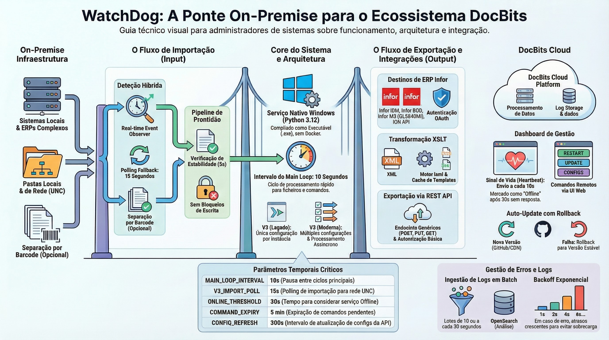

# WatchDog

<figure><figcaption></figcaption></figure>

**Instalação e Configurações**

Após baixar o arquivo WatchDog.exe, procure por Prompt de Comando → Executar como administrador em seu dispositivo Windows.

Assim que isso for aberto, chame o arquivo digitando o caminho onde o arquivo WatchDog.exe está armazenado em seu dispositivo como abaixo

Digite install após o caminho do arquivo e pressione ENTER em seu teclado

Você deverá receber a seguinte mensagem de erro, pois iniciará o aplicativo no modo de interface do usuário e ainda não há configuração presente.

O aplicativo abrirá automaticamente após a instalação. No topo, navegue até Einstellungen (Configurações) e aqui você verá 2 seções separadas.

**Configurações de pasta (Ordner Einstellungen)**

Aqui você configurará os caminhos dos arquivos onde os documentos serão lidos e processados. O caminho de leitura será para os documentos que você deseja que o WatchDog extraia e processe, enquanto o caminho processado será usado para indicar quais documentos da pasta de leitura foram extraídos e processados.

**Configurações gerais (Allgemeine Einstellungen)**

Aqui você configurará seu aplicativo DocBits com o WatchDog. Você precisará inserir seu ambiente DocBits, chave de API e o tipo de documento (conforme indicado acima). Para adicionar mais de um tipo de documento, separe os nomes dos tipos de documento com uma vírgula (INVOICE,DELIVERY-NOTE,PURCHASE-ORDER, etc.)

Se uma configuração inválida for inserida para qualquer um dos campos, você receberá uma mensagem de erro como a abaixo.

Após isso estar completo, volte para a área do Prompt de Comando e execute novamente o arquivo WatchDog.exe e desta vez ele será instalado corretamente devido às configurações agora estarem presentes

Para iniciar o aplicativo no modo de interface do usuário, execute o seguinte comando

Se você apenas deseja iniciar o aplicativo, execute este comando em vez disso.

**Início Automático**

Para configurar o aplicativo WatchDog de forma que ele inicie automaticamente quando você ligar seu sistema.

Basta abrir “Serviços” nas configurações de sua máquina Windows.

Procure por WatchDog nos serviços locais e abra o serviço (clique duas vezes na entrada)

No menu acima, você terá as seguintes opções para iniciar automaticamente:

* Selecione Automático, o serviço iniciará na inicialização
* Automático (Início Atrasado), isso aguardará 2 minutos após a inicialização para iniciar o serviço
