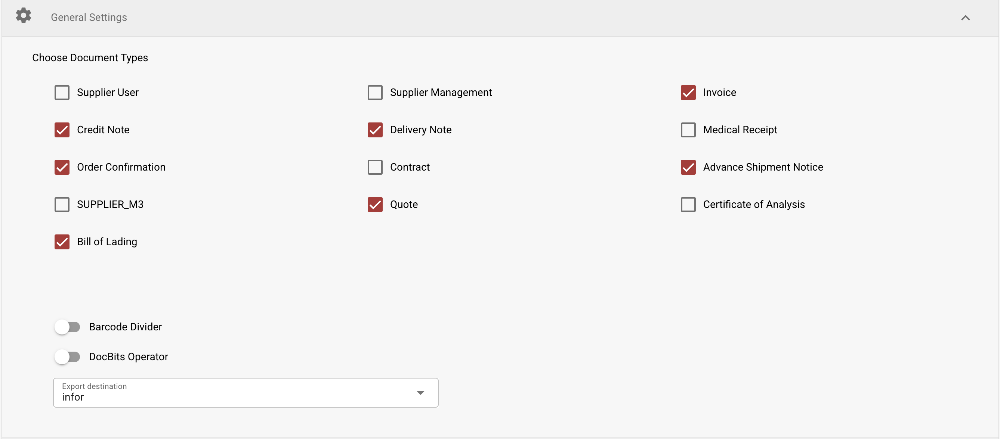

# Installazione di WatchDog

<figure><figcaption></figcaption></figure>

> **Recomendado:** Use a configuração moderna descrita abaixo. As configurações do WatchDog agora são criadas diretamente no aplicativo DocBits — não são necessários arquivos de configuração locais.

## Pré-requisitos

* Windows Server ou Windows 10/11
* Acesso de administrador
* Conectividade de rede com a API do DocBits
* Chave de API do DocBits (disponível em Configurações → WatchDog → aba General)

## Etapas de instalação

### 1. Criar as pastas necessárias

Crie um diretório principal e subpastas para o WatchDog:

```
C:\WatchDog\              ← WatchDog executable
C:\WatchDog\Import\       ← Watch folder for incoming documents
C:\WatchDog\Processed\    ← Success folder for processed documents
C:\WatchDog\Export\        ← Export folder for exported files
```

> **Observação:** Recomenda-se usar caminhos locais. Caminhos de rede UNC (por exemplo, `\\server\share`) são suportados, mas podem exigir um Polling Observer para uma detecção confiável de arquivos.

### 2. Baixar o WatchDog

Baixe o `WatchDog.exe` no aplicativo DocBits:

**Configurações → Processamento de documentos → WatchDog → aba General → Download**

Coloque o arquivo `WatchDog.exe` baixado em `C:\WatchDog\`.

### 3. Configurar a conexão com a API

Abra o **Prompt de Comando (CMD)** como **Administrador** e execute:

```powershell
cd C:\WatchDog
WatchDog.exe -api YOUR_API_KEY
```

Isso conecta o WatchDog à sua organização no DocBits e busca as configurações automaticamente.

### 4. Instalar como serviço do Windows

```powershell
WatchDog.exe install
```

### 5. Iniciar o serviço

```powershell
WatchDog.exe start
```

### 6. Criar configurações no DocBits

No DocBits, acesse **Configurações → Processamento de documentos → WatchDog → aba Configurations**:

* Clique em **New Import Configuration** para configurar as pastas monitoradas
* Clique em **New Export Configuration** para configurar os destinos de exportação

> **Importante:** As configurações de exportação exigem um **tipo de documento**. Todas as configurações são gerenciadas de forma centralizada no DocBits, não em arquivos de configuração locais.

### 7. Definir a inicialização automática

1. Abra **Serviços** (`Win + R` → `services.msc`)
2. Localize o **WatchDog** na lista de serviços
3. Clique duas vezes para abrir as propriedades
4. Defina o **Tipo de inicialização** como **Automático (Início atrasado)**
5. Clique em **OK**

## Verificar a instalação

Após a instalação, verifique o status do WatchDog no DocBits:

**Configurações → WatchDog → aba General**

<figure><figcaption></figcaption></figure>

* ✅ **Online** — o WatchDog está conectado e enviando heartbeats
* A versão, a última reinicialização e as informações do sistema devem estar visíveis

## Referência de comandos

| Comando                             | Descrição                                           |
| ----------------------------------- | --------------------------------------------------- |
| `WatchDog.exe -api KEY`             | Configura a chave de API                            |
| `WatchDog.exe install`              | Instala como serviço do Windows                     |
| `WatchDog.exe start`                | Inicia o serviço                                    |
| `WatchDog.exe stop`                 | Para o serviço                                      |
| `WatchDog.exe debug`                | Executa em modo console (para solução de problemas) |
| `WatchDog.exe remove`               | Desinstala o serviço                                |
| `WatchDog.exe --version`            | Exibe a versão atual                                |
| `WatchDog.exe --list-folders`       | Lista as pastas monitoradas configuradas            |
| `WatchDog.exe --add-folder PATH`    | Adiciona uma pasta monitorada                       |
| `WatchDog.exe --remove-folder PATH` | Remove uma pasta monitorada                         |

***

## Legado: configuração V1 (obsoleta)

O método de configuração V1 abaixo, com arquivos de configuração locais, está **obsoleto**. Use a configuração moderna baseada em API descrita acima.

<details>

<summary>Configuração V1 (clique para expandir)</summary>

### Configurando o WatchDog no DocBits (V1)

1. **Acessar as configurações do WatchDog**
   * Acesse **Configurações → Processamento de documentos → WatchDog**
2.  **Configurações de pasta**

    * Defina os caminhos: `C:/WatchDog/Read` e `C:/WatchDog/Processed`

    <figure><figcaption></figcaption></figure>
3.  **Configurações gerais**

    * Selecione os tipos de documento e configure o destino de exportação

    <figure><figcaption></figcaption></figure>
4.  **Configurações de exportação**

    * Mostra as exportações configuradas para processamento local

    <figure><figcaption></figcaption></figure>
5.  **Baixar a configuração**

    * Baixe o `watchdog-config.json` e coloque-o em `C:\WatchDog\`

    <figure><figcaption></figcaption></figure>

</details>
