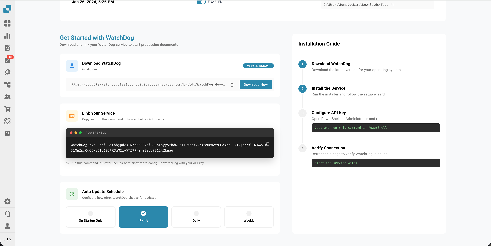
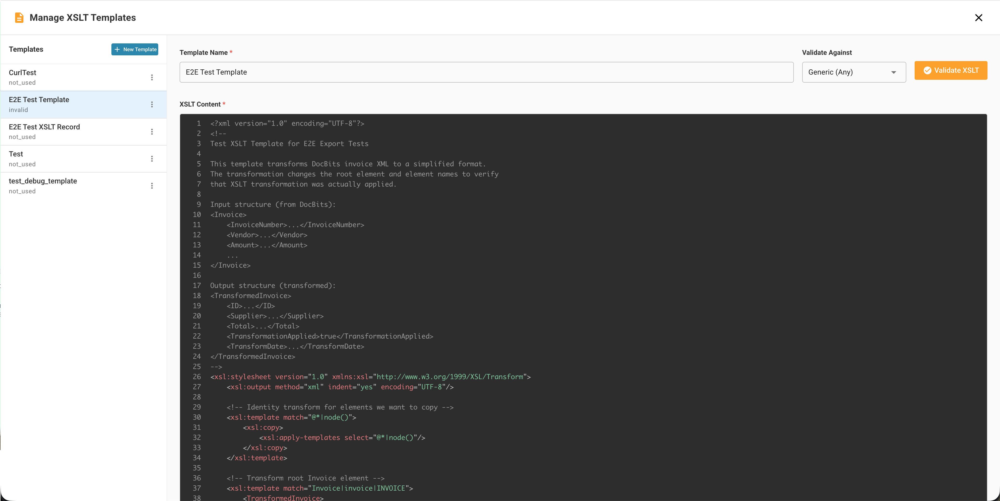

# Configuração do WatchDog

Este guia explica como configurar o serviço WatchDog no aplicativo DocBits. Todas as configurações são gerenciadas diretamente em **Configurações → Processamento de documentos → WatchDog**.

<figure><figcaption></figcaption></figure>

---

## 1. Aba General

A aba General oferece instruções de configuração, links de download e opções de atualização.

<figure><figcaption></figcaption></figure>

### 1.1 Download e configuração

* Baixe o `WatchDog.exe` mais recente diretamente na aba General
* Copie a chave de API exibida
* Execute o comando de configuração em um Prompt de Comando como administrador:

```powershell
WatchDog.exe -api YOUR_API_KEY
```

### 1.2 Agenda de atualização automática

| Opção | Intervalo |
| :--- | :--- |
| On Startup Only | Verifica uma vez na inicialização |
| Hourly | A cada 3600 segundos |
| Daily | A cada 86400 segundos |
| Weekly | A cada 604800 segundos |

---

## 2. Aba Configurations

Crie e gerencie configurações de importação e exportação. Todas as configurações são criadas diretamente no DocBits — não são necessários arquivos de configuração locais.

<figure><figcaption></figcaption></figure>

### 2.1 Configurações de importação

Defina onde o WatchDog monitora a chegada de novos documentos.

<figure><figcaption></figcaption></figure>

| Campo | Descrição |
| :--- | :--- |
| **Name** | Nome de exibição desta configuração |
| **Watch Folder** | Diretório monitorado para novos documentos (obrigatório) |
| **Success Folder** | Para onde os arquivos são movidos após uma importação bem-sucedida |
| **Document Type** | INVOICE, CREDIT\_NOTE, PURCHASE\_ORDER etc. |
| **Sub-Organisation** | Opcional — encaminha os documentos para uma suborganização específica |

### 2.2 Configurações de exportação

Defina como e para onde os documentos processados são exportados.

> **Importante:** As configurações de exportação agora **exigem um tipo de documento** (`doc_type`). Configurações sem tipo de documento são rejeitadas pelo sistema.

| Campo | Descrição |
| :--- | :--- |
| **Name** | Nome de exibição desta configuração |
| **Document Type** | Obrigatório — INVOICE, CREDIT\_NOTE etc. |
| **Export Method** | Como os documentos são exportados (veja abaixo) |
| **Export Folder** | Diretório de destino para exportações em pasta |
| **Execution Order** | Prioridade quando várias configurações correspondem (padrão: 1) |
| **XSLT Template** | Opcional — modelo de transformação XML |

### 2.3 Métodos de exportação

| Método | Descrição |
| :--- | :--- |
| **Folder (watcher)** | Exporta PDF + XML para uma pasta local |
| **Infor IDM** | Envia para o Infor Document Management |
| **Infor BOD** | Envia BOD XML para o Infor ERP / SAP ou M3 |
| **ION API** | Chama endpoints da API Infor ION |
| **GLS840MI** | Processamento em lote do M3 (via REST API) |
| **REST API** | Envia para uma API externa com autenticação ION OAuth |

<figure><figcaption></figcaption></figure>

### 2.4 Opções de processamento

* **Barcode Divider:** divide automaticamente documentos de várias páginas com base em códigos de barras
* **DocBits Operator:** habilita tarefas de automação do navegador

---

## 3. Aba Status

Monitore a integridade e a atividade do serviço WatchDog.

<figure><figcaption></figcaption></figure>

### Informações de status

| Campo | Descrição |
| :--- | :--- |
| **Online/Offline** | Status atual da conexão (limite de heartbeat de 30 s) |
| **Version** | Versão instalada do WatchDog |
| **Version First Seen** | Quando esta versão foi reportada pela primeira vez |
| **Last Restart** | Data e hora da última reinicialização do serviço |
| **Auto-Update Enabled** | Indica se as atualizações automáticas estão ativas |
| **Latest Version** | Versão mais recente disponível |
| **Latest Version Checked At** | Quando a versão mais recente foi verificada pela última vez |
| **System Info** | Caminho de instalação, RAM livre, espaço livre em disco |

### Indicador de integridade

| Status | Significado |
| :--- | :--- |
| ✅ **Online** | O WatchDog está conectado e ativo |
| ⚠️ **Offline** | Nenhum heartbeat recebido há mais de 30 segundos |
| ❌ **Not Installed** | O WatchDog nunca se conectou a esta organização |

---

## 4. Aba Logs

Veja todos os eventos do WatchDog armazenados no OpenSearch.

<figure><figcaption></figcaption></figure>

* Filtre por data, tipo de evento ou palavras-chave
* Tipos de evento: `FILE_IMPORT_STARTED`, `FILE_IMPORT_COMPLETED`, `FILE_IMPORT_FAILED`, `EXPORT_STARTED`, `EXPORT_COMPLETED`, `EXPORT_FAILED`, `FOLDER_VALIDATION_FAILED`, `CONFIG_LOADED`, `SERVICE_RESTART_INITIATED`, `SERVICE_RESTART_COMPLETED`

---

## 5. Aba XSLT Templates

Gerencie os modelos de transformação XSLT usados nas exportações XML.

<figure><figcaption></figcaption></figure>

* Faça upload e edite modelos XSLT
* **Validação em tempo real** — teste os modelos com um XML de exemplo, com análise de campos
* Vincule modelos a configurações de exportação
* Veja a contagem de uso (quais configurações usam cada modelo)

<figure><figcaption></figcaption></figure>

---

## 6. Aba Export Configurations

Visão geral de todas as configurações de exportação ativas com o status da conexão.

* Monitore a data e hora da última conexão bem-sucedida
* Gerencie as configurações diretamente na lista (editar, copiar, excluir)
* Copie configurações em lote entre suborganizações
