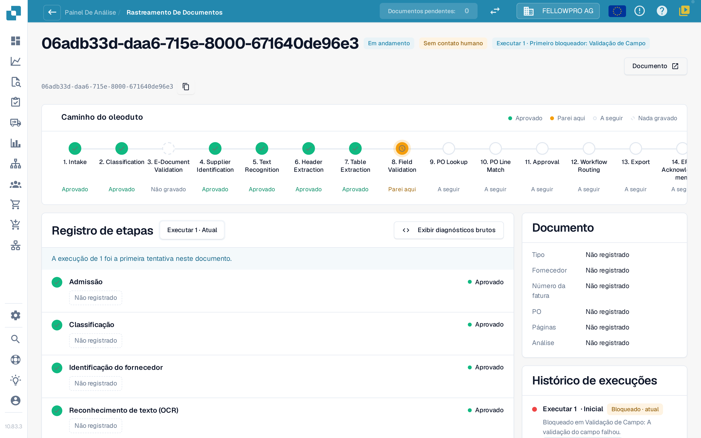
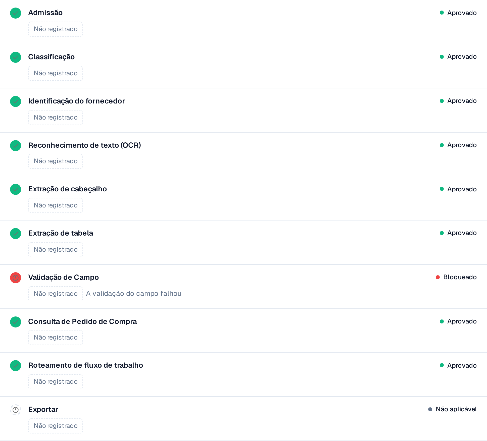

# Touchless Intelligence: Rastreamento do documento

Introduza um ID de documento em **Document ID**, ou abra um documento de exemplo a partir de um cluster, para ver **o que aconteceu a este documento**.

O cabeçalho mostra o ficheiro, o seu estado (por exemplo **Em andamento**), a execução que está a consultar e o seu primeiro bloqueador, além de um botão **Documento** com o ID do documento.

<figure><figcaption>
O rastreamento do documento: o caminho do oleoduto com todas as etapas e o registo de etapas com o que cada uma registou.
</figcaption></figure>

O **Caminho do oleoduto** mostra 14 etapas: Intake, Classification, E-Document Validation, Supplier Identification, Text Recognition, Header Extraction, Table Extraction, Field Validation, PO Lookup, PO Line Match, Approval, Workflow Routing, Export, ERP Acknowledgement. Cada etapa tem um único estado:

| Estado | Significado |
| --- | --- |
| **Aprovado** (verde) | A etapa decorreu sem problemas |
| **Parei aqui** (laranja) | A etapa bloqueou o documento |
| **A seguir** | O documento nunca chegou tão longe |
| **Nada gravado** (tracejado) | Não foram registados dados para esta etapa |
| **Não aplicável** | A etapa não se aplica a este documento |

### Registo de etapas

O **registo de etapas** sob o caminho lista as mesmas etapas com o que cada uma registou. Um ponto de estado e a palavra de estado ficam à esquerda e à direita de cada linha.

* Cada valor é uma **etiqueta de valor**: um número com a sua unidade, por exemplo **Confiança 100 %**, **Limiar 60 %**, **Regras falhadas 0**, **8 campos em falta** ou **0 lacunas de correspondência**. As percentagens são mostradas como `97 %`, nunca como `0.97`.
* **Detalhes** abre a lista completa dos valores que uma etapa registou, incluindo as alternativas que considerou.
* A etapa que bloqueou o documento indica o motivo, por exemplo **Validação de campo falhou**.
* Um valor que nenhuma etapa registou aparece como **Não registado**, nunca como um valor inventado. Os valores são números e termos fixos, nunca texto do documento.
* **Mostrar diagnósticos em bruto** ativa os dados em bruto quando o suporte os pede.

<figure><figcaption>
Cada etapa mostra o que registou; a etapa bloqueada indica a sua causa.
</figcaption></figure>

### Execuções e alterações

O seletor de execução no topo do registo de etapas (**Executar 1 · Atual**) alterna entre as execuções do documento. O **histórico de execuções** à direita lista cada execução com o seu resultado e o ponto onde parou. Quando um documento foi executado mais do que uma vez, escolha uma execução no seletor para a comparar com a atual: os valores alterados passam a ter um distintivo com a diferença e a respetiva unidade, por exemplo **−2 campos** ou **+3 %**.

O cartão **Documento** ao lado do registo de etapas indica o tipo de documento, o fornecedor, o número da fatura, a ordem de compra, o número de páginas e se a análise se baseia em **regras** ou foi escrita por uma IA.

**Exemplo.** Os documentos de um fornecedor param todos na etapa 8. No rastreamento vê sempre os mesmos campos em falta. Não é um problema de extração de documentos isolados, mas um valor predefinido em falta na sua configuração de campos: corrija-o uma vez e todo o cluster passa a ser recuperável.

## Páginas relacionadas

* [Touchless Intelligence](touchless-intelligence.md)
* [Diagnóstico de fornecedores e clusters de problemas](touchless-supplier-diagnosis.md)
* [Diagnóstico de PO Matching](touchless-po-matching-diagnosis.md)

As capturas de ecrã desta página mostram a interface em português.
