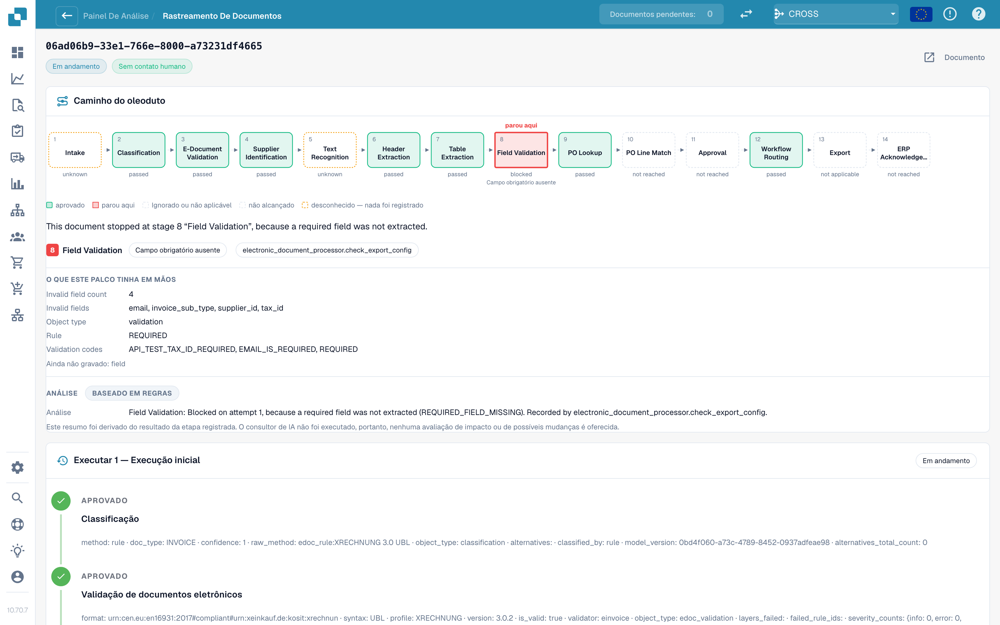

# Touchless Intelligence: rastreamento do documento

Digite um ID de documento em **Document ID**, ou abra um documento de exemplo de um cluster, para ver **o que aconteceu com este documento**.

<figure><figcaption>
O Document Trace: o caminho do pipeline com a etapa em que o documento parou, o que essa etapa tinha em mãos e o histórico de execuções abaixo.
</figcaption></figure>

O topo mostra o **caminho do pipeline** com 14 etapas: Intake (entrada), Classification (classificação), E-Document Validation (validação de documento eletrônico), Supplier Identification (identificação do fornecedor), Text Recognition (reconhecimento de texto), Header Extraction (extração do cabeçalho), Table Extraction (extração de tabelas), Field Validation (validação de campos), PO Lookup (consulta do PO), PO Line Match (match de linhas do PO), Approval (aprovação), Workflow Routing (roteamento do workflow), Export (exportação), ERP Acknowledgement (confirmação do ERP). Cada caixa tem um estado:

| Estado | Significado |
| --- | --- |
| **passed** (verde) | A etapa foi executada sem problemas |
| **stopped here** (vermelho) | A etapa bloqueou o documento |
| **skipped or not applicable** | A etapa não se aplica a este documento |
| **not reached** | O documento nunca chegou até aqui |
| **unknown** (tracejado) | Nada foi registrado para esta etapa |

Abaixo do caminho, uma frase indica a causa. Na captura de tela: *This document stopped at stage 8 "Field Validation", because a required field was not extracted.* O bloco **What this stage had in its hands** (o que esta etapa tinha em mãos) lista os fatos: **Invalid field count 5** e os campos (`delivery_date`, `email`, `invoice_sub_type`, `payment_terms`, `supplier_id`), a regra (**REQUIRED**) e os códigos de validação. O bloco **Analysis** diz se ela é **Rule-based** ou escrita por IA.

O **histórico de execuções** abaixo lista cada execução (**Run 1 · Initial run**, depois cada reinicialização) com cada etapa e os seus fatos registrados. Se o documento foi corrigido e reiniciado, uma nota lembra que ele **continua contado como tocado**.

**Exemplo.** Os documentos de um fornecedor param todos na etapa 8. No rastreamento, você vê sempre os mesmos cinco campos inválidos. Isso não é um problema de extração de documentos isolados, e sim um padrão ausente na configuração dos seus campos: corrija uma vez e o cluster inteiro é recuperável.

## Páginas relacionadas

* [Touchless Intelligence](touchless-intelligence.md)
* [Diagnóstico de fornecedores e clusters de problemas](touchless-supplier-diagnosis.md)
* [Diagnóstico de PO Matching](touchless-po-matching-diagnosis.md)
