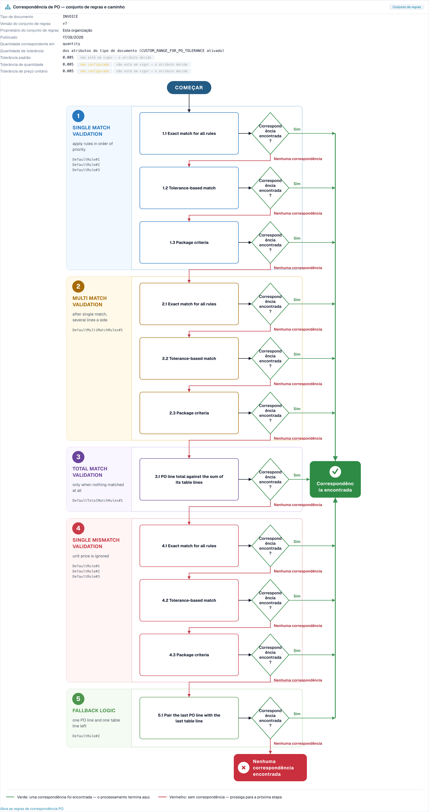

# Touchless Intelligence: diagnóstico de PO Matching

## Visão geral

Muitas faturas param no pedido de compra. A fatura diz uma coisa, o pedido de compra (PO) diz outra, e o DocBits não consegue decidir sozinho se elas combinam. Todo documento assim precisa de uma pessoa, portanto **não é touchless**.

O Touchless Intelligence mostra **por que** um PO match falhou e **como** o DocBits tentou fazer o match. Esta página explica as duas etapas do pipeline envolvidas, os motivos que você verá e o **fluxo de decisão do PO Matching** (PO matching decision flow), um diagrama que mostra as etapas do match uma após a outra.

### Onde você vê o PO Matching no Touchless Intelligence

| Onde | O que você vê |
| --- | --- |
| **Where touchless is lost first** (aba de visão geral) | Uma barra como *PO line match: PO item mismatch*. Ela diz quantos documentos pararam ali |
| **Supplier opportunities** | Um fornecedor com a causa raiz **PO matching** |
| **Supplier Diagnosis**, seção **How this organisation matches** e o **cluster de problemas** | O fluxo de decisão com o conjunto de regras da sua organização |
| **Document Trace** | A etapa **PO Line Match** com o status **blocked** e o motivo |
| **Configurações → Tipos de documento → Mais configurações → Pedido de compra** | As próprias regras de matching. Veja [Regras de matching de pedidos de compra](settings/global-settings/document-types/more-settings/purchase-order/purchase-order-matching-rules.md) |

## As duas etapas de PO

| Etapa | Pergunta | Para com |
| --- | --- | --- |
| **9 · PO Lookup** | Existe um pedido de compra para esta fatura? | *Purchase order not found* |
| **10 · PO Line Match** | Cada linha da fatura corresponde a uma linha do PO? | *PO item mismatch*, *PO line identifier mismatch*, *Unit price outside PO tolerance*, *Quantity outside PO tolerance* |

Um documento que para na etapa 9 ou 10 aparece na fila de fornecedores com o primeiro bloqueio **PO matching**.

## Motivos pelos quais um PO match falha

| Motivo exibido | O que significa | Causa típica | O que alterar |
| --- | --- | --- | --- |
| **Purchase order not found** | O DocBits não encontrou nenhum pedido de compra para o número de PO da fatura | O número do PO é lido errado ou está ausente; o PO ainda não foi importado; o PO pertence a outro fornecedor | Verifique a extração do número do PO para este fornecedor, a importação dos dados mestres de PO e o vínculo com o fornecedor |
| **PO item mismatch** | As linhas da fatura não corresponderam às linhas do PO | O fornecedor usa números de item próprios; a descrição difere; linhas foram unidas ou divididas | Verifique o mapeamento de números de item e as **prioridades das regras** nas regras de matching; adicione uma regra para a forma como o fornecedor identifica as linhas |
| **PO line identifier mismatch** | O número ou identificador da linha na fatura não corresponde ao PO | O fornecedor renumera as linhas | Faça o match por item e quantidade em vez de pelo número da linha |
| **Unit price outside PO tolerance** | O preço difere mais do que a tolerância permitida | Uma mudança de preço real, uma diferença de arredondamento ou uma unidade de preço diferente | Verifique a **Unit price tolerance** no conjunto de regras; corrija o PO ou fale com o fornecedor |
| **Quantity outside PO tolerance** | A quantidade difere mais do que a tolerância permitida | Entrega parcial, entrega excedente | Verifique **Match quantity on** e a **Quantity tolerance** |
| **PO matching service error** | O serviço de matching não conseguiu responder | Um problema técnico temporário | Reinicie os documentos; entre em contato com o suporte se se repetir |
| **Automatic PO export disabled** | A configuração **Auto export if PO matched 100%** está desativada, então os documentos com match não são exportados automaticamente | A configuração está desativada | Ative a configuração se quiser a exportação automática. Veja [Exportação automática se o PO tiver match de 100%](settings/document-processing/module/auto-export-if-po-matched-100.md) |


Nem todo motivo de PO Matching pode ser corrigido no DocBits. Se o fornecedor envia um número de PO errado, o cartão diz **Supplier action only**: o fornecedor precisa corrigir o documento e enviá-lo de novo.


## O fluxo de decisão do PO Matching

O fluxo de decisão mostra como o DocBits tenta fazer o match de uma linha da fatura com uma linha do PO. Ele tem **cinco etapas**, e o primeiro match vence:

1. **Single match validation**: aplica as regras em ordem de prioridade. É o caso normal, uma linha da fatura e uma linha do PO
2. **Multi match validation**: depois de um match único, quando várias linhas estão envolvidas em um dos lados
3. **Total match validation**: somente quando nada teve match. O total da linha do PO é comparado com a soma das suas linhas da tabela
4. **Single mismatch validation**: o preço unitário é ignorado, de modo que uma linha pode ter match por item e quantidade mesmo que o preço seja diferente
5. **Fallback logic**: sobram uma linha do PO e uma linha da tabela, então elas são emparelhadas

Dentro das etapas, o DocBits tenta, nesta ordem:

* **Exact match for all rules**: todos os valores comparados são idênticos
* **Tolerance-based match**: os valores numéricos podem se desviar dentro da tolerância
* **Package criteria**: a última passagem, baseada nos critérios relacionados a embalagem do conjunto de regras

Cada passo pergunta **Match found?** A resposta **Yes** (verde) leva a **Match found**, e o documento continua. A resposta **No match** (vermelho) passa para o próximo passo, e depois do último passo o resultado é **No match found**: o documento para e precisa de uma pessoa.

<figure><figcaption>
O fluxo de decisão do PO Matching, aberto a partir de <strong>How this organisation matches</strong> na página Supplier Diagnosis. O cabeçalho mostra o conjunto de regras (versão 7, de propriedade desta organização) e as tolerâncias. Abaixo dele, as cinco etapas com as suas passagens correm de cima para baixo. O verde leva a <strong>Match found</strong>, o vermelho passa para o próximo passo e termina em <strong>No match found</strong>. Organização de exemplo com dados de demonstração.
</figcaption></figure>

### O que o cabeçalho do diagrama diz

| Campo | Significado |
| --- | --- |
| **Document type** | O tipo de documento ao qual o conjunto de regras pertence, por exemplo INVOICE |
| **Rule set version** | A versão das regras de matching, por exemplo v3 |
| **Rule set owner** | **This organisation** (as suas próprias regras) ou **Shipped default rule set** (as regras padrão do DocBits) |
| **Published** | Quando a versão foi publicada |
| **Match quantity on** | Qual quantidade é comparada (quantidade pedida, quantidade em aberto) |
| **Tolerance amount** | Se as tolerâncias vêm dos atributos do tipo de documento ou do conjunto de regras |
| **Unit price tolerance** / **Quantity tolerance** | Quanto um preço ou uma quantidade pode se desviar |
| **Default tolerance** | A tolerância para todos os outros valores numéricos |

No exemplo acima, as tolerâncias mostram **not configured** e **not in force: attribute decides**. Isso significa: o próprio conjunto de regras não tem tolerância própria, e a linha **Tolerance amount** diz que as tolerâncias vêm dos **atributos do tipo de documento**. Uma tolerância só decide quando está em vigor. Leia esta linha primeiro quando uma diferença de preço ou de quantidade bloquear documentos: ela diz **onde** alterar a tolerância.

O estado do conjunto de regras é mostrado como uma nota: **Active version** (estas regras decidem), **Approved, not active**, **Draft, not yet in force** ou **Version state unknown**. Somente a versão ativa decide.

Se regras de transformação alteraram um documento antes do matching, o diagrama diz isso, por exemplo *2 applied: (names)* ou *"(rule)" rebuilt (table): the PO match was lost here*. Essa é uma causa oculta frequente: uma regra que reformata uma tabela pode quebrar um match que funcionava antes.

## Exemplos

Os números nos exemplos são ilustrativos.

### Exemplo 1: preço dentro da tolerância

Uma linha da fatura tem um preço unitário de **10,40**. A linha do PO diz **10,00**. A tolerância de preço unitário é de **5 %**.

* O **exact match** falha (10,40 não é 10,00).
* O **tolerance-based match** tem sucesso: a diferença é de **4 %**, o que está dentro de 5 %.
* A linha tem match. **Match found.**

Com uma tolerância de **3 %**, o tolerance-based match também falha. Depois de todas as etapas, o documento para com **Unit price outside PO tolerance**. O diagrama mostra exatamente esse caminho, e a correção é ou a tolerância (se 4 % for aceitável para o seu negócio) ou uma correção junto ao fornecedor.

### Exemplo 2: os números de item do fornecedor diferem dos seus

Um fornecedor fatura o item **"A-4711-X"**, o seu PO diz **"4711"**. Nenhuma regra compara os dois, então nenhum match é encontrado, e o Touchless Intelligence agrupa todas as faturas desse fornecedor em um cluster: **PO line match, PO item mismatch**, 27 documentos.

* No cluster você lê *27 affected, 27 recoverable*, ganho esperado, por exemplo, de **+8,7 pp**.
* A correção está do seu lado: adicione ou reordene uma regra que faça o match pelo número de item do fornecedor ou pela descrição, ou mantenha os números de item do fornecedor nos dados mestres.
* Depois de alterar a regra, aplique a alteração com uma [proposta de alteração](touchless-change-proposals.md) e leia o **Change history** duas semanas depois: taxa pure antes e depois.

### Exemplo 3: o pedido de compra ainda não existe

As faturas chegam antes de o PO ser importado. Elas param em **PO Lookup** com **Purchase order not found**. O cluster mostra um pico curto. A correção é a ordem dos seus processos, ou o agendamento da importação de PO, não as regras de matching. Verifique **Where touchless is lost first**: uma barra *PO lookup: Purchase order not found* que cresce após cada intervalo sem importação aponta para essa causa.

### Exemplo 4: uma regra reconstruiu a tabela

Depois que uma regra de transformação para a tabela de um fornecedor entrou em vigor, a taxa de matching desse fornecedor caiu bruscamente. O diagrama de um documento afetado diz *"(rule)" rebuilt (table): the PO match was lost here*. A correção é ajustar ou desfazer a regra de transformação, não as regras de matching.

## Uma rotina para problemas de PO Matching

1. Abra **Where touchless is lost first**. Uma etapa de PO Matching está entre as três primeiras?
2. Abra **Supplier opportunities** e ordene por **Expected lift**. Pegue o fornecedor com a causa raiz **PO matching** e o status **RECOVERABLE**.
3. Abra o **Supplier Diagnosis** e leia o cluster: motivo, documentos afetados, **What to change**, **Missing evidence**.
4. Abra **How this organisation matches** e verifique o conjunto de regras: versão, proprietário e tolerâncias.
5. Abra um **documento de exemplo** e o seu [Rastreamento do documento](touchless-document-trace.md): qual etapa, qual motivo?
6. Altere **uma** coisa (ordem das regras, tolerância, mapeamento de itens) com uma pré-visualização, para que o **Change history** possa medi-la.

## Páginas relacionadas

* [Touchless Intelligence](touchless-intelligence.md)
* [Diagnóstico de fornecedores e clusters de problemas](touchless-supplier-diagnosis.md)
* [Rastreamento do documento](touchless-document-trace.md)
* [Propostas de alteração e relatórios](touchless-change-proposals.md)
* [Regras de matching de pedidos de compra](settings/global-settings/document-types/more-settings/purchase-order/purchase-order-matching-rules.md)
* PO Matching Cards: guia completo
