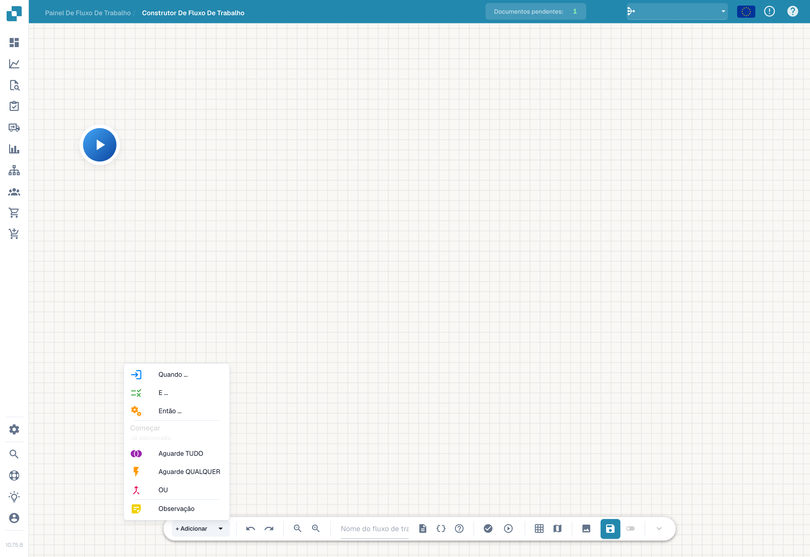

# Fluxo avançado

O construtor **Fluxo de trabalho avançado** é um editor de grafo de nós para fluxos de trabalho que precisam de ramificações, caminhos paralelos e controlo de fluxo — para além do When/And/Then linear do construtor Standard. Dispõe os nós numa tela e liga-os para definir o fluxo de execução.

## Vídeo: percursos das faturas no DocBits

Conheça o João e acompanhe a sua explicação na interface real do DocBits em português. Verifica o painel, a lista de workflows e a licença antes de abrir um rascunho não guardado no designer. Passo a passo, dá um nome ao workflow, configura a verificação do montante e duas ações, organiza os cartões e liga os dois percursos. Depois mostra como preparar testes com um documento ou dados personalizados. A conta de demonstração não tem uma subscrição Advanced Workflow e bloqueia a validação; o rascunho permanece não guardado e inativo.



[Abrir vídeo](https://docbits-videos.fra1.cdn.digitaloceanspaces.com/settings-assistant/advanced_workflows_canvas-admin/v7/pt.mp4) · [Legendas (WebVTT)](https://docbits-videos.fra1.cdn.digitaloceanspaces.com/settings-assistant/advanced_workflows_canvas-admin/v7/pt.vtt) · [Transcrição (texto)](https://docbits-videos.fra1.cdn.digitaloceanspaces.com/settings-assistant/advanced_workflows_canvas-admin/v7/pt.txt) · 3:15

| Neste vídeo | Início |
| --- | --- |
| Conheça o administrador | [0:00](https://docbits-videos.fra1.cdn.digitaloceanspaces.com/settings-assistant/advanced_workflows_canvas-admin/v7/pt.mp4#t=0) |
| Verificar o acesso | [0:04](https://docbits-videos.fra1.cdn.digitaloceanspaces.com/settings-assistant/advanced_workflows_canvas-admin/v7/pt.mp4#t=4) |
| Dar um nome ao workflow | [0:27](https://docbits-videos.fra1.cdn.digitaloceanspaces.com/settings-assistant/advanced_workflows_canvas-admin/v7/pt.mp4#t=27) |
| Configurar a condição de montante | [0:41](https://docbits-videos.fra1.cdn.digitaloceanspaces.com/settings-assistant/advanced_workflows_canvas-admin/v7/pt.mp4#t=41) |
| Adicionar a ação Approval | [1:05](https://docbits-videos.fra1.cdn.digitaloceanspaces.com/settings-assistant/advanced_workflows_canvas-admin/v7/pt.mp4#t=65) |
| Adicionar a ação Standard | [1:24](https://docbits-videos.fra1.cdn.digitaloceanspaces.com/settings-assistant/advanced_workflows_canvas-admin/v7/pt.mp4#t=84) |
| Organizar os cartões | [1:44](https://docbits-videos.fra1.cdn.digitaloceanspaces.com/settings-assistant/advanced_workflows_canvas-admin/v7/pt.mp4#t=104) |
| Ligar os percursos | [1:58](https://docbits-videos.fra1.cdn.digitaloceanspaces.com/settings-assistant/advanced_workflows_canvas-admin/v7/pt.mp4#t=118) |
| Preparar os testes | [2:23](https://docbits-videos.fra1.cdn.digitaloceanspaces.com/settings-assistant/advanced_workflows_canvas-admin/v7/pt.mp4#t=143) |
| Validar, guardar e ativar | [2:47](https://docbits-videos.fra1.cdn.digitaloceanspaces.com/settings-assistant/advanced_workflows_canvas-admin/v7/pt.mp4#t=167) |

Transcrição

**Conheça o administrador**

Administro o DocBits. Criamos uma verificação de faturas.

**Verificar o acesso**

Começo no painel de workflows e abro a lista. Depois verifico a licença. Workflow e Advanced Workflow precisam ambos de acesso ativo. Com os dois acessos ativos, Novo workflow apresenta Advanced Workflow. Esta conta de documentação não tem uma licença de workflow ativa. Por isso, continuo com uma pré-visualização não guardada no editor.

**Dar um nome ao workflow**

Estou no verdadeiro editor do DocBits. Primeiro, dou um nome claro ao rascunho. Vamos verificar o montante de uma fatura e usar duas ações simples para mostrar os percursos possíveis. Esta demonstração fica por guardar.

**Configurar a condição de montante**

Abro o menu para adicionar e escolho um cartão de condição. Na categoria Campo do documento, seleciono a condição Docfield. Introduzo o campo total_amount. Depois escolho a comparação maior que. E introduzo mil. Utilize a chave do seu próprio campo de documento. Um montante exatamente igual a mil não satisfaz esta comparação.

**Adicionar a ação Approval**

Agora adiciono um cartão de ação da categoria Campo do documento. A ação define um campo do documento. Uso a chave de demonstração approval_route. E introduzo o valor Approval. Isto identifica o percurso. Um processo de aprovação real precisa das suas próprias ações de negócio.

**Adicionar a ação Standard**

Adiciono um segundo cartão com a mesma ação. A ação define um campo do documento. Uso a chave de demonstração approval_route. Desta vez, o campo de demonstração recebe o valor Standard. Os dois cartões estão configurados. Ainda precisam de ligações para determinar qual a ação executada.

**Organizar os cartões**

Arrasto os cartões para uma disposição legível. As duas ações ficam à direita. A condição fica ao centro e Start à esquerda. Mover um cartão altera a posição. Não cria uma ligação.

**Ligar os percursos**

Arrasto da saída de Start para a entrada da condição. O percurso de sucesso segue uma ligação azul até Approval. O percurso laranja de condição não satisfeita segue para Standard. A saída vermelha de erro é distinta e destina-se a erros de avaliação. Aqui fica sem ligação. Num workflow de produção, defina como tratar estes erros.

**Preparar os testes**

O botão de teste na barra de ferramentas abre a seleção do documento de teste. Posso escolher um documento de demonstração ou preparar dados personalizados completos. Teste montantes superiores, inferiores e iguais a mil. Verifique também um montante em falta. Esta conta não tem licença Advanced Workflow. Mostro a preparação do teste, não um resultado executado.

**Validar, guardar e ativar**

A validação verifica ligações e configurações dos cartões. Nesta conta, a falta de licença impede a validação. Com uma conta autorizada, guardaria explicitamente no servidor. Depois verificaria a ativação em separado. Antes de guardar pela primeira vez, o interruptor está desativado. O indicador de rascunho automático refere-se a uma cópia local no navegador. Não significa que o workflow esteja guardado ou ativado.

## Como aceder

Abra o designer do Advanced Workflow a partir da área de fluxos de trabalho (a tela do construtor avançado). Começa por um nó **Começar** e constrói o fluxo adicionando nós.

<figure><figcaption>
A tela do Advanced Workflow — um grafo de nós com controlos de zoom, execução, grelha e gravação. Atribua um nome ao fluxo de trabalho na barra de ferramentas.
</figcaption></figure>

## Adicionar nós

Clique em **+ Add** para abrir o menu de nós. Para além dos já conhecidos cartões **Quando**, **E** e **Então**, o construtor avançado acrescenta nós de controlo de fluxo:

<figure><figcaption>
Menu de nós do construtor de fluxos avançados.
</figcaption></figure>

- **When / And / Then** — os mesmos cartões de condição e de ação do construtor Standard.
- **Aguarde TUDO** — aguarda até que *todas* as ramificações de entrada estejam concluídas antes de continuar.
- **Aguarde QUALQUER** — continua assim que *qualquer* ramificação de entrada estiver concluída.
- **OR** — ramifica o fluxo por caminhos alternativos.
- **Observação** — uma anotação de texto livre na tela (não afeta a execução).

Execute o fluxo com o controlo de reprodução, valide-o e guarde com o botão de gravação na barra de ferramentas.

## Próximos passos

- Veja o que cada cartão faz na secção **Cartas**.
- Para automações lineares simples, o construtor **Fluxo padrão** é mais rápido de configurar.

[Ver os cinco capítulos](advanced-workflow-videos.md)
