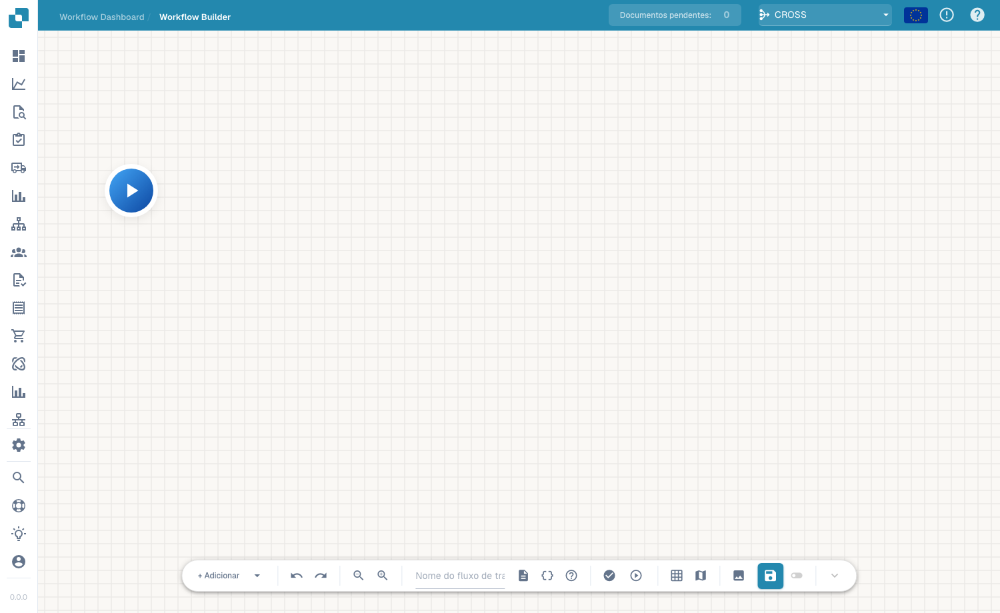

# Advanced Workflow

O construtor **Advanced Workflow** é um editor de grafo de nós para fluxos de trabalho que precisam de ramificações, caminhos paralelos e controlo de fluxo — para além do When/And/Then linear do construtor Standard. Dispõe os nós numa tela e liga-os para definir o fluxo de execução.

## Vídeo: percursos das faturas no DocBits

O vídeo mostra um workflow configurado na interface real do DocBits: verificação do montante, duas ações, ligações e preparação dos casos de teste.



[Legendas (WebVTT)](https://docbits-videos.fra1.cdn.digitaloceanspaces.com/settings-assistant/advanced_workflows_canvas/v2/pt.vtt)

As imagens mostram um rascunho de demonstração não guardado. `total_amount` e `approval_route` são exemplos de chaves de campo. `Approval` e `Standard` identificam os percursos. Configure as ações de negócio necessárias ao seu processo.

Transcrição

**Uma fatura com dois percursos**

Este é um workflow avançado real no DocBits. Uma verificação do montante da fatura conduz a duas ações. As ligações determinam qual a ação executada. O exemplo utiliza um rascunho não guardado e campos de demonstração.

**Configurar a verificação**

Abra Adicionar, escolha And e selecione uma condição de campo do documento. Indique o campo do montante, escolha Maior que e introduza mil. Utilize a chave exata do campo definida na configuração do documento.

**Configurar as ações**

Adicione dois cartões Then. Ambos definem o campo de demonstração approval route. Um escreve Approval e o outro Standard. Estes valores identificam o percurso. Configure as ações do seu processo para um workflow de produção.

**Ligar as saídas**

Ligue Start à entrada da condição. Ligue a saída azul de sucesso a Approval e a saída laranja de condição falsa a Standard. A saída vermelha trata os erros de avaliação separadamente. A posição dos cartões não cria um percurso.

**Preparar os casos de teste**

Abra Testar na barra de ferramentas. Escolha um documento de teste ou introduza os seus dados completos em JSON. Verifique montantes superiores, inferiores e iguais a mil, bem como valores em falta. Consulte os resultados dos nós após a execução.

**Validar, guardar e ativar**

Valide as ligações e as definições dos cartões. Guarde explicitamente no servidor e verifique a ativação em separado. Os rascunhos automáticos do navegador não substituem a gravação. A execução e os registos exigem o módulo e a subscrição adequados.

## Como aceder

Abra o designer do Advanced Workflow a partir da área de fluxos de trabalho (a tela do construtor avançado). Começa por um nó **Start** e constrói o fluxo adicionando nós.

<figure><figcaption>
A tela do Advanced Workflow — um grafo de nós com controlos de zoom, execução, grelha e gravação. Atribua um nome ao fluxo de trabalho na barra de ferramentas.
</figcaption></figure>

## Adicionar nós

Clique em **+ Add** para abrir o menu de nós. Para além dos já conhecidos cartões **When**, **And** e **Then**, o construtor avançado acrescenta nós de controlo de fluxo:

<figure><figcaption>
O menu de nós <strong>+ Add</strong>: When / And / Then mais Wait ALL, Wait ANY, OR e Note.
</figcaption></figure>

- **When / And / Then** — os mesmos cartões de condição e de ação do construtor Standard.
- **Wait ALL** — aguarda até que *todas* as ramificações de entrada estejam concluídas antes de continuar.
- **Wait ANY** — continua assim que *qualquer* ramificação de entrada estiver concluída.
- **OR** — ramifica o fluxo por caminhos alternativos.
- **Note** — uma anotação de texto livre na tela (não afeta a execução).

Execute o fluxo com o controlo de reprodução, valide-o e guarde com o botão de gravação na barra de ferramentas.

## Próximos passos

- Veja o que cada cartão faz na secção **Cards**.
- Para automações lineares simples, o construtor **Standard Workflow** é mais rápido de configurar.
