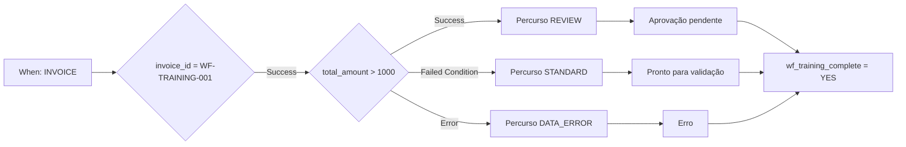

# Caso Advanced: encaminhamento de faturas

Uma fatura de formação acima de 1000 EUR precisa de revisão. Até 1000 EUR inclusive segue o percurso padrão. Um montante ausente ou numericamente inválido segue a correção de dados. Os três percursos chegam a uma ação final comum.

## Requisitos e estrutura

Utilize uma organização de teste com Advanced ativo e o [pacote de formação](workflow-training-kit.md). Importe `advanced-workflow.json` através de **Import Workflow**, mantenha-o desativado e abra o grafo. When verifica Fatura; o primeiro cartão And limita o exercício a `invoice_id = WF-TRAINING-001`. Não existem destinatários nem exportação configurados.

A verificação inicial utiliza `invoice_id`, `eq` e `WF-TRAINING-001`; outro número ignora todas as ações seguintes. O montante é verificado por **Docfield is**, versão 2, com `total_amount`, `gt`, `1000`. As ações de texto escrevem `wf_training_route`. Os cartões de estado utilizam a versão 3 e **Trigger Workflows = false**.

**v2:** O cartão de estado do percurso escolhido liga diretamente à Then comum `complete`, que escreve `wf_training_complete = YES`. Não há um nó OR à espera. V1 provava apenas o teste: com predecessores não alcançados, o escalonador pode ignorar uma junção que o teste avalia. O [guia P0](masterclass/control-nodes.md) explica a diferença. Uma Then comum direta não é uma barreira para várias ações obrigatórias simultâneas.

## Construir e verificar

1. Valide o grafo completo.
2. Prepare os ficheiros para a sua organização conforme o pacote.
3. Abra **Test → Custom Data** e utilize o ficheiro completo de cada caso. Um objeto com apenas `total_amount` é insuficiente.
4. Execute desde a entrada completa. Verifique a saída de `amount`, o percurso alcançado, a mensagem de estado e `complete`.
5. Compare com as expectativas independentes. As respostas guardadas mostram os resultados realmente observados.

| Caso | Montante | Saída de amount | Percurso / estado | Resultado global |
| --- | --- | --- | --- | --- |
| above | 1785,00 | Success | REVIEW / validated_pending_approval | success |
| below | 999,00 | Failed Condition | STANDARD / ready_for_validation | success |
| boundary | 1000,00 | Failed Condition | STANDARD / ready_for_validation | success |
| just-above | 1000,01 | Success | REVIEW / validated_pending_approval | success |
| missing | ausente | Error | DATA_ERROR / error | error |
| invalid-number | invalid | Error | DATA_ERROR / error | error |
| other-invoice | 1785,00 | não executado | outro número; nenhuma ação | failed_condition |

Num caso de erro, `data_error` e `complete` podem ter sucesso enquanto o resultado global permanece **error**. Tratar o erro não elimina a avaliação originalmente falhada.

## Alargar o processo

Os testes decorreram em 21 de outubro de 2026 contra o serviço Dev disponibilizado DocFlow **2.10.38**. O pacote contém respostas reais de teste; alterações de campos e estados foram simuladas. Não contém Workflow Logs documentais persistidos nem demonstra aprovação pessoal ou receção real de uma exportação.

Substitua os marcadores por atribuições e ações de aprovação configuradas. Ligue a exportação apenas a uma condição de aprovação explicitamente verificada. Confirme uma execução real no documento e a receção no destinatário, usando um documento próprio de formação e um destino de teste previsto. Consulte o [diagnóstico](workflow-troubleshooting.md).

## WF-02: Exercício e aceitação

Execute os sete casos e registe saída amount, percurso, estado, complete e resultado global. Aceite teste e execução real separadamente. Um erro tratado não é uma execução sem erros só porque complete tem sucesso.

[Percurso](workflow-learning-path.md)
