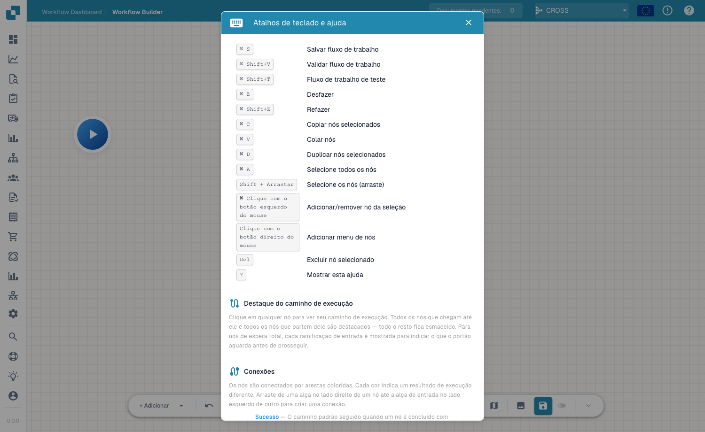

# Barra de ferramentas e Tela

## Vídeo: Construtor e canvas

Conheça o João e acompanhe a sua explicação na interface real do DocBits em português. Verifica o painel, a lista de workflows e a licença antes de abrir um rascunho não guardado no designer. Passo a passo, dá um nome ao workflow, configura a verificação do montante e duas ações, organiza os cartões e liga os dois percursos. Depois mostra como preparar testes com um documento ou dados personalizados. A conta de demonstração não tem uma subscrição Advanced Workflow e bloqueia a validação; o rascunho permanece não guardado e inativo.



[Abrir vídeo](https://docbits-videos.fra1.cdn.digitaloceanspaces.com/review/advanced_workflows_canvas-admin/20261019-paced-e/pt.mp4) · [Legendas (WebVTT)](https://docbits-videos.fra1.cdn.digitaloceanspaces.com/review/advanced_workflows_canvas-admin/20261019-paced-e/pt.vtt) · [Transcrição (texto)](https://docbits-videos.fra1.cdn.digitaloceanspaces.com/review/advanced_workflows_canvas-admin/20261019-paced-e/pt.txt) · 3:15

| Neste vídeo | Início |
| --- | --- |
| Conheça o administrador | [0:00](https://docbits-videos.fra1.cdn.digitaloceanspaces.com/review/advanced_workflows_canvas-admin/20261019-paced-e/pt.mp4#t=0) |
| Verificar o acesso | [0:04](https://docbits-videos.fra1.cdn.digitaloceanspaces.com/review/advanced_workflows_canvas-admin/20261019-paced-e/pt.mp4#t=4) |
| Dar um nome ao workflow | [0:27](https://docbits-videos.fra1.cdn.digitaloceanspaces.com/review/advanced_workflows_canvas-admin/20261019-paced-e/pt.mp4#t=27) |
| Configurar a condição de montante | [0:41](https://docbits-videos.fra1.cdn.digitaloceanspaces.com/review/advanced_workflows_canvas-admin/20261019-paced-e/pt.mp4#t=41) |
| Adicionar a ação Approval | [1:05](https://docbits-videos.fra1.cdn.digitaloceanspaces.com/review/advanced_workflows_canvas-admin/20261019-paced-e/pt.mp4#t=65) |
| Adicionar a ação Standard | [1:24](https://docbits-videos.fra1.cdn.digitaloceanspaces.com/review/advanced_workflows_canvas-admin/20261019-paced-e/pt.mp4#t=84) |
| Organizar os cartões | [1:44](https://docbits-videos.fra1.cdn.digitaloceanspaces.com/review/advanced_workflows_canvas-admin/20261019-paced-e/pt.mp4#t=104) |
| Ligar os percursos | [1:58](https://docbits-videos.fra1.cdn.digitaloceanspaces.com/review/advanced_workflows_canvas-admin/20261019-paced-e/pt.mp4#t=118) |
| Preparar os testes | [2:23](https://docbits-videos.fra1.cdn.digitaloceanspaces.com/review/advanced_workflows_canvas-admin/20261019-paced-e/pt.mp4#t=143) |
| Validar, guardar e ativar | [2:47](https://docbits-videos.fra1.cdn.digitaloceanspaces.com/review/advanced_workflows_canvas-admin/20261019-paced-e/pt.mp4#t=167) |

Transcrição

**Conheça o administrador**

Administro o DocBits. Criamos uma verificação de faturas.

**Verificar o acesso**

Começo no painel de workflows e abro a lista. Depois verifico a licença. Workflow e Advanced Workflow precisam ambos de acesso ativo. Com os dois acessos ativos, Novo workflow apresenta Advanced Workflow. Esta conta de documentação não tem uma licença de workflow ativa. Por isso, continuo com uma pré-visualização não guardada no editor.

**Dar um nome ao workflow**

Estou no verdadeiro editor do DocBits. Primeiro, dou um nome claro ao rascunho. Vamos verificar o montante de uma fatura e usar duas ações simples para mostrar os percursos possíveis. Esta demonstração fica por guardar.

**Configurar a condição de montante**

Abro o menu para adicionar e escolho um cartão de condição. Na categoria Campo do documento, seleciono a condição Docfield. Introduzo o campo total_amount. Depois escolho a comparação maior que. E introduzo mil. Utilize a chave do seu próprio campo de documento. Um montante exatamente igual a mil não satisfaz esta comparação.

**Adicionar a ação Approval**

Agora adiciono um cartão de ação da categoria Campo do documento. A ação define um campo do documento. Uso a chave de demonstração approval_route. E introduzo o valor Approval. Isto identifica o percurso. Um processo de aprovação real precisa das suas próprias ações de negócio.

**Adicionar a ação Standard**

Adiciono um segundo cartão com a mesma ação. A ação define um campo do documento. Uso a chave de demonstração approval_route. Desta vez, o campo de demonstração recebe o valor Standard. Os dois cartões estão configurados. Ainda precisam de ligações para determinar qual a ação executada.

**Organizar os cartões**

Arrasto os cartões para uma disposição legível. As duas ações ficam à direita. A condição fica ao centro e Start à esquerda. Mover um cartão altera a posição. Não cria uma ligação.

**Ligar os percursos**

Arrasto da saída de Start para a entrada da condição. O percurso de sucesso segue uma ligação azul até Approval. O percurso laranja de condição não satisfeita segue para Standard. A saída vermelha de erro é distinta e destina-se a erros de avaliação. Aqui fica sem ligação. Num workflow de produção, defina como tratar estes erros.

**Preparar os testes**

O botão de teste na barra de ferramentas abre a seleção do documento de teste. Posso escolher um documento de demonstração ou preparar dados personalizados completos. Teste montantes superiores, inferiores e iguais a mil. Verifique também um montante em falta. Esta conta não tem licença Advanced Workflow. Mostro a preparação do teste, não um resultado executado.

**Validar, guardar e ativar**

A validação verifica ligações e configurações dos cartões. Nesta conta, a falta de licença impede a validação. Com uma conta autorizada, guardaria explicitamente no servidor. Depois verificaria a ativação em separado. Antes de guardar pela primeira vez, o interruptor está desativado. O indicador de rascunho automático refere-se a uma cópia local no navegador. Não significa que o workflow esteja guardado ou ativado.

[Ver os cinco capítulos](../advanced-workflow-videos.md)

A barra de ferramentas do Advanced Workflow percorre a parte inferior da tela e dá-lhe tudo o que precisa para construir, navegar e gerir o fluxo.

## Controlos da barra de ferramentas

- **+ Add** — abre o menu de nós para adicionar um nó (consulte [Nós](nodes.md)).
- **Undo / Redo** — recue ou avance pelas suas alterações.
- **Zoom in / Zoom out** — altere o nível de zoom da tela.
- **Workflow name** — nomeie o fluxo de trabalho diretamente.
- **Edit description** — adicione uma descrição para o fluxo de trabalho.
- **Variables** — abra o painel [Variables](variables.md).
- **Help** — abra os atalhos de teclado e a caixa de diálogo de ajuda.
- **Validate / Test** — verifique e execute o fluxo (consulte [Validação e Testes](validation-and-testing.md)).
- **Snap to grid** — ative/desative o alinhamento dos nós à grelha para esquemas organizados.
- **Mini-map** — ative/desative um pequeno mapa de visão geral para navegar em grafos grandes.
- **Save** — guarde o fluxo de trabalho. Um indicador de **auto-save** mostra quando o fluxo foi guardado automaticamente pela última vez.

## Atalhos de teclado

Prima <kbd>?</kbd> na tela para abrir a caixa de diálogo de atalhos e ajuda a qualquer momento.

<figure><figcaption>
A caixa de diálogo de atalhos de teclado e ajuda — atalhos, realce do caminho de execução e cores das ligações.
</figcaption></figure>

| Atalho | Ação |
|---|---|
| <kbd>Cmd/Ctrl</kbd> + <kbd>S</kbd> | Guardar fluxo de trabalho |
| <kbd>Cmd/Ctrl</kbd> + <kbd>Shift</kbd> + <kbd>V</kbd> | Validar fluxo de trabalho |
| <kbd>Cmd/Ctrl</kbd> + <kbd>Shift</kbd> + <kbd>T</kbd> | Testar fluxo de trabalho |
| <kbd>Cmd/Ctrl</kbd> + <kbd>Z</kbd> / <kbd>Shift</kbd> + <kbd>Z</kbd> | Anular / Refazer |
| <kbd>Cmd/Ctrl</kbd> + <kbd>C</kbd> / <kbd>V</kbd> / <kbd>D</kbd> | Copiar / Colar / Duplicar nós selecionados |
| <kbd>Cmd/Ctrl</kbd> + <kbd>A</kbd> | Selecionar todos os nós |
| <kbd>Shift</kbd> + Arrastar | Selecionar nós (arrastando) |
| <kbd>Cmd/Ctrl</kbd> + Clique esquerdo | Adicionar/remover nó da seleção |
| Clique direito | Menu de adição de nós |
| <kbd>Del</kbd> | Eliminar nó selecionado |
| <kbd>?</kbd> | Mostrar esta ajuda |

## Próximos passos

- Construa o fluxo com [Nós](nodes.md) e [Variáveis](variables.md).
