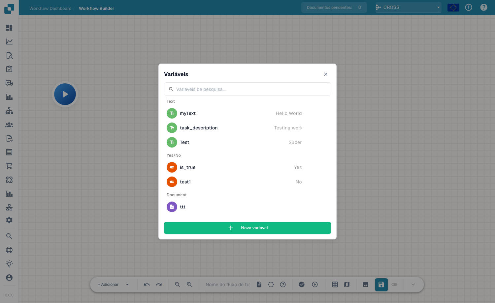

# Variáveis

## Vídeo: Variáveis, testes e ativação



[Abrir vídeo](https://docbits-videos.fra1.cdn.digitaloceanspaces.com/settings-assistant/advanced_workflows_testing/v3/pt.mp4) · [Legendas (WebVTT)](https://docbits-videos.fra1.cdn.digitaloceanspaces.com/settings-assistant/advanced_workflows_testing/v3/pt.vtt) · 1:57

Transcrição

**Escolha o tipo**

Abra Variáveis pelas chavetas. Escolha texto, número, sim ou não, ou documento. Pesquise nomes. Document guarda uma referência definida por uma ação específica; o formulário não aceita valores de documento.

**Variáveis da organização**

Escolha nome único, tipo e valor inicial. Criar, editar ou eliminar guarda imediatamente na organização. Outros workflows partilham estes valores. Guardar ou descartar o canvas não anula alterações às variáveis.

**Valide a estrutura**

Clique em Validar. Examine erros e avisos acima do canvas. Uma mensagem foca o nó. Verifique ações, entradas, saídas, ciclos e junções. Uma estrutura válida não garante dados corretos.

**Escolha o contexto**

Reproduzir na barra abre a escolha do documento. Escolha documento, dados personalizados ou teste sem documento para cartões independentes. Start executa diretamente. Os testes incluem alterações não guardadas e simulam ações destrutivas.

**Preparar e rever cenários de teste**

Prepara testes separados acima, abaixo e exatamente em mil, além de dados em falta. Após a execução, verifica mensagens e durações: verde indica sucesso, laranja falso, vermelho erro e cinzento ignorado. Volta a testar as correções. Usa o gestor de testes para cenários repetíveis.

**Guarde antes de ativar**

A gravação automática conserva um rascunho local cerca de trinta segundos após alterações. Guarde explicitamente no servidor. Ative após a primeira gravação. Verifique o estado na lista antes de esperar execução automática.

[Ver os cinco capítulos](../advanced-workflow-videos.md)

As **Variables** permitem-lhe guardar valores uma só vez e reutilizá-los em todos os nós de um Advanced Workflow — por exemplo, um limiar, um destinatário fixo ou um valor que lê do documento e passa a um nó posterior. Abra o painel de variáveis a partir do botão **Variables** (o ícone `{ }`) na barra de ferramentas.

<figure><figcaption>
O painel Variables — variáveis agrupadas por tipo, com pesquisa e **New Variable**.
</figcaption></figure>

## Tipos de variável

As variáveis são agrupadas pelo seu tipo:

- **Text** — um valor de texto (por ex. uma descrição ou uma etiqueta fixa).
- **Yes/No** — uma marca booleana (Yes / No).
- **Document** — uma referência a um documento ou a um campo de documento.

Utilize a caixa de pesquisa para encontrar rapidamente uma variável quando a lista crescer.

## Criar uma variável

Clique em **New Variable**, atribua-lhe um nome e um tipo, e defina o seu valor. A variável passa então a estar disponível para ser referenciada a partir dos cartões dos seus nós, para que possa manter a configuração num único local e alterá-la sem editar todos os nós.

## Próximos passos

- Veja como os nós usam estes valores em [Nós](nodes.md).
- Valide e execute o fluxo de trabalho em [Validação e Testes](validation-and-testing.md).

## Variáveis numéricas

**Number (Número)** é um tipo de variável independente, além de Text, Yes/No e Document. Introduza um valor numérico sem símbolo monetário. As variáveis da organização são partilhadas entre fluxos de trabalho; a criação, alteração e eliminação são guardadas imediatamente, independentemente de guardar ou descartar a tela. Antes de alterar uma variável, verifique os fluxos afetados e teste valores abaixo, iguais e acima do limite.
