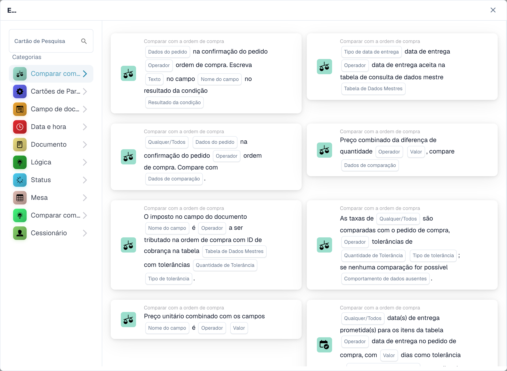
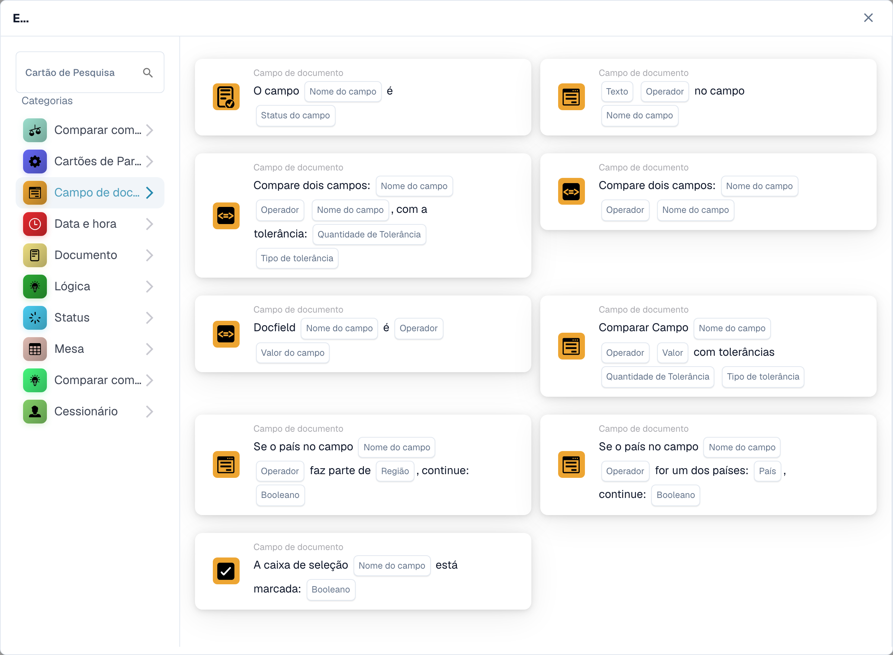
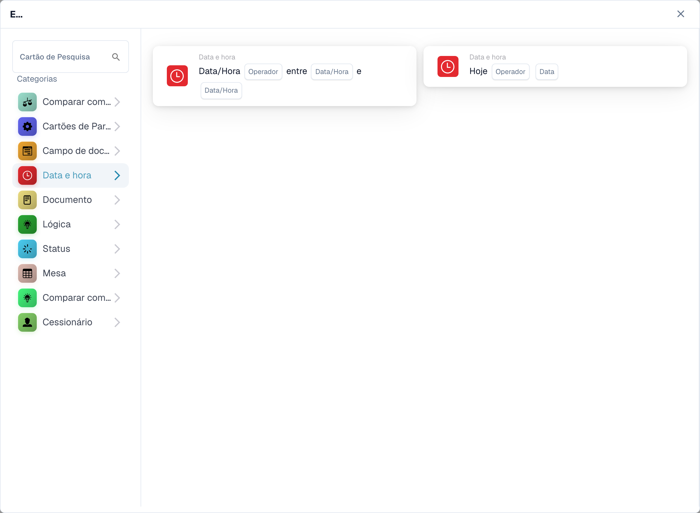
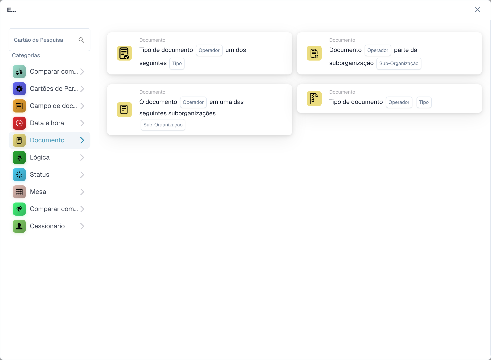
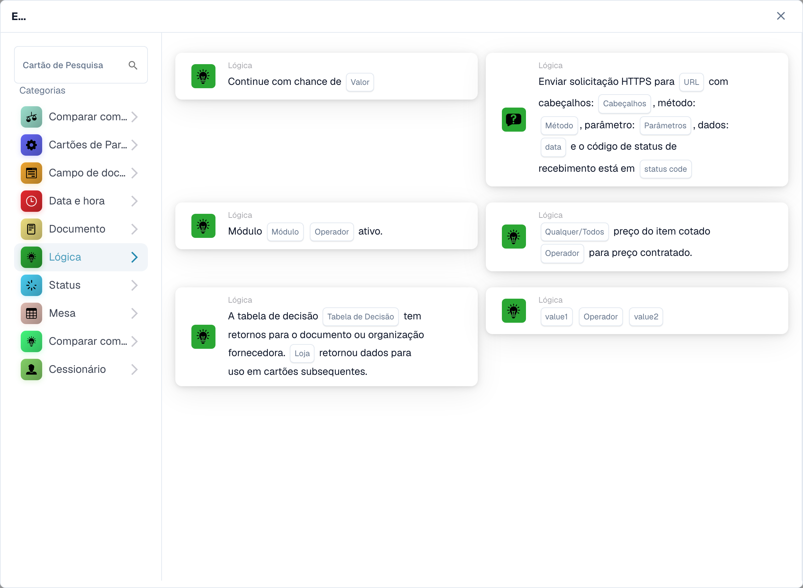
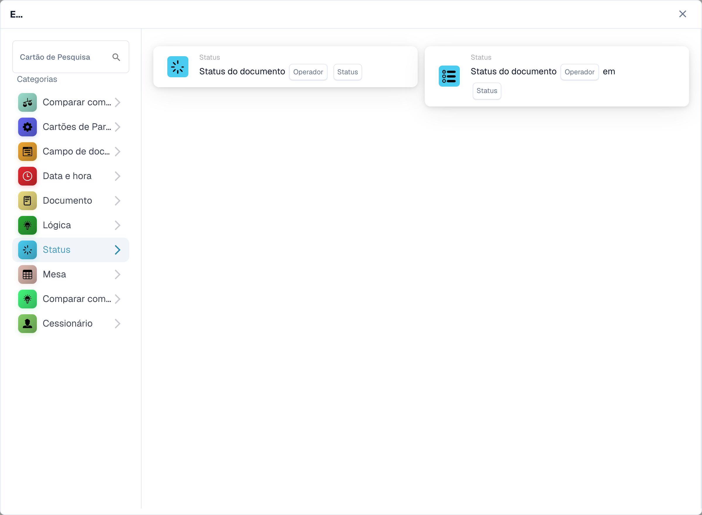
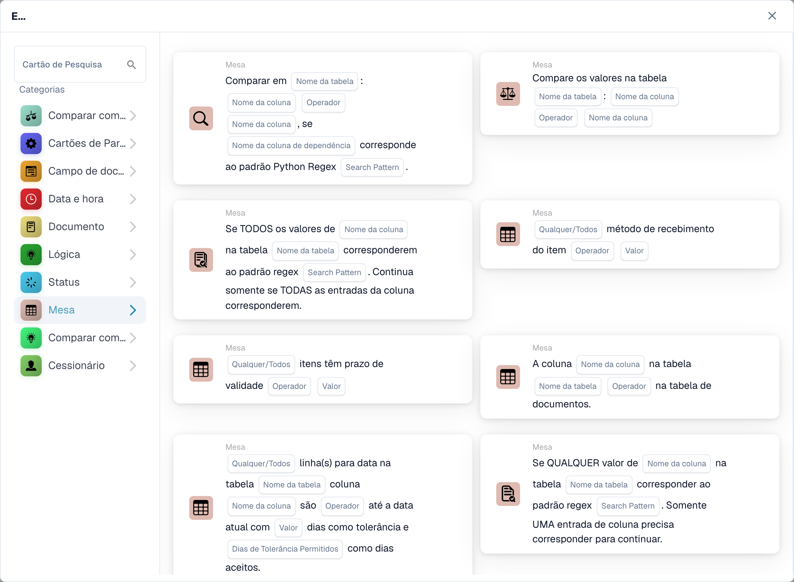
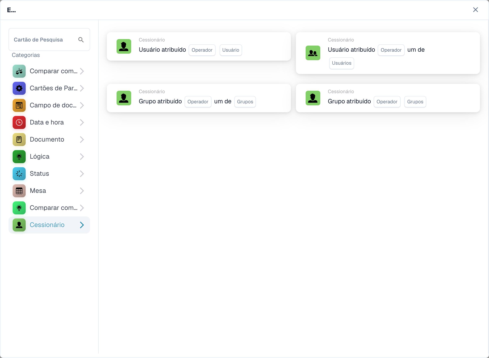

# E

Use um cartão **E** para decidir se um fluxo de trabalho deve continuar após seu acionador **Quando**. Adicione as verificações necessárias antes da ação **Então**. Cada cartão mostra campos para preencher, como **Operador**, **Nome do campo** ou **Valor**; as capturas de tela mostram os modelos de cartão disponíveis, não as regras concluídas.

No **Construtor de fluxo de trabalho**, selecione **Adicionar cartão** em **E...**. Escolha uma categoria à esquerda ou digite o nome do cartão em **Cartão de pesquisa**. Selecione uma visualização do cartão para adicioná-lo ao fluxo de trabalho. Você pode rolar a lista de visualização para ver mais cartões. Use **×** para fechar o seletor sem escolher outro cartão. Após configurar os cartões, salve o fluxo de trabalho. Consulte [Fluxo de trabalho](..) para as etapas **Quando**, **E** e **Então** circundantes.

## Comparar com pedido de compra

Use esses cartões para comparar dados de pedidos ou faturas com um pedido de compra, como preço unitário, data de entrega prometida, encargos ou quantidade. Escolha os campos, a operadora e qualquer tolerância que o cartão selecionado solicite. Consulte [Comparar com pedido de compra](compare-with-purchase-order) para cartões individuais.

<figure><figcaption>
Cartões disponíveis na categoria selecionada. Configure os campos antes de utilizar. Algumas etiquetas desta versão da interface ainda não estão traduzidas ou têm uma tradução incorreta. As explicações desta página usam os termos corretos; a imagem mostra a interface real.
</figcaption></figure>

## Campo do documento

Escolha esta categoria para marcar uma caixa de seleção ou status de campo, comparar um campo com um valor ou comparar dois campos. Preencha os espaços reservados **Nome do campo** e **Operador** no cartão escolhido. Algumas comparações também pedem tolerância. Consulte [Campo do Documento](document-field).

<figure><figcaption>
Cartões disponíveis na categoria selecionada. Configure os campos antes de utilizar. Algumas etiquetas desta versão da interface ainda não estão traduzidas ou têm uma tradução incorreta. As explicações desta página usam os termos corretos; a imagem mostra a interface real.
</figcaption></figure>

## Data e hora

Use **Data e Hora** para comparar uma data ou hora com um intervalo, ou compare **Hoje** com uma data escolhida. Selecione o **Operador** e os valores de data no cartão. Consulte [Data e Hora](date-and-time).

<figure><figcaption>
Cartões disponíveis na categoria selecionada. Configure os campos antes de utilizar. Algumas etiquetas desta versão da interface ainda não estão traduzidas ou têm uma tradução incorreta. As explicações desta página usam os termos corretos; a imagem mostra a interface real.
</figcaption></figure>

## Documento

Use esses cartões quando um fluxo de trabalho depender do **tipo de documento** ou **suborganização**. Escolha o tipo ou organização indicada no cartão. Veja [Documento](document).

<figure><figcaption>
Cartões disponíveis na categoria selecionada. Configure os campos antes de utilizar. Algumas etiquetas desta versão da interface ainda não estão traduzidas ou têm uma tradução incorreta. As explicações desta página usam os termos corretos; a imagem mostra a interface real.
</figcaption></figure>

## Lógica

Esta categoria inclui verificações usando uma tabela de decisão, uma resposta HTTPS, disponibilidade de módulo, preço de item cotado, valor de chance ou dois valores. Abra o cartão específico e preencha os espaços reservados nomeados; por exemplo, o cartão HTTPS solicita um URL, um método e um código de status aceito. Veja [Lógica](logic).

<figure><figcaption>
Cartões disponíveis na categoria selecionada. Configure os campos antes de utilizar. Algumas etiquetas desta versão da interface ainda não estão traduzidas ou têm uma tradução incorreta. As explicações desta página usam os termos corretos; a imagem mostra a interface real.
</figcaption></figure>

## Estado

Use **Estado** para verificar se um documento tem um status escolhido ou se seu status está em um conjunto selecionado. Escolha **Operador** e **Estado** no cartão. Consulte [Status](status).

<figure><figcaption>
Cartões disponíveis na categoria selecionada. Configure os campos antes de utilizar. Algumas etiquetas desta versão da interface ainda não estão traduzidas ou têm uma tradução incorreta. As explicações desta página usam os termos corretos; a imagem mostra a interface real.
</figcaption></figure>

## Tabela

Esses cartões examinam as linhas da tabela do documento. As opções visíveis incluem verificações de data, padrões de texto, prazo de validade e comparações entre colunas. Selecione **Nome da tabela** e **Nome da coluna** antes de escolher um operador ou padrão. Veja [Tabela](table).

<figure><figcaption>
Cartões disponíveis na categoria selecionada. Configure os campos antes de utilizar. Algumas etiquetas desta versão da interface ainda não estão traduzidas ou têm uma tradução incorreta. As explicações desta página usam os termos corretos; a imagem mostra a interface real.
</figcaption></figure>

## Compare com o preço de cotação

Use esses cartões para comparar um item com dados de preços cotados. As opções visíveis abrangem ID do item, tipo de fornecedor, ID do item do fornecedor, preço unitário e unidade de medida. O **Operador** e os espaços reservados para dados dependem do cartão selecionado.

<figure><figcaption>
Cartões disponíveis na categoria selecionada. Configure os campos antes de utilizar. Algumas etiquetas desta versão da interface ainda não estão traduzidas ou têm uma tradução incorreta. As explicações desta página usam os termos corretos; a imagem mostra a interface real.
</figcaption></figure>

## Responsável

Use **Responsável** quando a condição depender do usuário ou grupo atribuído. Escolha se deseja comparar com um usuário ou grupo ou com um conjunto selecionado. Consulte [Cessionário](assignee).

<figure><figcaption>
Cartões disponíveis na categoria selecionada. Configure os campos antes de utilizar. Algumas etiquetas desta versão da interface ainda não estão traduzidas ou têm uma tradução incorreta. As explicações desta página usam os termos corretos; a imagem mostra a interface real.
</figcaption></figure>

[Cartões detalhados de comparação de cotações e comportamento Qualquer/Todo](../cards-overview/quote-comparison-guide.md).
