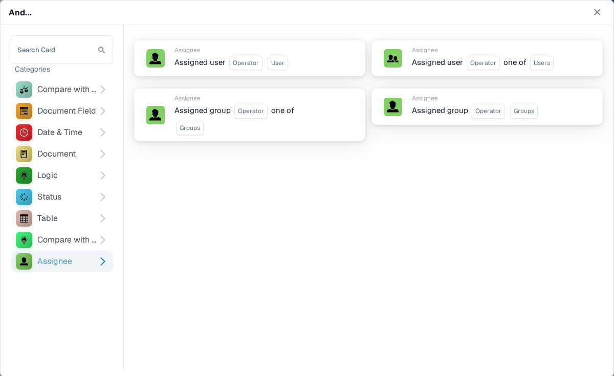

# And: escolha um cartão de condição

Use um cartão **And** para decidir se um workflow deve continuar após o gatilho **When**. Adicione as verificações necessárias antes da ação **Then**. Cada cartão mostra campos a preencher, como **Operator**, **Field Name** ou **Value**; as capturas de tela mostram os modelos de cartão disponíveis, não regras já preenchidas.

No **Workflow Builder**, selecione **Add Card** em **And...**. Escolha uma categoria à esquerda ou digite o nome de um cartão em **Search Card**. Selecione a pré-visualização de um cartão para adicioná-lo ao workflow. Você pode rolar a lista de pré-visualizações para ver mais cartões. Use **×** para fechar o seletor sem escolher outro cartão. Depois de configurar os cartões, salve o workflow. Consulte [Workflow](../README.md) para ver as etapas **When**, **And** e **Then** em conjunto.

## Compare with Purchase Order

Use estes cartões para comparar dados de pedido ou de fatura com um pedido de compra, como preço unitário, data de entrega prometida, encargos ou quantidade. Escolha os campos, o operador e a tolerância que o cartão selecionado solicitar. Consulte [Compare with Purchase Order](compare-with-purchase-order/README.md) para ver os cartões individuais.

<figure><figcaption>Categoria Compare with Purchase Order no Sandbox em inglês.</figcaption></figure>

## Document Field

Escolha esta categoria para verificar uma caixa de seleção ou o status de um campo, comparar um campo com um valor ou comparar dois campos. Preencha os campos **Field Name** e **Operator** do cartão escolhido. Algumas comparações também pedem uma tolerância. Consulte [Document Field](document-field/README.md).

<figure><figcaption>As verificações de Document Field usam valores do documento atual.</figcaption></figure>

## Date & Time

Use **Date & Time** para comparar uma data ou hora com um intervalo, ou para comparar **Today** com uma data escolhida. Selecione o **Operator** e os valores de data no cartão. Consulte [Date & Time](date-and-time/README.md).

<figure><figcaption>Date & Time oferece uma verificação de intervalo e uma verificação em relação à data de hoje.</figcaption></figure>

## Document

Use estes cartões quando um workflow deve depender do **tipo de documento** ou da **suborganização**. Escolha o tipo ou a organização indicados no cartão. Consulte [Document](document/README.md).

<figure><figcaption>As condições de Document verificam o tipo ou a suborganização.</figcaption></figure>

## Logic

Esta categoria inclui verificações com uma tabela de decisão, uma resposta HTTPS, a disponibilidade de um módulo, o preço cotado de um item, um valor de chance ou dois valores. Abra o cartão específico e preencha os campos indicados; por exemplo, o cartão HTTPS pede uma URL, um método e um código de status aceito. Consulte [Logic](logic/README.md).

<figure><figcaption>Logic oferece vários tipos de condição; escolha o que corresponde à sua regra.</figcaption></figure>

## Status

Use **Status** para verificar se um documento tem um determinado status ou se o status dele está em um conjunto selecionado. Escolha o **Operator** e o **Status** no cartão. Consulte [Status](status/README.md).

<figure><figcaption>As condições de Status verificam o estado atual do documento.</figcaption></figure>

## Table

Estes cartões examinam as linhas de tabelas do documento. As opções visíveis incluem verificações de data, padrões de texto, prazo de validade e comparações entre colunas. Selecione o **Table name** e o **Column Name** antes de escolher um operador ou padrão. Consulte [Table](table/README.md).

<figure><figcaption>As condições de Table usam linhas e colunas de uma tabela do documento.</figcaption></figure>

## Compare with Quote Price

Use estes cartões para comparar um item com dados de preço cotado. As opções visíveis abrangem ID do item, tipo de fornecedor, ID do item do fornecedor, preço unitário e unidade de medida. O **Operator** e os campos de dados dependem do cartão selecionado.

<figure><figcaption>Compare with Quote Price é uma categoria separada no seletor de cartões atual.</figcaption></figure>

## Assignee

Use **Assignee** quando a condição depende do usuário ou do grupo atribuído. Escolha se deseja comparar com um único usuário ou grupo ou com um conjunto selecionado. Consulte [Assignee](assignee/README.md).

<figure><figcaption>As condições de Assignee verificam o usuário ou grupo atribuído ao documento.</figcaption></figure>
