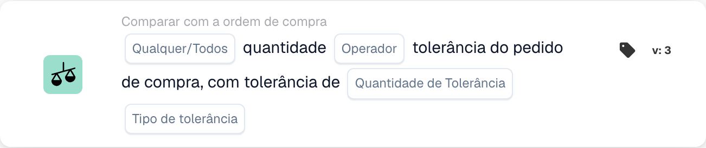
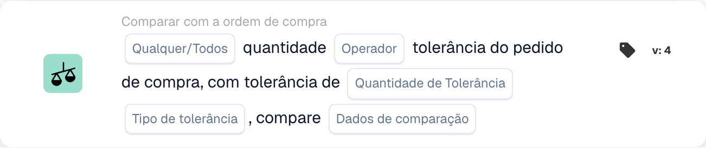

# Qualquer / Todas as Quantidades

<figure><figcaption>
Campos do cartão na versão apresentada. Os campos ainda não estão configurados.
</figcaption></figure>

<figure><figcaption>
Campos do cartão na versão apresentada. Os campos ainda não estão configurados.
</figcaption></figure>

## **Objetivo:**

Este cartão de fluxo de trabalho foi projetado para comparar a quantidade em um documento com a tolerância definida no pedido de compra. Permite avaliar se a quantidade atende a determinadas condições, como igualdade ou superação da tolerância especificada. Na versão 4, o cartão amplia a funcionalidade adicionando a capacidade de comparar múltiplas entidades, incluindo o pedido de compra, quantidades recebidas e quantidades de documentos, oferecendo maior flexibilidade no tratamento de diferentes cenários.

## **Componentes do cartão:**

1. **Qualquer / Todos:**
   * **Descrição**: Especifica como a comparação deve ser aplicada em vários itens ou condições.
   * **Opções**:
     * **Any**: Pelo menos uma das condições deve ser verdadeira para que a ação seja acionada.
     * **All**: Todas as condições devem ser verdadeiras para que a ação prossiga.
2. **Operador:**
   * **Descrição**: Define a condição que será aplicada para comparar a quantidade do documento com a tolerância especificada.
   * **Opções**:
     * **Igual a (=)**: Verifica se a quantidade corresponde ao valor de tolerância especificado.
     * **Diferente de (≠)**: Garante que a quantidade seja diferente do valor de tolerância especificado.
     * **Maior que (>)**: Verifica se a quantidade é maior que a tolerância especificada.
     * **Maior ou Igual (≥)**: Verifica se a quantidade é maior ou igual à tolerância especificada.
     * **Menor que (<)**: Verifica se a quantidade é menor que a tolerância especificada.
     * **Menor ou Igual (≤)**: Verifica se a quantidade é menor ou igual à tolerância especificada.
3. **Quantidade de tolerância:**
   * **Descrição**: Especifica o valor de tolerância com o qual a quantidade do documento será comparada.
   * **Detalhe**: Este valor é numérico e representa o limite de variação permitida na quantidade
4. **Tipo de tolerância:**
   * **Descrição**: Define o tipo de tolerância que será aplicada.
   * **Opções**:
     * **Porcentagem**: A tolerância é calculada como uma porcentagem da quantidade do pedido de compra.
     * **Valor**: A tolerância é especificada como um valor numérico fixo.

## **Componentes adicionais na versão 4:**

* **Tipo de comparação**: Seleciona as entidades a serem comparadas, proporcionando mais flexibilidade na forma como as quantidades são avaliadas na versão 4.
  * **Ordem de Compra para Documento**: Compara a quantidade no pedido de compra com a quantidade no documento relacionado.
  * **Recebido no Documento**: Compara a quantidade recebida com a quantidade no documento.
  * **Ordem de compra a receber**: Compara a quantidade do pedido de compra com a quantidade recebida.

## **Funcionalidade:**

* **Avaliação da condição:** O sistema compara a quantidade no documento com a tolerância no pedido de compra com base no operador selecionado e no valor/tipo de tolerância. Na versão 4, o **Tipo de comparação** permite que diferentes quantidades sejam comparadas, como pedido de compra a ser recebido ou pedido de compra a ser documentado, proporcionando uma comparação mais dinâmica.
* **Execução de ação:**
  * **Condição Verdadeira**: Se a comparação resultar em verdadeiro (por exemplo, a quantidade de documentos está dentro da faixa de tolerância aceitável), o fluxo de trabalho continuará.
  * **Condição Falsa**: Se a comparação resultar em falso (por exemplo, a quantidade não atende à tolerância), o fluxo de trabalho não prosseguirá.

## **Instalação e configuração:**

**Versão 3:**

* Os usuários configuram o cartão selecionando a quantidade do documento, definindo o valor e o tipo de tolerância e escolhendo o operador apropriado para comparar a quantidade com a tolerância. O cartão avalia se a quantidade está dentro do limite de tolerância e prossegue com a ação “Verdadeiro” ou “Falso” com base no resultado.

**Versão 4:**

* Além da configuração na Versão 3, os usuários podem selecionar o **Tipo de comparação**, permitindo comparações entre diferentes entidades, como:
  * **Ordem de compra para documento**
  * **Recebido no Documento**
  * **Ordem de compra a ser recebida**

## **Exemplo de cenário:**

Uma fatura mostra que foram entregues 100 unidades, mas o pedido de compra autorizou apenas 90 unidades. O valor da tolerância é definido em 10 unidades e o tipo de tolerância é absoluto.

* **Versão 3**: O cartão compara as 100 unidades do documento com a tolerância do pedido de compra de 90 unidades. Se a quantidade exceder a tolerância, o cartão sinaliza a discrepância para análise posterior.
* **Versão 4**: O cartão pode comparar a **quantidade do pedido de compra** (90 unidades) com a **quantidade recebida** (100 unidades) ou a **quantidade do documento** (100 unidades). Dependendo do **Tipo de comparação** selecionado, ele verifica se a diferença entre as duas entidades excede a tolerância e aciona a ação correspondente.

## **Conclusão:**

* **Versão 3**: Este cartão de fluxo de trabalho compara a quantidade do documento com a tolerância do pedido de compra, ajudando a garantir que as discrepâncias na quantidade sejam sinalizadas e tratadas adequadamente.
* **Versão 4**: Amplia essa funcionalidade, permitindo aos usuários comparar diferentes entidades, como pedido de compra a recebido ou pedido de compra a documento, proporcionando maior flexibilidade no tratamento de cenários mais complexos. A versão 4 garante um controle mais rígido sobre os fluxos de compras e recebimento, oferecendo comparações e ações mais dinâmicas com base no tipo de comparação escolhido.

Consulte [direção de comparação, base de tolerância e versões de cartão salvo](../../cards-overview/po-comparison-versions-guide.md) antes de alterar os lados de comparação.
