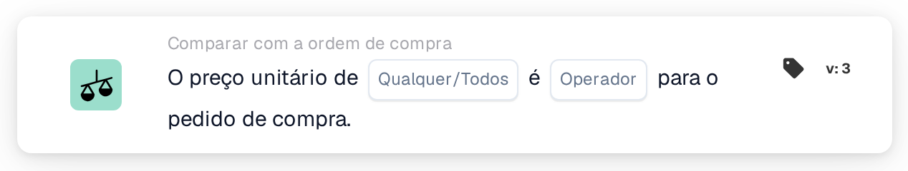
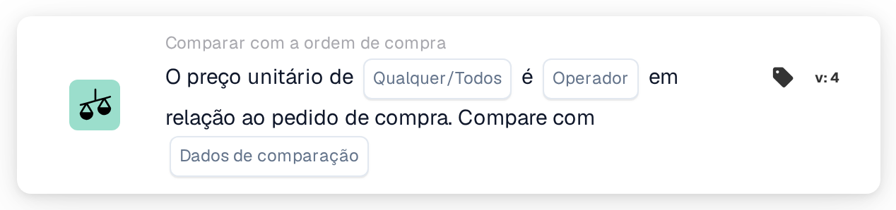
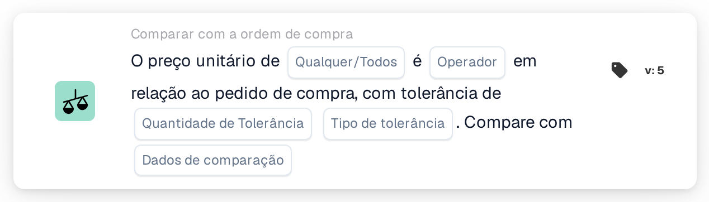

# Qualquer / todo o preço unitário é

<figure><figcaption>
Versão 2
</figcaption></figure>

<figure><figcaption>
Versão 3
</figcaption></figure>

<figure><figcaption>
Versão 4
</figcaption></figure>

<figure><figcaption>
Versão 5
</figcaption></figure>

## **Objetivo:**

Este cartão de fluxo de trabalho é usado para comparar o preço unitário de um documento com o preço unitário de um pedido de compra, garantindo que os preços estejam alinhados dentro dos níveis de tolerância definidos. A comparação pode desencadear ações caso o preço unitário não atenda às expectativas. **Versão 4** adiciona mais flexibilidade, permitindo que os usuários escolham diferentes entidades para comparação, proporcionando um nível mais profundo de controle sobre preços e processos de aquisição.

## **Componentes do cartão:**

1. **Qualquer / Todos:**
   * **Descrição**: Define se a condição se aplica a alguma ou todas as instâncias onde o preço unitário é comparado.
   * **Opções**:
     * **Any**: A condição é atendida se qualquer preço unitário atender à condição de comparação especificada.
     * **All**: A condição é atendida somente se todos os preços unitários atenderem à condição de comparação especificada.
2. **Operador:**
   * **Descrição**: Define a condição para comparar o preço unitário com o valor especificado.
   * **Opções**:
     * **Igual a (=)**: Verifica se o preço unitário corresponde ao valor especificado.
     * **Diferente de (≠)**: Garante que o preço unitário seja diferente do valor especificado.
     * **Maior que (>)**: Verifica se o preço unitário é maior que o valor especificado.
     * **Maior ou Igual (≥)**: Verifica se o preço unitário é maior ou igual ao valor especificado.
     * **Menor que (<)**: Verifica se o preço unitário é menor que o valor especificado.
     * **Menor ou Igual (≤)**: Verifica se o preço unitário é menor ou igual ao valor especificado.

## **Componentes adicionais na versão 4:**

**Tipo de comparação:**

* **Descrição**: Permite ao usuário escolher quais entidades serão comparadas além do preço unitário.
* **Opções**:
  * **Ordem de Compra para Documento**: Compara o preço unitário no pedido de compra com o preço unitário no documento.
  * **Recebido no documento**: Compara o valor do lado recebido derivado do pedido de compra conciliado com o valor do lado do documento.
  * **Ordem de compra a receber**: Compara o lado do pedido de compra com o valor derivado do lado recebido.

## **Funcionalidade:**

* **Avaliação da condição:** O sistema compara o preço unitário no documento com o preço unitário no pedido de compra (ou outra entidade selecionada, na versão 4) com base no operador selecionado. Se a comparação for verdadeira, o fluxo de trabalho prossegue de acordo com as próximas etapas, acionando a aprovação ou interrompendo o processo.
* **Execução de ação:**
  * **Condição Verdadeira**: Se a condição for avaliada como verdadeira (por exemplo, o preço unitário no documento é maior que o valor especificado), o fluxo de trabalho prosseguirá com a ação verdadeira (por exemplo, aprovação, processamento do documento).
  * **Condição Falsa**: Se a condição for avaliada como falsa (por exemplo, o preço unitário no documento não atende à comparação), o fluxo de trabalho não prosseguirá.

## **Instalação e configuração:**

* **Configuração da versão 3:** Os usuários configuram o cartão selecionando o preço unitário no documento, escolhendo o operador apropriado para definir como o preço unitário será comparado ao valor especificado e definindo o valor com o qual comparar. Além disso, os usuários selecionam se a condição se aplica a alguma ou a todas as instâncias da comparação de preços unitários.
* **Configuração da versão 4:** Na versão 4, os usuários têm a opção adicional de selecionar o tipo de comparação. Isto permite-lhes definir as entidades a comparar, como Ordem de Compra para Documento, Recebido para Documento ou Ordem de Compra para Recebido. Isto aumenta a flexibilidade do cartão para comparar preços unitários em cenários mais complexos.

## **Exemplo de cenário:**

*   **Exemplo da versão 3:**

    Uma fatura mostra um preço unitário de $ 50. O pedido de compra relacionado tem um preço unitário de US$ 45. O cartão compara os dois preços unitários usando o operador “Maior que”. Como o preço unitário no documento (US$ 50) é maior que o preço unitário no pedido de compra (US$ 45), o fluxo de trabalho acionará a condição verdadeira (por exemplo, enviar o documento para revisão).
* **Exemplo da versão 4:**\
  Uma fatura mostra um preço unitário de US$ 50 e o pedido de compra relacionado autorizou um preço unitário de US$ 45. Além disso, a quantidade recebida é de 60 unidades. O cartão compara a quantidade recebida com o preço unitário do documento através do operador “Maior que”. Como a quantidade recebida (60) é maior que o preço unitário (US$ 50), o fluxo de trabalho aciona a condição verdadeira e o documento é sinalizado para revisão adicional.

## **Conclusão:**

A versão 3 do cartão de fluxo de trabalho "Comparação de preços unitários" foi projetada para garantir que os preços unitários nos documentos estejam alinhados com os dos pedidos de compra, acionando ações com base nas condições definidas. A versão 4 amplia essa funcionalidade introduzindo opções de comparação mais complexas, como comparar pedidos de compra com documentos, quantidades recebidas com documentos e pedidos de compra com quantidades recebidas. Essa flexibilidade adicional permite que as organizações lidem com cenários de preços e compras mais sofisticados, melhorando o controle e a precisão em seus fluxos de trabalho.

## Versão 5 e direção de comparação

A versão 5 inclui Qualquer/Todos, operador, quantidade de tolerância, tipo de tolerância e seleção do lado de comparação. As versões mais recentes oferecem direções do documento, pedido de compra e comparações de dados recebidos. O lado de referência determina a base de uma tolerância percentual. Consulte [Versões de comparação de PO](../../cards-overview/po-comparison-versions-guide.md) para todas as seis opções, migração de cartões salvos e exemplos de teste.
