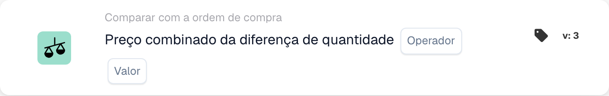
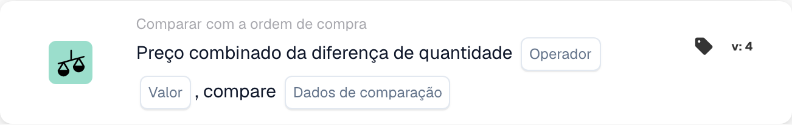

# Preço Combinado de Diferença de Quantidade

<figure><figcaption>
Campos do cartão na versão apresentada. Os campos ainda não estão configurados.
</figcaption></figure>

<figure><figcaption>
Campos do cartão na versão apresentada. Os campos ainda não estão configurados.
</figcaption></figure>

## **Objetivo**:

Este cartão de fluxo de trabalho avalia o preço combinado de uma diferença de quantidade, comparando-o com um valor especificado. Ajuda a automatizar ações com base em discrepâncias de preços e quantidades em documentos relacionados, melhorando os fluxos de trabalho de aquisição e recebimento. A **Versão 4** expande essa funcionalidade ao permitir comparações entre diferentes entidades como o pedido de compra, quantidades recebidas e o próprio documento, agregando mais flexibilidade e controle ao fluxo de trabalho.

## **Componentes do Cartão**:

1. **Operador**:
   * **Descrição:** A condição para comparar o preço combinado com um valor especificado.
   * **Opções:**
     * **Igual a (=)**: Verifica se o preço combinado corresponde ao valor especificado.
     * **Diferente de (≠)**: Garante que o preço combinado seja diferente do valor especificado.
     * **Maior que (>)**: Verifica se o preço combinado é maior que o valor especificado.
     * **Maior ou Igual (≥)**: Verifica se o preço combinado é maior ou igual ao valor especificado.
     * **Menor que (<)**: Verifica se o preço combinado é menor que o valor especificado.
     * **Menor ou Igual (≤)**: Verifica se o preço combinado é menor ou igual ao valor especificado
2. **Valor**:
   * **Descrição:** Especifica o valor com o qual o preço combinado do valor da quantidade será comparado.
   * **Detalhe:** O valor deve ser um valor numérico.

## **Componentes adicionais na versão 4**:

* **Tipo de comparação**: Seleciona as entidades a serem comparadas. As opções incluem:
  * **Ordem de Compra para Documento**: Compara as quantidades e preços entre o pedido de compra e o documento relacionado.
  * **Recebido no Documento**: Compara as quantidades recebidas com as quantidades no documento.
  * **Ordem de compra a receber**: Compara as quantidades do pedido de compra com as quantidades recebidas.

## **Funcionalidade**:

* **Avaliação da condição**: Calcula o preço combinado multiplicando a diferença de quantidade pelo preço por unidade e compara-o com o valor especificado usando o operador selecionado.\
  **Versão 4** adiciona a opção de comparar entidades adicionais com base na configuração do usuário, como pedido de compra para recebimento ou pedido de compra para documento.
* **Execução de ação**: Com base se o preço combinado atende à condição especificada, o fluxo de trabalho continuará com condições verdadeiras ou falsas para acionar ações ou interromper o fluxo de trabalho. **Versão 4** também permite uma execução de ação mais dinâmica, onde o tipo de condição (por exemplo, pedido de compra a ser recebido) influencia o próximo passo.

## **Instalação e Configuração**:

* **Versão 3**: O usuário configura o cartão selecionando os campos do documento para diferença de quantidade e preço unitário. A operadora é então escolhida para definir como o preço combinado será comparado ao valor especificado. Por fim, os usuários definem a condição de continuação (verdadeiro ou falso), que determina a próxima etapa do fluxo de trabalho.
* **Versão 4**: Além da configuração em **Versão 3**, os usuários têm uma opção adicional para configurar o **Tipo de comparação**. Isso define quais entidades serão comparadas, como **Ordem de Compra para Documento**, **Recebido para Documento** ou **Ordem de Compra para Recebido**.

## **Exemplo de cenário**:

* Uma fatura mostra 50 unidades de um produto a US$ 100 cada, totalizando US$ 5.000. O pedido de compra relacionado autorizou uma compra de US$ 4.500 por 45 unidades. A diferença de quantidade é de 5 unidades e o preço combinado da diferença é de US$ 500. O cartão compara a quantidade do pedido de compra (45 unidades) com a quantidade recebida (50 unidades) e verifica se o preço combinado é superior a US$ 400 (o valor especificado). Usando o operador **Maior que (>)**, o cartão identifica a discrepância e a sinaliza para revisão pela equipe financeira.

## **Conclusão**:

**A versão 3** do cartão de fluxo de trabalho "Preço combinado de diferença de quantidade" oferece uma abordagem direta para comparar discrepâncias de quantidade e acionar ações com base em limites de preço.\
**Versão 4** amplia esta funcionalidade permitindo comparações entre diferentes entidades (pedido de compra, recebido, documento), proporcionando mais flexibilidade e controle sobre o fluxo de trabalho. As organizações agora podem automatizar cenários mais complexos e impor um controle mais rígido sobre seus processos de aquisição e recebimento.

Consulte [direção de comparação, base de tolerância e versões de cartão salvo](../../cards-overview/po-comparison-versions-guide.md) antes de alterar os lados de comparação.
