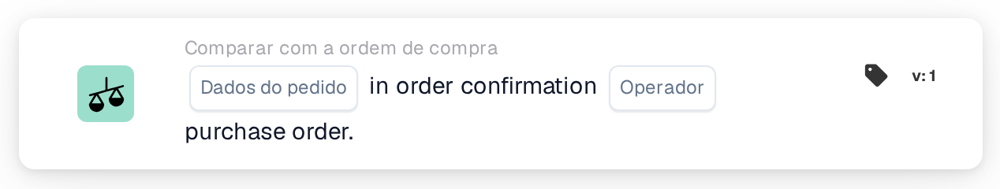
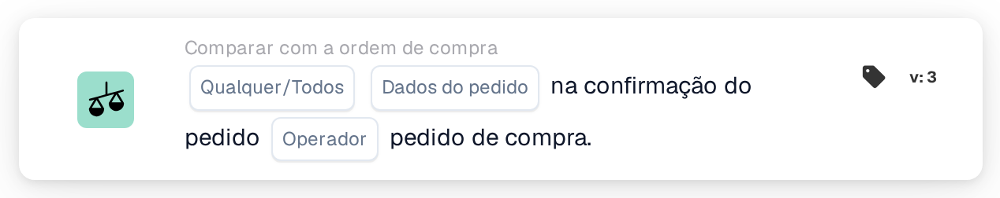
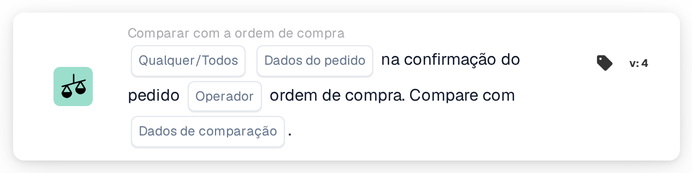

# Compare a confirmação do pedido com o pedido de compra

<figure><figcaption>
Versão 1
</figcaption></figure>

<figure><figcaption>
Versão 2
</figcaption></figure>

<figure><figcaption>
Versão 3
</figcaption></figure>

<figure><figcaption>
Versão 4
</figcaption></figure>

## Objetivo:

Este cartão DocBits foi projetado para comparar um campo de dados de pedido específico – como quantidade, desconto ou preço unitário – entre uma confirmação de pedido e um pedido de compra. Ao permitir uma comparação focada de um campo por vez, garante precisão na validação dos principais pontos de dados, mantendo a precisão do pedido. A **Versão 4** expande essa funcionalidade ao permitir comparações entre diferentes entidades como o pedido de compra, quantidades recebidas e o próprio documento, agregando mais flexibilidade e controle ao fluxo de trabalho.

## Componentes do Cartão:

1. **Qualquer/Todos**
   * **Descrição:** Determina se a condição se aplica a alguma ou todas as linhas na confirmação do pedido.\
     **Opções:**
     * **Qualquer**: A comparação será acionada se o valor do campo selecionado em qualquer linha da confirmação do pedido corresponder ao valor correspondente no pedido de compra.
     * **All**: A comparação será acionada somente se o valor do campo selecionado em todas as linhas da confirmação do pedido corresponder ao valor correspondente no pedido de compra.
2. **Campo de dados do pedido**
   * **Descrição**: Especifica o campo de dados a ser comparado entre a confirmação do pedido e o pedido de compra.
   * **Detalhe**: Os usuários podem selecionar um dos seguintes campos para comparação:
     * **Quantidade**: Compara a quantidade solicitada com a quantidade confirmada.
     * **Desconto**: Valida que o desconto na confirmação corresponde ao pedido de compra.
     * **Preço unitário**: Garante que o preço unitário na confirmação esteja alinhado com o pedido de compra.
3. **Operador**
   * **Descrição**: Define a condição aplicada à comparação do campo de dados selecionado.
   * **Opções**:
     * **Igual a (=)**: Confirma que o valor corresponde ao pedido de compra.
     * **Diferente (≠)**: Garante que o valor seja diferente do pedido de compra.
     * **Maior que (>)**: Verifica se o valor excede o valor do pedido de compra.
     * **Maior ou Igual (≥)**: Confirma que o valor é igual ou superior ao valor do pedido de compra.
     * **Menor que (<)**: Verifica se o valor está abaixo do valor do pedido de compra.
     * **Menor ou Igual (≤)**: Confirma que o valor é inferior ou igual ao valor do pedido de compra.

## **Componentes adicionais na versão 4**:

* **Tipo de comparação**: Seleciona as entidades a serem comparadas. As opções incluem:
  * **Ordem de Compra para Documento**: Compara os dados do pedido de compra com o documento relacionado.
  * **Recebido no Documento**: Compara os dados recebidos (por exemplo, quantidades recebidas) com o documento.
  * **Ordem de Compra a Receber**: Compara os dados do pedido de compra com as quantidades recebidas.

## Funcionalidade:

* **Comparação de campos**: O sistema compara o campo de dados do pedido selecionado (Preço unitário, Desconto ou Quantidade) da confirmação do pedido com o valor correspondente no pedido de compra.
* **Execução da ação**: Com base no resultado da comparação e na condição do operador, o cartão pode acionar ações de acompanhamento, como notificações ou alertas.

## Cenário de exemplo:

* Uma confirmação de pedido especifica um **preço unitário** de US$ 50, enquanto o pedido de compra indica US$ 45. Utilizando o operador “Maior que”, o cartão sinaliza a discrepância, permitindo que a equipe de compras resolva a questão antes do processamento.

## Conclusão:

Este cartão simplifica a validação de campos de dados de pedidos individuais, garantindo o cumprimento dos termos do pedido de compra. Ao isolar um campo de cada vez para comparação, ele oferece suporte a revisões direcionadas e prevenção de erros no processamento de pedidos.

Consulte [direção de comparação, base de tolerância e versões de cartão salvo](../../cards-overview/po-comparison-versions-guide.md) antes de alterar os lados de comparação.
