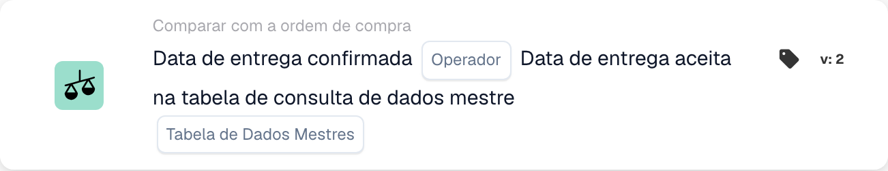

# Data de entrega confirmada

<figure><figcaption>
Campos do cartão na versão apresentada. Os campos ainda não estão configurados.
</figcaption></figure>

## **Propósito**

Este cartão de fluxo de trabalho foi concebido para verificar se as datas de entrega confirmadas em faturas ou documentos de envio estão alinhadas com as datas de entrega aceites definidas numa tabela de consulta de dados-mestre. Ao comparar estas datas, ajuda a garantir a conformidade com os calendários de entrega acordados e melhora a fiabilidade da cadeia de abastecimento.

## **Componentes do cartão**

1. **Operador**
   * **Descrição:** Define a condição para comparar a data de entrega confirmada com a data de entrega aceite.
   * **Opções:**
     * **Is:** Confirma que a data de entrega corresponde à data de entrega aceite nos dados-mestre.
     * **Não é:** Garante que a data de entrega não corresponde à data de entrega aceite nos dados-mestre.
2. **Pesquisa de tabela de dados mestre**
   * **Descrição:** Especifica a tabela de referência que contém as datas de entrega aceites para comparação.
   * **Detalhe:** A tabela é definida pelo parâmetro **Tabela de dados mestre** e pode incluir metadados adicionais, como números de encomenda ou regiões de entrega.

## **Funcionalidade**

* **Comparação de datas:** O sistema compara a data de entrega confirmada da fatura ou documento de envio com a data de entrega aceite na tabela de consulta de dados-mestre especificada.
* **Execução da ação:** Com base no resultado da comparação, o cartão pode acionar ações de seguimento, como notificações.

## **Configuração**

* Para configurar este cartão, os utilizadores selecionam o campo que representa a data de entrega confirmada no documento e especificam a tabela de consulta de dados-mestre que contém as datas de entrega aceites. É depois escolhido um operador para definir como as duas datas devem ser comparadas (por exemplo, **Is** ou **Não é**).

## **Exemplo de cenário**

* Uma fatura indica uma data de entrega confirmada de 10 de junho, enquanto a tabela de consulta de dados-mestre especifica uma data de entrega aceite de 15 de junho. Utilizando o operador **Não é**, o cartão assinala a discrepância para revisão, permitindo que a equipa de logística investigue a causa e ajuste os calendários em conformidade.

## **Conclusão**

O cartão de fluxo de trabalho **"Data de entrega confirmada vs. data de entrega aceita"** ajuda as organizações a manter a aderência aos calendários de entrega acordados ao automatizar a comparação entre datas de entrega confirmadas e aceites. Esta abordagem proativa à gestão de entregas melhora a eficiência operacional, reduz atrasos e promove uma melhor colaboração ao longo da cadeia de abastecimento.
