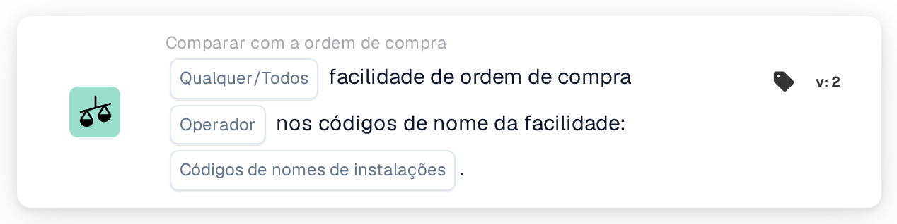

# Instalação da ordem de compra

<figure><figcaption>
Versão 2
</figcaption></figure>

## Propósito:

Este cartão de fluxo de trabalho verifica a instalação das ordens de compra associadas a um documento em relação a uma lista de códigos de instalação. Pode ser utilizado para tratar documentos de forma diferente consoante a instalação (localização) para a qual a encomenda foi feita, por exemplo para os encaminhar para a equipa responsável por essa instalação.

A correspondência da ordem de compra deverá ser executada antes deste cartão. Sem uma ordem de compra associada, o cartão comunica dados em falta.

## Componentes do cartão:

1. **Qualquer/Todos**
   * **Descrição:** Como os códigos de instalação das ordens de compra associadas são avaliados em relação à lista.
   * **Opções:**
     * **Qualquer:** Pelo menos uma ordem de compra associada cumpre o operador.
     * **Todos:** Cada ordem de compra associada com instalação cumpre o operador. Se não for definido nenhum valor, o cartão utiliza **Todos**.
2. **Operador**
   * **Descrição:** Se a instalação deverá estar na lista ou não.
   * **Opções:**
     * **É**
     * **Não é**
3. **Códigos de nomes de instalações**
   * **Descrição:** Os códigos de instalação com os quais a instalação da ordem de compra é comparada.
   * **Detalhe:** Podem ser introduzidos vários códigos, separados por vírgulas.

## Funcionalidade:

* **Avaliação da condição:** O cartão lê os números das ordens de compra associadas ao documento, carrega essas ordens de compra e recolhe a instalação (localização) de cada uma delas. As ordens de compra sem instalação são ignoradas. Os códigos de instalação recolhidos são depois comparados com os **Códigos de nomes de instalações** do cartão.
  * Um código de instalação conta como listado quando é igual, na íntegra, a um dos códigos introduzidos. As maiúsculas e minúsculas e os espaços à volta das entradas são ignorados, pelo que `wh01` corresponde a `WH01`, mas `WH` não corresponde a `WH01`.
  * Com **É**, uma ordem de compra cumpre a condição quando o seu código de instalação está listado. Com **Não é**, cumpre a condição quando o seu código de instalação não está listado.
  * Com **Qualquer**, a condição é cumprida se pelo menos uma ordem de compra a cumprir; com **Todos**, se cada ordem de compra com instalação a cumprir.
  * Se nenhuma das ordens de compra associadas tiver instalação, **Todos** é cumprido e **Qualquer** não.
* **Execução da ação:**
  * **Condição Verdadeira:**\
    Se a condição for cumprida, o fluxo de trabalho continua, por exemplo com um passo específico das instalações listadas.
  * **Condição Falsa:**\
    Se a condição não for cumprida, o fluxo de trabalho para com uma condição não satisfeita.
* **Dados em falta:** Se não forem introduzidos códigos de instalação no cartão, ou se o documento não tiver nenhuma ordem de compra associada, o cartão não avalia a condição e regista os dados em falta no registo do fluxo de trabalho.

## Configuração:

* O cartão pode ser adicionado como condição And após a correspondência da ordem de compra, a partir da categoria **Comparar com a ordem de compra**. Em seguida, podem ser definidos **Qualquer** ou **Todos**, o operador e os códigos de instalação, separados por vírgulas. As maiúsculas e minúsculas não importam, mas cada código deverá ser introduzido por completo, porque partes de um código não têm correspondência.
* Pode ser utilizado **Test Card** no menu do cartão do Workflow Builder para experimentar a configuração num documento existente. O registo do cartão lista as ordens de compra associadas, os códigos de instalação nelas encontrados e os códigos que não tiveram correspondência.

## Conclusão:

O cartão de fluxo de trabalho "Facility of Purchase Order" disponibiliza a instalação dos bens encomendados como condição do fluxo de trabalho. Isto permite que um único fluxo de trabalho trate de forma diferente documentos de instalações diferentes, com base nos dados da ordem de compra e não no que está impresso no documento.
