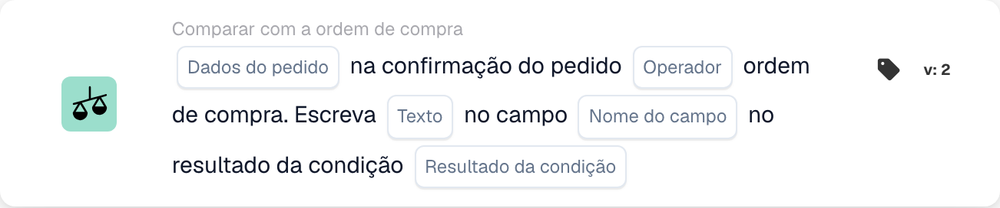
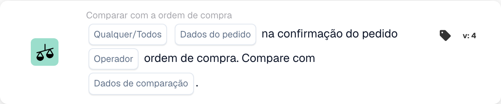

# Comparação entre confirmação de pedido e pedido de compra

Use **Comparar com a ordem de compra** no Workflow Builder quando uma confirmação de pedido precisar de ser verificada em relação ao respetivo pedido de compra. Adicione o cartão sob **E...**, depois escolha os dados do pedido, um operador e o que deve acontecer com o resultado. As capturas de tela abaixo mostram duas versões disponíveis do cartão na interface em português. Os campos ainda são marcadores de posição; configure-os para o seu próprio fluxo de trabalho antes de guardar.

## Escrever o resultado num campo

<figure><figcaption>
Campos do cartão na versão apresentada. Os campos ainda não estão configurados.
</figcaption></figure>

Escolha **Dados do pedido** na confirmação do pedido e um **Operador** para a comparação com o pedido de compra. Introduza o **Texto** a escrever, selecione o **Nome do campo** e escolha o **Resultado da condição** que deve acionar a escrita.

## Comparar os dados

<figure><figcaption>
Campos do cartão na versão apresentada. Os campos ainda não estão configurados.
</figcaption></figure>

Escolha **Qualquer/Todos** para decidir se uma ou todas as condições selecionadas devem corresponder. Depois selecione os **Dados do pedido**, o **Operador** e os **Dados de comparação** para a comparação com o pedido de compra.

Para os passos seguintes, veja [Fluxo de trabalho](../..) e [Comparar com a ordem de compra](.).

<!-- workflow-card-practical-example-20261021 -->

## Exemplo prático

**Quando usar:** Compare uma confirmação de pedido com seu pedido de compra vinculado.

**Configuração:** Utilize pedido de demonstração e confirmação com o mesmo fornecedor, referência de artigo e valores comparados. Selecione a direção de comparação pretendida e os campos que esta versão oferece.

**Resultado esperado e contra-exemplo:** A comparação correspondente é aprovada. Altere um valor de item comparado em um caso de teste separado e verifique se ele foi detectado; um pedido vinculado ausente é um problema de dados separado.

Esta é uma configuração ilustrativa e resultado esperado. Utilize campos, usuários e grupos configurados em sua organização de teste; não é uma afirmação de que este exemplo foi executado.
