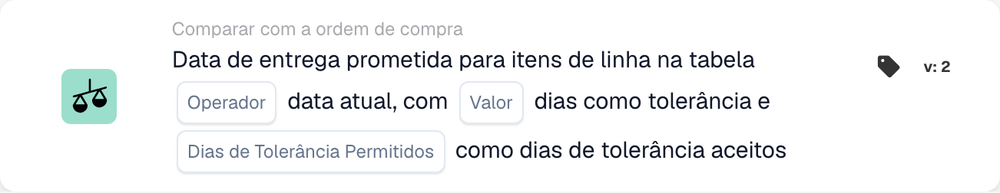
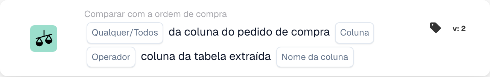
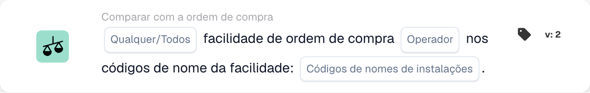
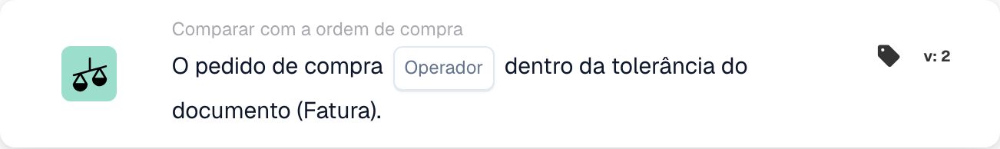
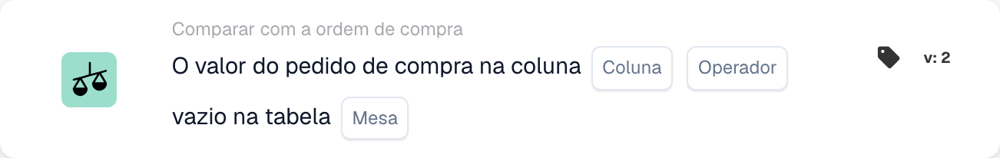
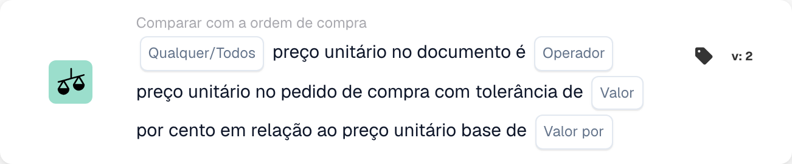
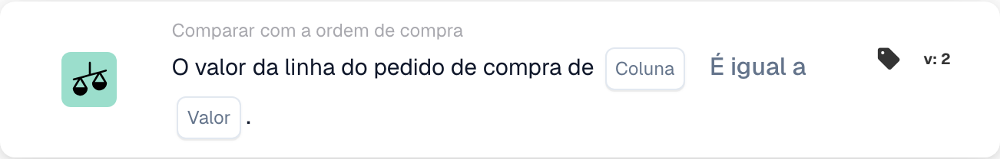

# Cartões correspondentes PO - Guia completo

## Cartões correspondentes de pedido de compra (PO) - Guia completo

**Estado:** Abrange 15 cartões de comparação de PO com cálculos detalhados

***

Os cartões de comparação de pedidos de compra nesta página vão para o grupo **E** do Workflow Builder — eles comparam os dados da fatura com o pedido de compra correspondente antes da execução das ações Então:

<figure><figcaption><p>Exemplo não guardado com cartões Quando, E e Então. Configure todos os campos antes da execução. Algumas etiquetas desta versão da interface ainda não estão traduzidas ou têm uma tradução incorreta. As explicações desta página usam os termos corretos; a imagem mostra a interface real.</p></figcaption></figure>

***

### 📌 Informações da versão

**Carta mais evoluída:** CONDITION\_DOC\_TO\_PO\_UNIT\_PRICE (5 versões, v5 mais recente) **Outras cartas complexas:** CONDITION\_OC\_TO\_PO\_ITEMS (v4), CONDITION\_LESS\_THAN\_TOLERANCE\_AS\_VALUE\_OF\_ORDERED\_QUANTITY (v4)

**Padrões de teclas:**

* **v2 → v3+:** Adição de parâmetros de tolerância para correspondência flexível
* **v3 → v4:** Adição de parâmetros do modo de comparação
* **v4 → v5:** Tolerância aprimorada com múltiplas unidades (%, EUR, $, etc.)

📖 [Histórico completo da versão](../../release.md) | [Versões e comportamento das cartas](../../cards-overview/card-versions-guide.md)

***

### Compreendendo a correspondência de PO

Quando você recebe uma fatura, ela deve corresponder ao Pedido de Compra (PO) feito anteriormente. Os cartões correspondentes do pedido de compra verificam automaticamente se os dados da fatura correspondem aos dados do pedido de compra.

**O panorama geral:**

```
PO Placed     Invoice Arrives     PO Matching     Decision
(€100)    →   (€103)          →   (Check if       → Approve/Reject
Qty: 100      Qty: 100            within tolerance)
```

***

## 1. Correspondência completa do pedido de compra

### Objetivo

Verifica se toda a fatura corresponde perfeitamente ao pedido ou dentro da tolerância

### Quando usar

* Antes de aprovar uma fatura
* Como uma verificação preliminar de qualidade
* Para identificar problemas precocemente

### Como funciona

O sistema compara:

* Quantidades de fatura versus quantidades de pedido
* Preços de fatura versus preços de PO
* Itens de fatura versus itens de pedido de compra
* Total da fatura versus total do pedido

### Resultado

* **TRUE** (correspondência completa): tudo corresponde, prossiga
* **FALSE** (Incompatibilidade): Algo não corresponde, precisa de revisão

### Exemplo

```
PO:
- Item ABC: Qty 100, Unit Price €50 = €5000
- Item XYZ: Qty 50, Unit Price €20 = €1000
- Total: €6000

Invoice:
- Item ABC: Qty 100, Unit Price €50 = €5000
- Item XYZ: Qty 50, Unit Price €20 = €1000
- Total: €6000

Result: ✅ FULL MATCH
```

***

## 2. Comparação de preços unitários (documento vs PO)

### Objetivo

Compara o preço unitário na fatura com o preço unitário no pedido

### Parâmetros

* **Tolerância de preço unitário**: Permitir variação até este valor
* **Tipo de tolerância**: Porcentagem (%) ou Absoluta (€/$)
* **Operador**: É igual a, é maior que, é menor que, etc.

### Como funciona (tolerância percentual)

**Fórmula:**

```
Variance % = |(Invoice Price - PO Price)| / PO Price × 100

Check: Is Variance % ≤ Tolerance %?
```

**Exemplo passo a passo:**

```
Step 1: Get prices
  PO Unit Price: €100.00
  Invoice Unit Price: €103.00

Step 2: Calculate difference
  Difference = |€103.00 - €100.00| = €3.00

Step 3: Calculate percentage
  Percentage = (€3.00 / €100.00) × 100 = 3%

Step 4: Check tolerance (5% allowed)
  Is 3% ≤ 5%? YES ✅

Result: PASS - Within tolerance
```

### Exemplos do mundo real

#### Exemplo 1: Pequeno Aumento (Aceito)

```
PO Price: €50.00
Invoice Price: €51.50
Tolerance: ±3%

Calculation:
  Variance = |(€51.50 - €50.00)| / €50.00 × 100
  Variance = €1.50 / €50.00 × 100 = 3%

Is 3% ≤ 3%? YES ✅ ACCEPT
```

#### Exemplo 2: Grande Aumento (Rejeitado)

```
PO Price: €50.00
Invoice Price: €55.00
Tolerance: ±3%

Calculation:
  Variance = |(€55.00 - €50.00)| / €50.00 × 100
  Variance = €5.00 / €50.00 × 100 = 10%

Is 10% ≤ 3%? NO ❌ REJECT - NEEDS REVIEW
```

#### Exemplo 3: Desconto (também verificado)

```
PO Price: €100.00
Invoice Price: €97.00
Tolerance: ±5%

Calculation:
  Variance = |(€97.00 - €100.00)| / €100.00 × 100
  Variance = €3.00 / €100.00 × 100 = 3%

Is 3% ≤ 5%? YES ✅ ACCEPT (Discount is within tolerance)
```

#### Exemplo 4: Tolerância de Valor Absoluto

```
PO Price: €10.00
Invoice Price: €10.50
Tolerance: ±€1.00 (absolute, not %)

Calculation:
  Variance = |€10.50 - €10.00| = €0.50

Is €0.50 ≤ €1.00? YES ✅ ACCEPT
```

### O que fazer com os resultados

**Se PASSAR ✅:**

* Continuar para a próxima verificação
* Ou aprovar fatura
* Ou prossiga com a exportação

**Se FALHAR ❌:**

* Sinalizar para revisão manual
* Peça explicação ao fornecedor
* Contate a equipe de compras
* Aprove com nota se for aceitável

***

## 3. Comparação de quantidades

### Objetivo

Verifica se a quantidade solicitada corresponde à quantidade faturada

### Parâmetros

* **Tolerância**: Quantidade ou % permitida para diferir
* **Operador**: Igual, Maior que, Menor que
* **Tipo de quantidade**: Pedido, Recebido, Aberto

### Exemplo de cálculo

**Tolerância percentual:**

```
Formula:
  Quantity Variance % = |(Invoice Qty - PO Qty)| / PO Qty × 100

Example:
  PO Quantity: 100 units
  Invoice Quantity: 103 units
  Tolerance: ±5%

  Variance = |(103 - 100)| / 100 × 100
  Variance = 3 / 100 × 100 = 3%

  Is 3% ≤ 5%? YES ✅ ACCEPT
```

**Tolerância absoluta:**

```
Formula:
  Quantity Variance = |Invoice Qty - PO Qty|

Example:
  PO Quantity: 100 units
  Invoice Quantity: 102 units
  Tolerance: ±5 units

  Variance = |102 - 100| = 2 units

  Is 2 units ≤ 5 units? YES ✅ ACCEPT
```

### Cenários do mundo real

#### Entrega excessiva (mais do que o pedido)

```
Ordered: 100 units
Invoiced: 110 units
Tolerance: ±5%

Variance = |(110-100)|/100 × 100 = 10%

Is 10% ≤ 5%? NO ❌

Decision: Contact supplier - more delivered than ordered
Possible reason: Error by supplier, partial shipment already received
```

#### Entrega insuficiente (menos do que o pedido)

```
Ordered: 100 units
Invoiced: 95 units
Tolerance: ±5%

Variance = |(95-100)|/100 × 100 = 5%

Is 5% ≤ 5%? YES ✅

Decision: Accept - within tolerance
Possible reason: Partial shipment, rest to follow
```

***

## 4. Preço Combinado de Diferença de Quantidade

### Objetivo

Quando a quantidade difere, calcula se a diferença total de preço é aceitável

### Por que isso é importante

```
Scenario: You ordered 100 units but received 110
- Quantity is 10% over (bad)
- BUT: You're only charged for 10% extra
- Combined effect might be acceptable
```

### Cálculo

**Fórmula:**

```
Combined Variance = Quantity Variance × Price Variance

If both are within tolerance, combined is usually acceptable
```

**Exemplo:**

```
PO:
- Unit Price: €100
- Quantity: 100
- Total: €10,000

Invoice:
- Unit Price: €102 (2% higher)
- Quantity: 105 (5% higher)
- Total: €10,710

Analysis:
- Price variance: 2% ✅
- Quantity variance: 5% ✅
- Combined effect: 1.02 × 1.05 = 1.071 = 7.1% total increase

Is combined variance acceptable? Usually YES ✅
```

***

## 5. Comparação de ID do item/número do item do fornecedor

### Objetivo

Verifica se os itens da fatura correspondem aos itens do pedido

### Como funciona

**Correspondência exata (mais simples):**

```
PO Item ID: ABC-123
Invoice Item ID: ABC-123
Result: ✅ MATCH
```

**Número do item do fornecedor (mais comum):**

```
PO Item: ABC-123 (Our internal code)
Supplier Item: SUPP-456 (Their code for same item)
System matches these as same item
Result: ✅ MATCH
```

### Cenário: e se não corresponder?

```
PO Item: ABC-123 (Copper Wire, 2mm)
Invoice Item: ABC-124 (Steel Wire, 2mm)

Result: ❌ NO MATCH

Actions:
1. Is this a substitution? Check with procurement
2. Is this an error? Contact supplier
3. Is the description similar? Verify manually
```

***

## 6. Verificação do tipo de pedido

### Objetivo

Verifica se o tipo de pedido de compra está correto

### Tipos de pedidos

* **Pedido padrão**: Compra normal
* **Pedido urgente**: Urgente, pode ter prêmio
* **Acordo Quadro**: Contrato de longo prazo
* **Pedido geral**: Contrato sem termo
* **Consignação**: Você não paga até usar

### Verifique o exemplo

```
PO Order Type: Standard Order
Invoice Order Type: Standard Order
Result: ✅ MATCH

If mismatch: Could affect terms, payment, pricing
```

***

## 7. Verificação da data de entrega

### Objetivo

Verifica se a data de entrega corresponde à data prometida no pedido

### Cálculo

**Entrega atrasada:**

```
Formula:
  Days Late = Invoice Delivery Date - PO Promised Date

Example:
  PO Promised: 2025-10-15
  Actual Delivery: 2025-10-22
  Days Late = 7 days

If tolerance is ±3 days:
  Is 7 ≤ 3? NO ❌ LATE
```

**Entrega antecipada:**

```
Formula:
  Days Early = PO Promised Date - Invoice Delivery Date

Example:
  PO Promised: 2025-10-15
  Actual Delivery: 2025-10-10
  Days Early = 5 days

Early delivery is usually OK ✅
Unless you need it at specific time
```

### Configurações de tolerância

```
±3 days: Allow 3 days late or early
±5 days: Allow up to 5 days variance
0 days: Must match exactly
```

***

## 8. Verificação de cobrança (impostos, frete, etc.)

### Objetivo

Verifica se os encargos adicionais (impostos, frete, manuseio) correspondem ao pedido

### Encargos Comuns

```
- Shipping: €50
- Handling: €10
- Packaging: €5
- Insurance: €15
- Taxes: €300
```

### Cálculo

**Exemplo: Verificação de taxa de envio**

```
PO Shipping: €50.00
Invoice Shipping: €51.00
Tolerance: ±3%

Variance = |€51.00 - €50.00| / €50.00 × 100 = 2%

Is 2% ≤ 3%? YES ✅ ACCEPT
```

**Exemplo: Múltiplas Cargas**

```
PO Total Charges:
  - Shipping: €50
  - Taxes: €300
  - Handling: €10
  Total: €360

Invoice Total Charges:
  - Shipping: €50
  - Taxes: €312 (11% tax)
  - Handling: €10
  Total: €372

Difference: €12
Check if within tolerance ✅ or ❌
```

***

## 9. Verificação Fiscal

### Objetivo

Verifica se os valores dos impostos foram calculados corretamente

### Cálculo

**Fórmula:**

```
Tax Amount = Subtotal × Tax Rate

Example:
  Subtotal: €1000
  Tax Rate: 19%
  Expected Tax: €1000 × 0.19 = €190

Invoice Tax: €190
Match? YES ✅
```

**Problemas Comuns:**

```
1. Tax rate changed (region-based)
2. Tax applied to wrong amount (before/after discounts)
3. Multiple tax rates (some items 7%, others 19%)
4. Tax exempt items (0% tax)
```

**Exemplo: Tributação Multitaxa**

```
Item A: €100 @ 19% tax = €119
Item B: €100 @ 7% tax = €107
Item C: €100 @ 0% tax = €100
Total: €326

Invoice shows €325 (€1 error)

Check: Within tolerance or needs attention?
```

***

## 10. Correspondência de instalação/centro de custo

### Objetivo

Garante que a fatura seja para a instalação/centro de custo correto

### Exemplo

```
PO is for:
- Facility: Berlin Plant
- Cost Center: CC-2025

Invoice should have:
- Facility: Berlin Plant ✅
- Cost Center: CC-2025 ✅

If different facility: May need different approval
```

***

## 11. Validação do status do fornecedor

### Objetivo

Verifica se o fornecedor ainda está aprovado/ativo

### Tipos de status

```
✅ ACTIVE: Approved, can do business
⚠️ ON HOLD: Temporarily blocked
❌ INACTIVE: No longer doing business
⚠️ CONDITIONAL: Only for specific items
```

### Verifique o exemplo

```
Supplier: ABC Corp
Status in Database: ACTIVE
Status when creating PO: ACTIVE
Status when invoice arrives: INACTIVE

Alert: Supplier status changed! Investigate why.
```

***

## Qual tolerância devo usar?

### Tolerâncias rigorosas (menor risco, mais trabalho manual)

```
Use for:
- High-value items
- Items where exactness matters
- Regulated industries

Settings:
- Unit Price: ±1%
- Quantity: ±1%
- Delivery Date: ±1 day
- Charges: ±1%
```

### Tolerâncias moderadas (equilibradas)

```
Use for:
- Most business transactions
- Standard items
- Normal purchasing

Settings:
- Unit Price: ±3-5%
- Quantity: ±3-5%
- Delivery Date: ±3 days
- Charges: ±5%
```

### Tolerâncias flexíveis (maior risco, menos trabalho manual)

```
Use for:
- Low-value items
- Bulk purchases
- Supplier agreements with flexibility

Settings:
- Unit Price: ±10%
- Quantity: ±10%
- Delivery Date: ±7 days
- Charges: ±10%
```

***

## Exemplo de fluxo de trabalho de correspondência de pedido de compra

```
Invoice Arrives
    ↓
Condition: "Is amount > €5000?" → YES
    ↓
Check: Full Match? → NO (10% price difference)
    ↓
Check: Unit Price within 5%? → NO (12% difference)
    ↓
Check: Quantity within 5%? → YES (2% difference)
    ↓
Decision: FAIL - Price variance too high
    ↓
Flag for: Manual review / Buyer approval
    ↓
Wait for: Buyer comment
    ↓
If Approved: Continue to Export
If Rejected: Return to Supplier
```

***

## Solução de problemas de correspondência de pedido de compra

### "PO não encontrado"

```
Cause: Invoice PO number doesn't exist in system
Fix:
1. Verify PO number spelling
2. Check if PO was created
3. Verify PO is in correct organization
4. Ask supplier for PO reference
```

### "Itens não correspondem"

```
Cause: Invoice items are different from PO items
Possible Reasons:
1. Substitution approved by procurement
2. Different item numbers for same item
3. Error by supplier
Fix: Contact procurement or supplier
```

### "Preço superior ao PO"

```
Cause: Invoice price > PO price
Possible Reasons:
1. Price increase approved
2. Supplier error
3. Currency difference
4. Additional services included
Fix: Verify with procurement
```

### "Data de entrega errada"

```
Cause: Invoice dated after promised delivery
Possible Reasons:
1. Shipment was delayed
2. Receiving date different from invoice date
3. Partial shipment
Fix: Check shipping documents or contact supplier
```

***

## Tabela Resumo

| Cartão           | O que verifica        | Cálculo Principal     | Tolerância Comum |
| -------------- | --------------------- | -------------------- | ---------------- |
| Partida completa     | Tudo            | Todas as verificações           | Varia           |
| Preço unitário     | Preço por unidade        | % ou € diferença    | ±3-5%            |
| Quantidade       | Quantidade encomendada        | % ou diferença unitária | ±3-5%            |
| Preço Combinado | Total com alteração de quantidade | Quantidade × Preço          | ±5-10%           |
| ID do item        | Itens certos           | Correspondência de strings         | Exato            |
| Tipo de pedido     | Tipo de compra      | Correspondência de strings         | Exato            |
| Data de entrega  | Quando chegou          | Diferença do dia       | ±3 dias          |
| Encargos        | Taxas extras            | % ou € diferença    | ±5%              |
| Imposto            | Valor do imposto            | Cálculo de % de imposto    | ±1%              |
| Instalação       | Centro de custo           | Correspondência de strings         | Exato            |
| Fornecedor       | Aprovado?             | Verificação de status         | Somente ativo      |

***

## Documentação Relacionada

* Consulte o guia "Validação de fatura" para obter o fluxo de trabalho completo
* Consulte "Configurações de tolerância" para valores recomendados por setor
* Consulte "Tratamento de exceções" para saber o que fazer com falhas
* Entre em contato com sua equipe de compras para políticas de tolerância específicas

<!-- workflow-card-example-condition_promised_delivery_date_to_current-20261021 -->

### Data de entrega prometida em relação à data de referência

<figure><figcaption><p>Campos do cartão na versão apresentada. Os campos ainda não estão configurados.</p></figcaption></figure>

`CONDITION_PROMISED_DELIVERY_DATE_TO_CURRENT` · versão 2

Suponha uma data de referência de `2026-10-21` e uma data prometida de entrega da linha de `2026-10-23`. Selecione a comparação posterior e a tolerância de dia zero. A data futura satisfaz essa comparação; `2026-10-20` não. Configure deliberadamente as opções Qualquer/Todos e dias de tolerância aceitos e teste uma data ausente separadamente.

<!-- workflow-card-example-condition_po_extracted_table_column-20261021 -->

### Coluna de pedido de compra em relação a uma coluna extraída

<figure><figcaption><p>Campos do cartão na versão apresentada. Os campos ainda não estão configurados.</p></figcaption></figure>

`CONDITION_PO_EXTRACTED_TABLE_COLUMN` · versão 2

Compare a coluna do artigo PO correspondente com a coluna extraída `article_number`, usando igualdade e Todos. Valores correspondentes `DEMO-A` aprovados; um valor extraído `DEMO-B` falha. Selecione uma tabela de consulta somente quando for necessária uma substituição documentada de ID por valor; verifique esse mapeamento antes de comparar.

<!-- workflow-card-example-condition_check_facility_in_po-20261021 -->

### Facilidades de ordem de compra permitidas

<figure><figcaption><p>Campos do cartão na versão apresentada. Os campos ainda não estão configurados.</p></figcaption></figure>

`CONDITION_CHECK_FACILITY_IN_PO` · versão 2

Selecione Tudo, a comparação está em uso e o código de recurso configurado `DEMO-NORTH`. Linhas PO correspondentes nessa instalação passam; uma linha em `DEMO-SOUTH` falha. Use códigos de instalação dos dados do pedido de compra em vez de assumir que um rótulo de exibição é o seu código.

<!-- workflow-card-example-condition_purchase_order_full_match-20261021 -->

### Concluir correspondência do pedido de compra

<figure><figcaption><p>Campos do cartão na versão apresentada. Os campos ainda não estão configurados.</p></figcaption></figure>

`CONDITION_PURCHASE_ORDER_FULL_MATCH` · versão 2

Use uma fatura de demonstração e um pedido de compra totalmente combinados com quantidade `2` e preço unitário `100` em ambos os lados e tolerâncias de quantidade/preço configuradas. Selecione a condição de correspondência completa: ela é aprovada. Depois teste um preço fora da tolerância configurada. Dados de comparação ausentes ou um pedido de compra ausente não representam uma correspondência completa bem-sucedida. Uma nota de entrega tem uma comparação apenas de quantidade; não presuma que as regras de preço da fatura se aplicam a ele.

<!-- workflow-card-example-condition_po_update_empty_column_check-20261021 -->

### Coluna vazia do banco de dados de pedidos de compra

<figure><figcaption><p>Campos do cartão na versão apresentada. Os campos ainda não estão configurados. Algumas etiquetas desta versão da interface ainda não estão traduzidas ou têm uma tradução incorreta. As explicações desta página usam os termos corretos; a imagem mostra a interface real.</p></figcaption></figure>

`CONDITION_PO_UPDATE_EMPTY_COLUMN_CHECK` · versão 2

Selecione uma tabela e coluna de PO válida oferecida pelo cartão e pelo operador está vazio. Para um registro de pedido de compra correspondente existente com um valor em branco, a condição é aprovada; um valor preenchido falha. Verifique primeiro a referência do pedido de compra e o mapeamento de tabela/coluna. O booleano `false` ainda é um valor booleano atual; um registro de pedido de compra ausente é um erro de dados separado.

<!-- workflow-card-example-condition_compare_unit_price_percent_per-20261021 -->

### Tolerância percentual por base de preço

<figure><figcaption><p>Campos do cartão na versão apresentada. Os campos ainda não estão configurados.</p></figcaption></figure>

`CONDITION_COMPARE_UNIT_PRICE_PERCENT_PER` · versão 2

Exemplo: preço unitário do pedido `200`, preço base `100` e tolerância configurada `1` produzem uma taxa efetiva de `(200 / 100) * (1 / 100) = 0.02` ou `2%`. A banda de comparação é `196–204`. A igualdade dentro da tolerância aceita um preço de documento de `203` e rejeita `210`. Não presuma que este cartão equivale a uma tolerância fixa de 1%.

<!-- workflow-card-example-condition_compare_po_line_value-20261021 -->

### Valor da linha da ordem de compra em relação a uma referência

<figure><figcaption><p>Campos do cartão na versão apresentada. Os campos ainda não estão configurados.</p></figcaption></figure>

`CONDITION_COMPARE_PO_LINE_VALUE` · versão 2

Selecione a coluna PO correspondente `item_number`, igualdade e valor `DEMO-A`. Uma linha com `DEMO-A` passa; `DEMO-B` falha. Use apenas operadores suportados para o tipo de dados selecionado e teste os dados de linhas correspondentes ausentes separadamente.
