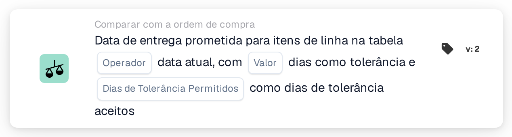

# Data de entrega prometida para itens de linha na tabela com data de entrega prometida

<figure><figcaption>
Versão 2
</figcaption></figure>

A forma como a janela de tolerância é calculada, com exemplos como "hoje ou amanhã", é explicada em [Date Tolerances](../../date-tolerances.md).

## Propósito:

Este cartão de fluxo de trabalho foi concebido para validar a **data de entrega prometida das linhas de itens** face à **data de entrega prometida na ordem de compra**, utilizando operadores de comparação e regras de tolerância configuráveis. Permite que os fluxos de trabalho detetem automaticamente datas de entrega conformes, antecipadas ou atrasadas e reajam em conformidade.

## Componentes do cartão:

1. **Operador**
   * **Descrição:**\
     Define como a data de entrega prometida da linha de item é comparada com a data de entrega prometida da ordem de compra.
   * **Opções:**
     * **Igual a (=):** A data da linha de item tem de estar dentro da janela de tolerância.
     * **Não é igual (≠):** A data da linha de item tem de estar fora da janela de tolerância.
     * **Maior que (>):** A data da linha de item tem de ser posterior à janela de tolerância.
     * **Maior ou Igual (≥):** A data da linha de item tem de ser igual ou posterior ao início da janela de tolerância.
     * **Menor que (<):** A data da linha de item tem de ser anterior à janela de tolerância.
     * **Menor ou igual (≤):** A data da linha de item tem de ser igual ou anterior ao fim da janela de tolerância. 
2. **Dias de tolerância**
   * **Descrição:**\
     Especifica o número de dias usado para calcular a janela de tolerância aceitável em torno da data de entrega prometida da ordem de compra.
   * **Detalhe:**\
     Este valor é um número inteiro e define quantos dias antes e depois da data da ordem de compra são considerados durante a validação. 
3. **Dias de tolerância permitidos**
   * **Descrição:**\
     Define quais os dias da semana que são contabilizados ao calcular os dias de tolerância.
   * **Detalhe:**\
     Os utilizadores podem selecionar dias da semana específicos (por exemplo, de segunda a sexta-feira). Apenas os dias selecionados são incluídos ao calcular a janela de tolerância.

### Funcionalidade:

* **Avaliação da condição:** O sistema calcula uma janela de tolerância em torno da data de entrega prometida da ordem de compra com base nos **Dias de tolerância** e **Dias de tolerância permitidos** configurados.\
  A data de entrega prometida de cada linha de item é então comparada com esta janela utilizando o operador selecionado.
* Execução da ação:
  * **Condição Verdadeira:** Se a diferença da data de entrega estiver dentro do intervalo de tolerância e corresponder à condição definida pelo operador, o fluxo de trabalho prossegue.
  * **Condição Falsa:** Se a condição não for cumprida, o fluxo de trabalho não continuará.

### Configuração:

* Selecione o operador de comparação adequado.
* Introduza o número de dias de tolerância.
* Escolha quais os dias da semana que devem ser contabilizados como dias de tolerância.

### Conclusão:

O cartão de fluxo de trabalho **Comparar com pedido de compra – data de entrega prometida para itens de linha** oferece uma forma flexível de aplicar regras de datas de entrega. Ao combinar operadores com um tratamento de tolerância sensível aos dias da semana, permite a validação precisa dos compromissos de entrega, reduzindo ao mesmo tempo as verificações manuais e as exceções.
