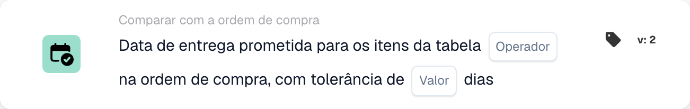

# Data de entrega prometida no pedido de compra

<figure><figcaption>
Campos do cartão na versão apresentada. Os campos ainda não estão configurados.
</figcaption></figure>

## **Propósito**

Este cartão DocBits foi concebido para facilitar a comparação precisa das datas de entrega prometidas nas ordens de compra com as datas de entrega especificadas para as linhas de itens numa tabela. Ao integrar um valor de tolerância, o cartão assegura flexibilidade na monitorização dos prazos de entrega, ajudando a manter a precisão do planeamento de inventário e a satisfação do cliente.

## **Componentes do cartão**

1. **Operador**
   * **Descrição:** Define a condição aplicada para comparar as datas de entrega.
   * **Opções:**
     * **Igual a (=):** Verifica se a data de entrega prometida na linha de item corresponde à data de entrega da ordem de compra.
     * **Diferente (≠):** Garante que a data de entrega prometida na linha de item não corresponde à data na ordem de compra.
     * **Maior que (>):** Verifica se a data de entrega prometida da linha de item é posterior à data de entrega da ordem de compra.
     * **Maior ou Igual (≥):** Verifica se a data de entrega prometida da linha de item é igual ou posterior à data de entrega da ordem de compra.
     * **Less Than (<):** Confirma se a data de entrega prometida da linha de item é anterior à data de entrega da ordem de compra.
     * **Menor ou igual (≤):** Valida se a data de entrega prometida da linha de item é igual ou anterior à data de entrega da ordem de compra.
2. **Valor**
   * **Descrição:** Especifica uma margem de erro admissível na comparação das datas de entrega.
   * **Detalhe:** Os utilizadores definem o número de dias em que a data de entrega da linha de item pode diferir da data de entrega prometida.

## **Funcionalidade**

* **Avaliação da condição:**\
  O cartão calcula a diferença entre a data de entrega prometida da ordem de compra e as datas de entrega das linhas de itens na tabela. O operador selecionado é depois aplicado para determinar se a condição é cumprida.
* **Execução da ação:**
  * **Condição Verdadeira:** Se a diferença da data de entrega estiver dentro do intervalo de tolerância e corresponder à condição definida pelo operador, o fluxo de trabalho prossegue.
  * **Condição Falsa:** Se a condição não for cumprida, o fluxo de trabalho não continuará.

## **Configuração**

* O operador é selecionado para definir a condição de comparação desejada, como igual a, superior a ou inferior a. Por fim, os utilizadores especificam um valor de tolerância em dias, que permite pequenas variações na comparação sem acionar alertas.

## **Exemplo de cenário**

* Uma ordem de compra especifica uma data de entrega prometida de 1 de dezembro. Uma linha de item na tabela tem uma data de entrega prometida de 3 de dezembro. Com um valor de tolerância definido em 2 dias e o operador **Equals (≥)** selecionado, o cartão considera a data de entrega dentro do intervalo aceitável. Não é acionado qualquer alerta, assegurando que pequenas variações são toleradas sem perturbar as operações.

## **Conclusão**

O cartão "Promised Delivery Date Comparison" ajuda a simplificar as operações da cadeia de abastecimento ao permitir uma monitorização precisa dos prazos de entrega. Com a sua capacidade de incorporar tolerâncias e operadores de comparação flexíveis, assegura a aderência às expectativas de entrega, evitando alertas desnecessários para pequenos desvios. Isto melhora a gestão de fornecedores e a eficiência global do fluxo de trabalho.
