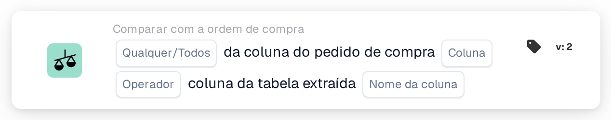
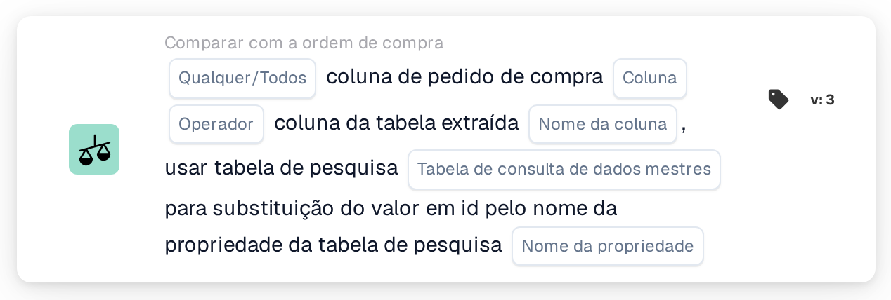

# Coluna da ordem de compra e coluna da tabela extraída

<figure><figcaption>
Versão 2
</figcaption></figure>

<figure><figcaption>
Versão 3
</figcaption></figure>

## Propósito:

Este cartão de fluxo de trabalho compara uma coluna das linhas da ordem de compra associadas com uma coluna da tabela de itens de linha extraída do documento. Para cada linha do documento que a correspondência da ordem de compra emparelhou com uma linha da ordem de compra, o valor da coluna da ordem de compra selecionada é comparado com o valor da coluna da tabela selecionada nessa linha. Os resultados individuais são depois combinados, através da definição **Qualquer/Todos**, no único resultado do cartão.

A versão 3 pode, adicionalmente, traduzir o valor da ordem de compra através de uma tabela de consulta de dados mestres antes da comparação, o que ajuda quando a ordem de compra e o documento utilizam códigos diferentes para a mesma coisa, por exemplo códigos de unidade diferentes.

A correspondência da ordem de compra deverá ser executada antes deste cartão. Sem uma ordem de compra associada, o cartão comunica dados em falta.

## Componentes do cartão:

1. **Qualquer/Todos**
   * **Descrição:** Como as comparações das linhas individuais são combinadas no resultado do cartão.
   * **Opções:**
     * **Qualquer:** Pelo menos uma linha comparada satisfaz a condição.
     * **Todos:** Cada linha comparada satisfaz a condição. Se não for definido nenhum valor, o cartão utiliza **Todos**.
2. **Coluna**
   * **Descrição:** A coluna da linha da ordem de compra cujo valor é comparado.
   * **Detalhe:** O valor é lido da linha da ordem de compra que foi associada à linha do documento.
3. **Operador**
   * **Descrição:** Como o valor da ordem de compra é comparado com o valor do documento. O valor da ordem de compra está do lado esquerdo da comparação, pelo que **Maior que** significa que o valor da ordem de compra é maior do que o valor do documento.
   * **Opções:**
     * **É igual a**
     * **Não é igual a**
     * **Maior que**
     * **Maior ou igual**
     * **Menor que**
     * **Menor ou igual**
4. **Nome da coluna**
   * **Descrição:** A coluna da tabela extraída do documento que é comparada com a coluna da ordem de compra.
   * **Detalhe:** O cartão utiliza a primeira tabela extraída do documento.
5. **Tabela de consulta de dados mestres (apenas versão 3)**
   * **Descrição:** Uma tabela de consulta opcional utilizada para traduzir o valor da ordem de compra antes da comparação.
   * **Detalhe:** O valor da ordem de compra, convertido em maiúsculas, é procurado na propriedade **codevalue** da tabela de consulta. Se for encontrado um registo e este tiver um valor para o **Nome da propriedade** selecionado, o valor da ordem de compra é substituído pelo valor limpo dessa propriedade. Se não for encontrado nenhum registo ou nenhum valor, é utilizado o valor da ordem de compra em maiúsculas. O valor do documento não é traduzido.
6. **Nome da propriedade (apenas versão 3)**
   * **Descrição:** A propriedade do registo da tabela de consulta cujo valor substitui o valor da ordem de compra.
   * **Detalhe:** **Tabela de consulta de dados mestres** e **Nome da propriedade** podem ambos ficar vazios; nesse caso, o cartão compara os valores sem tradução. Se apenas um dos dois estiver definido, o cartão comunica dados em falta.

## Funcionalidade:

* **Avaliação da condição:** Para cada linha da ordem de compra associada, o cartão encontra a linha da tabela do documento (ou, na versão 3, as linhas) emparelhada com ela e compara os dois valores com o operador selecionado.
  * Se ambos os valores forem números, são comparados como números.
  * Caso contrário, são comparados como texto. Com **É igual a**, as diferenças entre maiúsculas e minúsculas não contam. Na versão 3, ambos os valores são convertidos em maiúsculas antes da comparação; um valor obtido da tabela de consulta é utilizado tal como está aí guardado. Os operadores **Maior** e **Menor** comparam texto pela simples ordem dos caracteres, pelo que são úteis sobretudo para colunas numéricas.
* **Execução da ação:**
  * **Condição Verdadeira:**\
    Com **Todos**, cada linha comparada satisfaz o operador; com **Qualquer**, pelo menos uma satisfaz. O fluxo de trabalho continua.
  * **Condição Falsa:**\
    Se o resultado combinado não for cumprido, o fluxo de trabalho para com uma condição não satisfeita.
* **Dados em falta:** O cartão não avalia a condição e comunica dados em falta no registo do fluxo de trabalho quando:
  * o documento não tem nenhuma ordem de compra associada, ou os dados de uma ordem de compra associada não estão disponíveis,
  * o documento não tem nenhuma tabela extraída,
  * a coluna da ordem de compra de uma linha comparada está vazia (um valor numérico de 0 também conta como vazio),
  * a coluna da tabela de uma linha comparada está vazia ou não existe,
  * não foi possível comparar nenhuma linha,
  * uma entrada obrigatória não está definida (na versão 3, também quando apenas uma das duas entradas de consulta está definida).

## Configuração:

* O cartão pode ser adicionado como condição And após a correspondência da ordem de compra, a partir da categoria **Comparar com a ordem de compra**. Em seguida, podem ser selecionados **Qualquer/Todos**, a **Coluna** da ordem de compra, o **Operador** e o **Nome da coluna** da tabela do documento. Na versão 3, podem ser acrescentados uma **Tabela de consulta de dados mestres** e um **Nome da propriedade** quando a ordem de compra utiliza códigos diferentes dos do documento.
* Para verificar uma configuração, pode ser utilizado **Test Card** no menu do cartão do Workflow Builder num documento existente. O registo do cartão lista cada comparação com ambos os valores e o respetivo resultado.

## Conclusão:

O cartão de fluxo de trabalho "Purchase Order Column and Extracted Table Column" verifica uma única coluna de itens de linha em relação à ordem de compra associada, linha a linha. Pode ser utilizado para qualquer coluna que exista em ambos os lados, e a versão 3 abrange também os casos em que os dois lados utilizam códigos diferentes para o mesmo valor.
