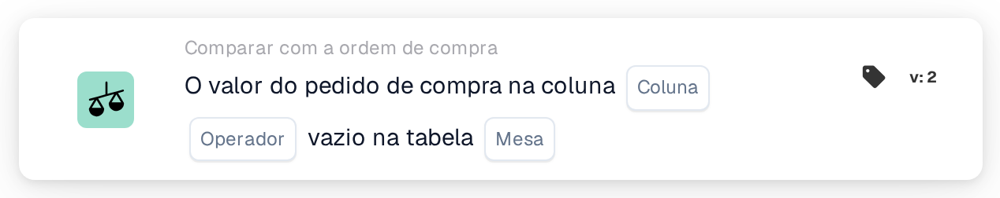

# Coluna da ordem de compra vazia

<figure><figcaption>
Versão 2
</figcaption></figure>

## Propósito:

Este cartão de fluxo de trabalho verifica se uma coluna dos dados da ordem de compra está vazia. Analisa diretamente a ordem de compra guardada, as suas linhas ou os seus encargos distribuídos, e pode ser utilizado, por exemplo, para reter documentos cuja ordem de compra não tenha informações de que dependem os passos seguintes.

## Componentes do cartão:

1. **Coluna**
   * **Descrição:** A coluna da ordem de compra que é verificada.
   * **Detalhe:** A lista contém as colunas do cabeçalho da ordem de compra, das linhas da ordem de compra e dos encargos distribuídos, por exemplo **ID do fornecedor**, **Preço unitário**, **Quantidade** ou **Tipo de cobrança**. A coluna deverá pertencer à tabela selecionada em **Mesa**.
2. **Operador**
   * **Descrição:** Se a coluna deverá estar vazia ou não.
   * **Opções:**
     * **É:** A condição é cumprida se a coluna estiver vazia em pelo menos um registo verificado.
     * **Não é:** A condição é cumprida se a coluna tiver um valor em todos os registos verificados.
3. **Mesa**
   * **Descrição:** A tabela da ordem de compra a partir da qual a coluna é lida.
   * **Opções:**
     * **Ordem de compra:** O cabeçalho da ordem de compra (um registo).
     * **Linha de pedido de compra:** Todas as linhas da ordem de compra.
     * **Encargo distribuído por ordem de compra:** Todos os encargos distribuídos da ordem de compra.

## Funcionalidade:

* **Ordem de compra utilizada:** Se a execução do fluxo de trabalho tiver uma ordem de compra própria, é verificada essa ordem de compra. Caso contrário, o cartão utiliza a ordem de compra da primeira linha do documento associada ou, se nenhuma linha estiver associada, a primeira ordem de compra carregada para o documento.
* **Avaliação da condição:** O cartão lê todos os registos da tabela selecionada que pertencem à ordem de compra e verifica a coluna selecionada em cada um deles. Uma coluna conta como vazia se não tiver valor, se tiver um texto vazio ou um valor numérico de 0. Um valor sim/não conta sempre como preenchido, mesmo quando é "não".
* **Coluna inexistente na tabela:** Se a coluna selecionada não existir na tabela selecionada, o cartão não comunica nenhum erro. Com **É**, a condição é considerada cumprida; com **Não é**, não cumprida.
* **Execução da ação:**
  * **Condição Verdadeira:**\
    Com **É**, a coluna está vazia em pelo menos um registo; com **Não é**, tem um valor em todos os registos. O fluxo de trabalho continua.
  * **Condição Falsa:**\
    Caso contrário, o fluxo de trabalho para com uma condição não satisfeita.
* **Dados em falta:** O cartão não avalia a condição e comunica dados em falta no registo do fluxo de trabalho quando não está disponível nenhuma ordem de compra (nem da execução do fluxo de trabalho nem associada ao documento), quando **Coluna** ou **Mesa** não estão definidos, ou quando não existe nenhum registo da tabela selecionada para a ordem de compra.

## Configuração:

* O cartão pode ser adicionado como condição And a partir da categoria **Comparar com a ordem de compra**. Em seguida, podem ser selecionados a **Coluna**, o operador e a **Mesa**. Escolher uma coluna que pertença à tabela selecionada evita o resultado silencioso descrito acima.
* Pode ser utilizado **Test Card** no menu do cartão do Workflow Builder para experimentar o cartão num documento existente.

## Conclusão:

O cartão de fluxo de trabalho "Purchase Order Column Empty" verifica a integridade dos próprios dados da ordem de compra. Ajuda a parar documentos numa fase inicial quando falta à ordem de compra um valor de que dependem a aprovação, a exportação ou outros passos do fluxo de trabalho.
