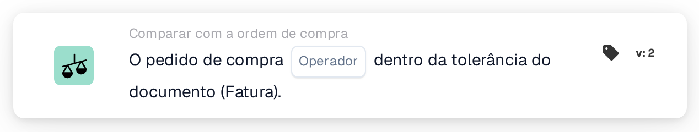

# Correspondência total com a ordem de compra

<figure><figcaption>
Versão 2
</figcaption></figure>

## Propósito:

Este cartão de fluxo de trabalho verifica se a ordem de compra associada concorda com o documento dentro das tolerâncias, no seu conjunto. A quantidade, o preço unitário e os encargos adicionais de cada linha associada são verificados num único passo, pelo que um único cartão pode decidir se um documento pode ser processado sem revisão manual.

A correspondência da ordem de compra deverá ser executada antes deste cartão. Sem uma ordem de compra associada, o cartão comunica dados em falta.

## Componentes do cartão:

1. **Operador**
   * **Descrição:** Se a ordem de compra deverá corresponder totalmente ao documento ou não.
   * **Opções:**
     * **É:** A condição é cumprida se todas as verificações estiverem dentro da tolerância.
     * **Não é:** A condição é cumprida se pelo menos uma verificação estiver fora da tolerância.

## Funcionalidade:

* **Avaliação da condição:** O cartão percorre cada linha da ordem de compra associada (incluindo sublinhas) e utiliza os dados de comparação que a correspondência da ordem de compra guardou para ela:
  * **Quantidade:** A quantidade do documento é comparada com a quantidade da ordem de compra, dentro da tolerância de quantidade da linha.
  * **Preço unitário:** O preço unitário do documento é comparado com o preço unitário da ordem de compra, dentro da tolerância de preço unitário da linha. Quando a linha não tem preço unitário nos seus dados de comparação, mas apenas nas suas informações gerais de correspondência, o cartão utiliza a tolerância de preço unitário configurada para o tipo de documento em vez da tolerância guardada na linha; uma tolerância percentual é então medida a partir do preço da ordem de compra.
  * **Encargos adicionais:** Para cada encargo adicional da linha, a taxa do encargo, o preço unitário e o montante são comparados, cada um, com a ordem de compra, dentro das respetivas tolerâncias.
  * Nas guias de remessa, que não têm preços, apenas é comparada a quantidade.
* Todas as verificações de todas as linhas são combinadas: a ordem de compra só corresponde totalmente se cada verificação individual estiver dentro da tolerância.
* **Execução da ação:**
  * **Condição Verdadeira:**\
    Com **É**, todas as verificações estão dentro da tolerância; com **Não é**, pelo menos uma não está. O fluxo de trabalho continua.
  * **Condição Falsa:**\
    Caso contrário, o fluxo de trabalho para com uma condição não satisfeita.
* **Dados em falta:** O cartão não avalia a condição e comunica dados em falta no registo do fluxo de trabalho quando o documento não tem nenhuma ordem de compra associada, ou quando falta a uma linha associada parte dos dados necessários para as suas verificações, por exemplo uma quantidade, um preço unitário, um valor de encargo adicional ou a tolerância de um deles (incluindo uma tolerância de preço unitário em falta ou inutilizável no tipo de documento, quando esta é necessária). Uma tolerância em falta não é tratada como uma tolerância de 0. Isto aplica-se também com **Não é**: os dados em falta são comunicados como dados em falta, não como uma divergência.

## Configuração:

* O cartão pode ser adicionado como condição And após a correspondência da ordem de compra, a partir da categoria **Comparar com a ordem de compra**. Em seguida, pode ser selecionado o operador (**É** ou **Não é**). As tolerâncias propriamente ditas não são definidas no cartão; provêm da correspondência da ordem de compra e das definições do tipo de documento.
* Pode ser utilizado **Test Card** no menu do cartão do Workflow Builder para experimentar o cartão num documento existente. O registo do cartão lista cada comparação de quantidade, preço unitário e encargo com os valores do documento e da ordem de compra.

## Conclusão:

O cartão de fluxo de trabalho "Purchase Order Full Match" resume numa única condição a comparação de um documento com a ordem de compra. Os documentos que concordam com a respetiva ordem de compra em todas as linhas podem passar automaticamente, enquanto qualquer diferença fora das tolerâncias é comunicada como condição não satisfeita e os dados de comparação em falta como dados em falta, nunca como correspondência.
