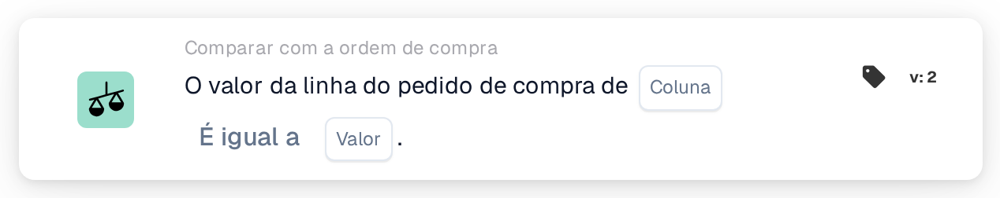

# Valor da linha da ordem de compra

<figure><figcaption>
Versão 2
</figcaption></figure>

## Propósito:

Este cartão de fluxo de trabalho compara uma coluna das linhas da ordem de compra associadas com um valor fixo. Pode ser utilizado para verificar uma propriedade das linhas encomendadas que não está impressa no documento, por exemplo um estado, um código de unidade ou um método de entrega, e para tratar o documento em conformidade.

A correspondência da ordem de compra deverá ser executada antes deste cartão. Sem uma ordem de compra associada, o cartão comunica dados em falta.

## Componentes do cartão:

1. **Coluna**
   * **Descrição:** A coluna da linha da ordem de compra cujo valor é comparado.
2. **Operador**
   * **Descrição:** Como o valor da linha da ordem de compra é comparado com o valor do cartão. A predefinição é **É igual a**.
   * **Opções:**
     * **É igual a:** O valor da linha é igual ao valor. No caso de texto, as maiúsculas e minúsculas são ignoradas.
     * **Não é igual a:** O valor da linha difere do valor. No caso de texto, as maiúsculas e minúsculas contam.
     * **Maior que**, **Maior ou igual**, **Menor que**, **Menor ou igual:** Úteis sobretudo para colunas numéricas.
     * **Contém:** O valor da linha é exatamente uma das entradas de **Valor**, incluindo maiúsculas e minúsculas. As correspondências parciais não contam.
     * **Não contém:** O valor da linha não é nenhuma das entradas de **Valor** (comparado da mesma forma exata).
3. **Valor**
   * **Descrição:** O valor com o qual o valor da linha da ordem de compra é comparado.
   * **Detalhe:** Com **Contém** e **Não contém**, podem ser introduzidas várias entradas, separadas por vírgulas. Com os operadores **Maior** e **Menor**, não é suportada uma lista de valores.

## Funcionalidade:

* **Avaliação da condição:** Para cada linha da ordem de compra associada (incluindo sublinhas), o cartão lê o valor da coluna selecionada e compara-o com **Valor** utilizando o operador. Se ambos forem números, são comparados como números; caso contrário, como texto.
* A condição só é cumprida se cada linha comparada a satisfizer; não existe nenhuma opção **Qualquer/Todos** neste cartão.
* **Execução da ação:**
  * **Condição Verdadeira:**\
    Se cada linha comparada satisfizer a condição, o fluxo de trabalho continua.
  * **Condição Falsa:**\
    Se pelo menos uma linha não a satisfizer, o fluxo de trabalho para com uma condição não satisfeita.
* **Dados em falta:** O cartão não avalia a condição e comunica dados em falta no registo do fluxo de trabalho quando **Coluna** ou **Valor** não estão definidos, quando o documento não tem nenhuma ordem de compra associada ou os respetivos dados não estão disponíveis, quando a coluna selecionada de uma linha associada está vazia (um valor numérico de 0 também conta como vazio), ou quando não foi possível comparar nenhuma linha.
* **Erro de configuração:** Se **Valor** contiver uma vírgula e estiver selecionado um dos operadores **Maior** ou **Menor**, o cartão para com um erro de configuração.

## Configuração:

* O cartão pode ser adicionado como condição And após a correspondência da ordem de compra, a partir da categoria **Comparar com a ordem de compra**. Em seguida, podem ser definidos a **Coluna** da linha da ordem de compra, o operador e o **Valor**. Para uma verificação em relação a vários valores permitidos, pode ser utilizado **Contém** com uma lista separada por vírgulas.
* Pode ser utilizado **Test Card** no menu do cartão do Workflow Builder para experimentar o cartão num documento existente. O registo do cartão lista cada valor de linha comparado, com o operador e o valor utilizados.

## Conclusão:

O cartão de fluxo de trabalho "Purchase Order Line Value" integra os dados das linhas da ordem de compra no fluxo de trabalho como uma condição simples. Permite que um fluxo de trabalho reaja à forma como os bens foram encomendados, mesmo quando essa informação não aparece no próprio documento.
