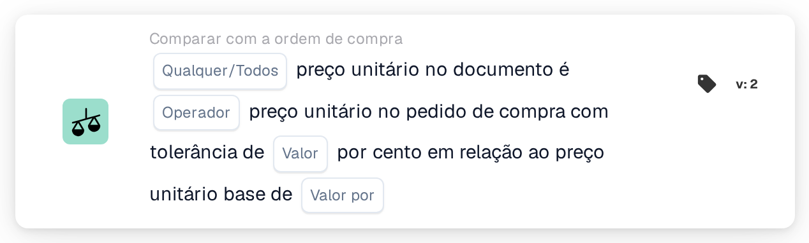

# Tolerância de preço unitário por preço base

<figure><figcaption>
Versão 2
</figcaption></figure>

## Propósito:

Este cartão de fluxo de trabalho compara os preços unitários do documento com os preços unitários das linhas da ordem de compra associadas, utilizando uma tolerância percentual que aumenta com o preço da ordem de compra. A tolerância é introduzida como uma percentagem por preço unitário base, pelo que os itens de preço mais elevado recebem uma tolerância percentual maior do que os de preço mais baixo.

Para uma tolerância fixa, pode ser utilizado o cartão **Any / All Unit Price is**.

A correspondência da ordem de compra deverá ser executada antes deste cartão. Sem uma ordem de compra associada, o cartão comunica dados em falta.

## Componentes do cartão:

1. **Qualquer/Todos**
   * **Descrição:** Como as comparações das linhas individuais são combinadas no resultado do cartão.
   * **Opções:**
     * **Qualquer:** Pelo menos uma linha satisfaz a comparação.
     * **Todos:** Cada linha comparada satisfaz a comparação. Se não for definido nenhum valor, o cartão utiliza **Todos**.
2. **Operador**
   * **Descrição:** Como o preço unitário do documento é comparado com o preço unitário da ordem de compra, tendo em conta a tolerância.
   * **Opções:**
     * **É igual a:** O preço do documento está dentro do intervalo de tolerância em torno do preço da ordem de compra.
     * **Não é igual a:** O preço do documento está fora do intervalo de tolerância.
     * **Maior que:** O preço do documento está acima do intervalo de tolerância.
     * **Maior ou igual:** O preço do documento está dentro ou acima do intervalo de tolerância.
     * **Menor que:** O preço do documento está abaixo do intervalo de tolerância.
     * **Menor ou igual:** O preço do documento está dentro ou abaixo do intervalo de tolerância.
3. **Valor**
   * **Descrição:** A tolerância em percentagem que se aplica ao preço unitário base.
   * **Detalhe:** Um número, por exemplo `1` para 1 por cento.
4. **Valor por**
   * **Descrição:** O preço unitário base a que a percentagem de tolerância se refere.
   * **Detalhe:** Um número maior do que 0, por exemplo `100`.

## Funcionalidade:

* **Cálculo da tolerância:** Para cada linha, a percentagem de tolerância é ajustada pela razão entre o preço unitário da ordem de compra e o preço unitário base:\
  tolerância % = **Valor** × (preço unitário da ordem de compra ÷ **Valor por**)\
  O intervalo de tolerância é o preço unitário da ordem de compra mais e menos esta percentagem.\
  Exemplo com **Valor** 1 e **Valor por** 100: um preço de ordem de compra de 50 dá uma tolerância de 0.5 %, pelo que o intervalo vai de 49.75 a 50.25. Um preço de ordem de compra de 200 dá 2 %, pelo que o intervalo vai de 196 a 204.
* **Avaliação da condição:** Para cada linha da ordem de compra associada, o preço unitário do documento é comparado com o preço unitário da linha da ordem de compra, utilizando o operador e o intervalo calculado. As entradas associadas sem linha da ordem de compra são ignoradas. Os resultados são combinados com **Qualquer/Todos**.
* **Execução da ação:**
  * **Condição Verdadeira:**\
    Se o resultado combinado for cumprido, o fluxo de trabalho continua.
  * **Condição Falsa:**\
    Se o resultado combinado não for cumprido, o fluxo de trabalho para com uma condição não satisfeita. O mesmo acontece quando não foi possível comparar nenhuma linha.
* **Dados em falta:** O cartão não avalia a condição e comunica dados em falta no registo do fluxo de trabalho quando **Valor** ou **Valor por** não estão definidos, quando o documento não tem nenhuma ordem de compra associada, ou quando falta ao documento ou à ordem de compra o preço unitário de uma linha comparada (um preço unitário vazio ou um preço unitário numérico de 0 conta como em falta).
* **Erros:** O cartão para com um erro quando **Valor** ou **Valor por** não são números, quando um preço unitário não pode ser lido como número, quando **Valor por** é 0, ou quando a tolerância calculada para uma linha é inferior a 0 % ou superior a 100 %.

## Configuração:

* O cartão pode ser adicionado como condição And após a correspondência da ordem de compra, a partir da categoria **Comparar com a ordem de compra**. Em seguida, podem ser introduzidos **Qualquer/Todos**, o operador, a percentagem de tolerância em **Valor** e o preço unitário base em **Valor por**. O preço unitário base deverá ser escolhido de forma a que a tolerância calculada se mantenha entre 0 % e 100 % para a gama de preços dos itens.
* Pode ser utilizado **Test Card** no menu do cartão do Workflow Builder para experimentar o cartão num documento existente. O registo do cartão mostra, para cada linha, ambos os preços, a tolerância calculada em percentagem e o intervalo resultante.

## Conclusão:

O cartão de fluxo de trabalho "Unit Price Tolerance per Base Price" aplica uma tolerância dependente do preço à comparação do preço unitário com a ordem de compra. Isto permite, com um único cartão, uma tolerância apertada para itens de preço baixo e uma tolerância mais ampla para itens de preço elevado.
