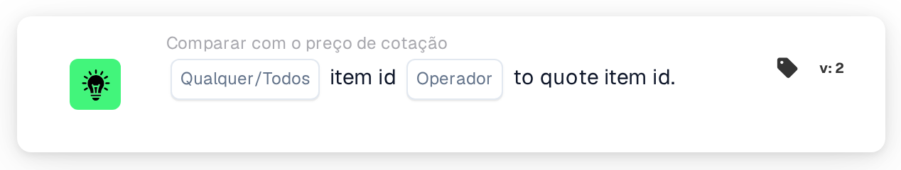

# ID do item face ao ID do item da cotação

<figure><figcaption>
Versão 2
</figcaption></figure>

## Propósito:

Este cartão de fluxo de trabalho compara o número do item de cada linha de um documento com o número do item guardado para o mesmo item do fornecedor na tabela de preços de itens de fornecedor. Pode ser utilizado para detetar linhas em que o documento indica um item diferente daquele a que os dados de preços se referem. Consoante o resultado, o fluxo de trabalho continua com a condição verdadeira ou com a falsa.

## Componentes do cartão:

1. **Qualquer/Todos**
   * **Descrição:** Define se uma linha ou todas as linhas comparadas da tabela do documento deverão cumprir a condição.
   * **Opções:**
     * **Qualquer:** A condição é verdadeira se pelo menos uma linha comparada cumprir a condição.
     * **Todos:** A condição só é verdadeira se todas as linhas comparadas cumprirem a condição.
2. **Operador**
   * **Descrição:** Define como o número do item na tabela de preços de itens de fornecedor é comparado com o número do item na linha do documento.
   * **Opções:**
     * **É igual a:** Os números de item são iguais. Os números de item que possam ambos ser lidos como números são comparados como números (por exemplo, "007" e "7" são iguais); caso contrário, são comparados como texto, sem distinguir maiúsculas de minúsculas.
     * **Não é igual a:** Os números de item diferem. Os números de item que possam ambos ser lidos como números são comparados como números; caso contrário, são comparados como texto e, neste caso, as maiúsculas e minúsculas são distinguidas.
     * **Maior que, Maior ou igual, Menor que, Menor ou igual:** Também disponibilizados pelo cartão. Com estes operadores, os números de item são sempre comparados como texto, carácter a carácter, pelo que, por exemplo, "10" conta como menor do que "9".

## Funcionalidade:

* **Avaliação da condição:** Para cada linha da tabela do documento, o cartão procura o ID do item do fornecedor da linha (coluna `SUPPLIER_ITEM_NUMBER`) na tabela de preços de itens de fornecedor e compara o número do item aí guardado com o número do item da linha (coluna `ITEM_NUMBER`). Os resultados de todas as linhas comparadas são depois combinados com **Qualquer** ou **Todos**.
* **Linhas ignoradas:** Uma linha fica de fora da comparação se a tabela de preços de itens de fornecedor não tiver nenhuma entrada para o seu ID do item do fornecedor, ou se a entrada não tiver número do item. Cada linha ignorada é anotada no registo do fluxo de trabalho.
* **Datas de validade:** Se uma entrada da tabela de preços de itens de fornecedor tiver uma data de início ou de fim e a data do documento estiver fora desse período, o cartão anota isso no registo do fluxo de trabalho. Esta nota não altera o resultado do cartão.
* **Execução da ação:**
  * **Condição Verdadeira:**\
    Os números de item cumprem o operador selecionado para qualquer uma ou para todas as linhas comparadas. O fluxo de trabalho continua com a condição verdadeira.
  * **Condição Falsa:**\
    Se a condição não for cumprida, o fluxo de trabalho continua com a condição falsa, por exemplo para enviar o documento para uma revisão manual. A condição falsa é também utilizada se nenhuma das linhas puder ser comparada, porque nenhuma linha tinha número do item na tabela de preços de itens de fornecedor.
* **Dados em falta:** Se o documento não tiver nenhuma tabela, tiver mais do que uma tabela, ou se não for possível ler linhas da tabela, o cartão não avalia a condição e regista os dados em falta no registo do fluxo de trabalho. Se não estiver definida nenhuma opção **Qualquer/Todos**, o cartão anota isso no registo e utiliza **Todos**.

## Configuração:

* O cartão pode ser adicionado a partir da categoria **Comparar com o preço de cotação**. Em seguida, podem ser selecionados **Qualquer** ou **Todos** e o operador. Para verificar se os números de item coincidem, a escolha habitual é **É igual a** ou **Não é igual a**. Por fim, define-se a condição de continuação (verdadeira ou falsa), que determina o passo seguinte do fluxo de trabalho.
* O cartão funciona com documentos que tenham exatamente uma tabela, cujas linhas contenham o ID do item do fornecedor e o número do item.

## Conclusão:

O cartão de fluxo de trabalho "Item ID to Quote Item ID" assegura que os itens de um documento correspondem aos itens a que a tabela de preços de itens de fornecedor se refere. As linhas sem dados de preços são ignoradas em vez de serem contadas como diferenças, pelo que o resultado reflete apenas as linhas que podem efetivamente ser comparadas.
