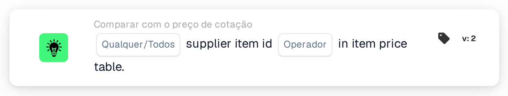

# ID do item do fornecedor na tabela de preços de itens

<figure><figcaption>
Versão 2
</figcaption></figure>

## Propósito:

Este cartão de fluxo de trabalho verifica se os IDs de item do fornecedor nas linhas de um documento podem ser encontrados na tabela de preços de itens de fornecedor. Pode ser utilizado para saber se o DocBits dispõe de dados de preços para os itens de uma cotação, para o fornecedor do documento, antes de serem executadas outras comparações de cotações, ou para encaminhar documentos com itens desconhecidos para uma verificação manual. Consoante o resultado, o fluxo de trabalho continua com a condição verdadeira ou com a falsa.

## Componentes do cartão:

1. **Qualquer/Todos**
   * **Descrição:** Define se uma linha ou todas as linhas da tabela do documento deverão cumprir a condição.
   * **Opções:**
     * **Qualquer:** A condição é verdadeira se pelo menos uma linha cumprir a condição.
     * **Todos:** A condição só é verdadeira se todas as linhas cumprirem a condição.
2. **Operador**
   * **Descrição:** Define se o ID do item do fornecedor deverá ser encontrado na tabela de preços de itens de fornecedor ou não.
   * **Opções:**
     * **É:** Uma linha cumpre a condição se o seu ID do item do fornecedor estiver na tabela de preços de itens de fornecedor.
     * **Não é:** Uma linha cumpre a condição se o seu ID do item do fornecedor não estiver na tabela de preços de itens de fornecedor.

## Funcionalidade:

* **Avaliação da condição:** O cartão lê o ID do item do fornecedor (coluna `SUPPLIER_ITEM_NUMBER`) de cada linha da tabela do documento e verifica se a tabela de preços de itens de fornecedor contém uma entrada para esse ID. Os resultados de todas as linhas são depois combinados com **Qualquer** ou **Todos**.
* **Datas de validade:** Se uma entrada da tabela de preços de itens de fornecedor tiver uma data de início ou de fim e a data do documento estiver fora desse período, o cartão anota isso no registo do fluxo de trabalho. Esta nota não altera o resultado do cartão.
* **Execução da ação:**
  * **Condição Verdadeira:**\
    Com **É**, os IDs de item do fornecedor (qualquer um ou todos, conforme selecionado) estão na tabela de preços de itens de fornecedor. Com **Não é**, não estão. O fluxo de trabalho continua com a condição verdadeira, por exemplo para prosseguir com a comparação de preços.
  * **Condição Falsa:**\
    Se a condição não for cumprida, o fluxo de trabalho continua com a condição falsa, por exemplo para enviar o documento para uma revisão manual.
* **Dados em falta:** Se o documento não tiver nenhuma tabela, tiver mais do que uma tabela, se não for possível ler linhas da tabela, ou se o documento não tiver quaisquer dados de preços de itens de fornecedor, o cartão não avalia a condição e regista os dados em falta no registo do fluxo de trabalho. Se não estiver definida nenhuma opção **Qualquer/Todos**, o cartão anota isso no registo e utiliza **Todos**.
* **Erros:** O cartão termina com um erro se uma linha da tabela não tiver a coluna `SUPPLIER_ITEM_NUMBER`. Se não estiver definido nenhum operador, o cartão comunica um erro de configuração.

## Configuração:

* O cartão pode ser adicionado a partir da categoria **Comparar com o preço de cotação**. Em seguida, podem ser selecionados **Qualquer** ou **Todos** e o operador (**É** ou **Não é**). Por fim, define-se a condição de continuação (verdadeira ou falsa), que determina o passo seguinte do fluxo de trabalho.
* O cartão funciona com documentos que tenham exatamente uma tabela, cujas linhas contenham o ID do item do fornecedor.

## Conclusão:

O cartão de fluxo de trabalho "Supplier Item ID in Item Price Table" mostra se os itens de um documento são conhecidos na tabela de preços de itens de fornecedor. Pode servir como primeira verificação num fluxo de trabalho de cotações, de modo que as comparações posteriores de preço, número do item e unidade de medida só sejam executadas para documentos cujos itens tenham dados de preços.
