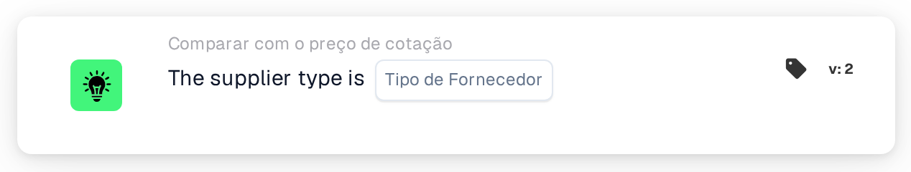

# Tipo de fornecedor

<figure><figcaption>
Versão 2
</figcaption></figure>

## Propósito:

Este cartão de fluxo de trabalho verifica o tipo de fornecedor dos itens nos dados de preços de itens de fornecedor de um documento, por exemplo se os itens são itens de contrato ou itens geridos. Pode ser utilizado para aplicar regras de aprovação diferentes consoante a forma como os itens do fornecedor são geridos. Consoante o resultado, o fluxo de trabalho continua com a condição verdadeira ou com a falsa.

## Componentes do cartão:

1. **Tipo de Fornecedor**
   * **Descrição:** O tipo de fornecedor com o qual o documento é verificado.
   * **Opções:**
     * **Contract:** Corresponde a entradas cuja classe de gestão é "contract".
     * **Managed:** Corresponde a entradas cuja classe de gestão é "managed".
     * **NonManaged:** Corresponde a entradas cuja classe de gestão é "unmanaged".

## Funcionalidade:

* **Avaliação da condição:** O cartão lê o tipo de fornecedor (classe de gestão) de cada entrada nos dados de preços de itens de fornecedor do documento e compara-o com o tipo de fornecedor selecionado no cartão. A comparação não distingue maiúsculas de minúsculas.
* **Execução da ação:**
  * **Condição Verdadeira:**\
    Todas as entradas nos dados de preços de itens de fornecedor têm o tipo de fornecedor selecionado. O fluxo de trabalho continua com a condição verdadeira, por exemplo para aplicar as regras deste tipo de fornecedor.
  * **Condição Falsa:**\
    Se pelo menos uma entrada tiver um tipo de fornecedor diferente ou não tiver classe de gestão, o fluxo de trabalho continua com a condição falsa.
* **Dados em falta:** Se não estiver selecionado nenhum tipo de fornecedor no cartão, ou se o documento não tiver dados de preços de itens de fornecedor, o cartão não avalia a condição e regista os dados em falta no registo do fluxo de trabalho.

## Configuração:

* O cartão pode ser adicionado a partir da categoria **Comparar com o preço de cotação**. Em seguida, o tipo de fornecedor pode ser selecionado no campo **Tipo de Fornecedor**. Por fim, define-se a condição de continuação (verdadeira ou falsa), que determina o passo seguinte do fluxo de trabalho.

## Conclusão:

O cartão de fluxo de trabalho "Supplier Type" permite que um fluxo de trabalho de cotações se ramifique consoante o tipo de fornecedor dos itens, de modo que os itens de contrato, os itens geridos e os itens não geridos possam ser tratados, cada um, com as suas próprias regras.
