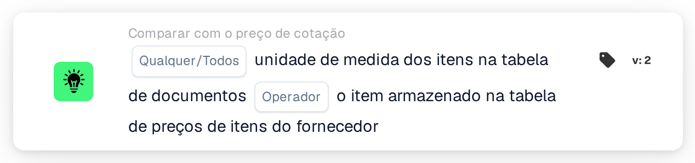
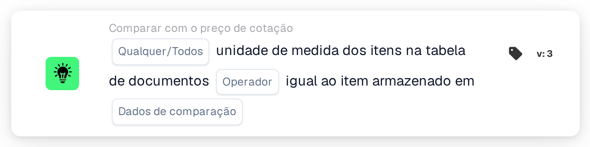

# Unidade de medida

<figure><figcaption>
Versão 2
</figcaption></figure>

<figure><figcaption>
Versão 3
</figcaption></figure>

## Propósito:

Este cartão de fluxo de trabalho compara a unidade de medida dos itens da tabela do documento com a unidade de medida guardada noutro local para os mesmos itens. Na versão 2, a comparação é sempre feita com a tabela de preços de itens de fornecedor. A versão 3 acrescenta a escolha entre a tabela de preços de itens de fornecedor e os itens de linha da ordem de compra associada. O cartão pode ser utilizado para detetar linhas em que um item é cotado ou faturado numa unidade diferente da esperada. Consoante o resultado, o fluxo de trabalho continua com a condição verdadeira ou com a falsa.

## Componentes do cartão:

1. **Qualquer/Todos**
   * **Descrição:** Define se uma linha ou todas as linhas comparadas da tabela do documento deverão cumprir a condição.
   * **Opções:**
     * **Qualquer:** A condição é verdadeira se pelo menos uma linha comparada cumprir a condição.
     * **Todos:** A condição só é verdadeira se todas as linhas comparadas cumprirem a condição.
2. **Operador**
   * **Descrição:** Define se as unidades de medida deverão ser iguais ou diferentes.
   * **Opções:**
     * **É igual a:** A unidade de medida na linha do documento é igual à guardada.
     * **Não é igual a:** A unidade de medida na linha do documento difere da guardada.
3. **Dados de comparação** (apenas versão 3)
   * **Descrição:** A origem com a qual a unidade de medida do documento é comparada.
   * **Opções:**
     * **preço do item do fornecedor cotado:** A unidade de medida guardada para o item do fornecedor na tabela de preços de itens de fornecedor, como na versão 2.
     * **item de linha do pedido de compra:** A unidade de medida da linha da ordem de compra associada.

## Funcionalidade:

* **Avaliação da condição:** O cartão lê a unidade de medida (coluna `UNIT`) das linhas da primeira tabela do documento e compara-a com a origem selecionada. A comparação não distingue maiúsculas de minúsculas. Os resultados de todas as linhas comparadas são depois combinados com **Qualquer** ou **Todos**.
  * **preço do item do fornecedor cotado:** Apenas são comparadas as linhas ligadas a uma entrada dos dados de cotação associados. Para cada uma destas linhas, é utilizada a unidade de medida guardada para o respetivo item do fornecedor.
  * **item de linha do pedido de compra** (versão 3): Apenas são comparadas as linhas associadas a uma linha da ordem de compra. A unidade de medida da linha da ordem de compra é primeiro traduzida com a tabela de consulta de unidades de medida (da unidade EDI para a unidade M3). Em ambos os lados, algumas grafias são tratadas como iguais: "each" como "ea", e "lbs" e "lbp" como "lb".
* **Linhas ignoradas:** Uma linha fica de fora da comparação se a origem não tiver unidade de medida para ela. Cada linha ignorada é anotada no registo do fluxo de trabalho.
* **Execução da ação:**
  * **Condição Verdadeira:**\
    As unidades de medida cumprem o operador selecionado para qualquer uma ou para todas as linhas comparadas. O fluxo de trabalho continua com a condição verdadeira.
  * **Condição Falsa:**\
    Se a condição não for cumprida, o fluxo de trabalho continua com a condição falsa, por exemplo para enviar o documento para uma revisão manual. A condição falsa é também utilizada se nenhuma linha puder ser ligada à origem selecionada e, na versão 3, se não estiver selecionada nenhuma opção em **Dados de comparação**, porque nesse caso nenhuma linha é comparada.
* **Dados em falta:** O cartão não avalia a condição e regista os dados em falta no registo do fluxo de trabalho se:
  * o documento não tiver nenhuma tabela,
  * for utilizado **preço do item do fornecedor cotado** (ou a versão 2) e o documento não tiver dados de cotação associados ou não tiver dados de preços de itens de fornecedor,
  * estiver selecionado **item de linha do pedido de compra** e o documento não tiver nenhuma ordem de compra associada,
  * uma linha comparada tiver uma unidade de medida vazia no documento,
  * nenhuma das linhas puder ser comparada, porque todas as linhas foram ignoradas.

  Se não estiver definida nenhuma opção **Qualquer/Todos**, o cartão anota isso no registo e utiliza **Todos**.
* **Erros:** Com **item de linha do pedido de compra**, se uma linha da ordem de compra estiver dividida em sublinhas com unidades de medida diferentes, o cartão termina com um erro.

## Configuração:

* O cartão pode ser adicionado a partir da categoria **Comparar com o preço de cotação**. Em seguida, podem ser selecionados **Qualquer** ou **Todos** e o operador. Na versão 3, a origem com a qual comparar também pode ser selecionada no campo **Dados de comparação**. Por fim, define-se a condição de continuação (verdadeira ou falsa), que determina o passo seguinte do fluxo de trabalho.
* A tabela do documento deverá conter uma coluna `UNIT`. Para a comparação com itens de linha da ordem de compra, a tabela de consulta de unidades de medida deverá conter as correspondências entre as unidades utilizadas nos documentos e nas ordens de compra.

## Conclusão:

O cartão de fluxo de trabalho "Unit of Measure" assegura que os itens são cotados ou faturados na unidade esperada. As linhas sem unidade de medida guardada são ignoradas em vez de serem contadas como diferenças, e a versão 3 alarga a verificação da tabela de preços de itens de fornecedor às linhas da ordem de compra.
