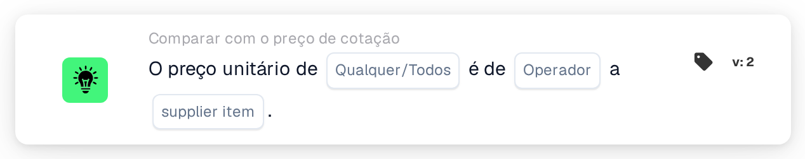

# Preço unitário face ao preço do item do fornecedor

<figure><figcaption>
Versão 2
</figcaption></figure>

## Propósito:

Este cartão de fluxo de trabalho compara o preço unitário de cada linha de um documento com um preço da tabela de preços de itens de fornecedor, seja o preço gerido ou o último preço pago pelo mesmo item do fornecedor. Pode ser utilizado para verificar se um preço cotado corresponde ao preço conhecido, o excede ou fica abaixo dele antes de o documento ser aprovado. Consoante o resultado, o fluxo de trabalho continua com a condição verdadeira ou com a falsa.

## Componentes do cartão:

1. **Qualquer/Todos**
   * **Descrição:** Define se uma linha ou todas as linhas comparadas da tabela do documento deverão cumprir a condição.
   * **Opções:**
     * **Qualquer:** A condição é verdadeira se pelo menos uma linha comparada cumprir a condição.
     * **Todos:** A condição só é verdadeira se todas as linhas comparadas cumprirem a condição.
2. **Operador**
   * **Descrição:** Define como o preço unitário do documento é comparado com o preço do item do fornecedor selecionado.
   * **Opções:**
     * **É igual a:** O preço unitário é igual ao preço do item do fornecedor.
     * **Não é igual a:** O preço unitário difere do preço do item do fornecedor.
     * **Maior que:** O preço unitário é superior ao preço do item do fornecedor.
     * **Maior ou igual:** O preço unitário é superior ou igual ao preço do item do fornecedor.
     * **Menor que:** O preço unitário é inferior ao preço do item do fornecedor.
     * **Menor ou igual:** O preço unitário é inferior ou igual ao preço do item do fornecedor.
3. **supplier item**
   * **Descrição:** O preço da tabela de preços de itens de fornecedor com o qual o preço unitário é comparado.
   * **Opções:**
     * **ManagedPrice:** O preço gerido guardado para o item do fornecedor.
     * **LastPrice:** O último preço pago pelo item do fornecedor.

## Funcionalidade:

* **Avaliação da condição:** Para cada linha da tabela do documento, o cartão procura o ID do item do fornecedor da linha (coluna `SUPPLIER_ITEM_NUMBER`) na tabela de preços de itens de fornecedor e compara o preço unitário da linha (coluna `UNIT_PRICE`) com o preço selecionado. Ambos os preços são comparados como números. Os resultados de todas as linhas comparadas são depois combinados com **Qualquer** ou **Todos**.
* **Linhas ignoradas:** Uma linha fica de fora da comparação se o seu preço unitário estiver vazio ou não puder ser lido como número, ou se não estiver guardado nenhum preço do tipo selecionado para o seu item do fornecedor, por exemplo porque o item do fornecedor não está na tabela de preços de itens de fornecedor. Cada linha ignorada é anotada no registo do fluxo de trabalho, juntamente com o lado que não tinha preço.
* **Execução da ação:**
  * **Condição Verdadeira:**\
    Os preços unitários cumprem o operador selecionado para qualquer uma ou para todas as linhas comparadas. O fluxo de trabalho continua com a condição verdadeira, por exemplo para aprovar o documento.
  * **Condição Falsa:**\
    Se a condição não for cumprida, o fluxo de trabalho continua com a condição falsa, por exemplo para enviar o documento para uma revisão de preços.
* **Dados em falta:** O cartão não avalia a condição e regista os dados em falta no registo do fluxo de trabalho se:
  * não estiver selecionado nenhum preço de item do fornecedor no cartão,
  * o documento não tiver dados de cotação associados,
  * o documento não tiver nenhuma tabela, tiver mais do que uma tabela, ou se não for possível ler linhas da tabela,
  * nenhuma das linhas puder ser comparada, porque todas as linhas foram ignoradas.

  Se não estiver definida nenhuma opção **Qualquer/Todos**, o cartão anota isso no registo e utiliza **Todos**.
* **Erros:** Se uma linha da tabela não tiver a coluna `SUPPLIER_ITEM_NUMBER` ou a coluna `UNIT_PRICE`, o cartão termina com um erro.

## Configuração:

* O cartão pode ser adicionado a partir da categoria **Comparar com o preço de cotação**. Em seguida, podem ser selecionados **Qualquer** ou **Todos**, o operador e, no campo **supplier item**, o preço com o qual comparar. Por fim, define-se a condição de continuação (verdadeira ou falsa), que determina o passo seguinte do fluxo de trabalho.
* O cartão funciona com documentos que tenham exatamente uma tabela, cujas linhas contenham o ID do item do fornecedor e o preço unitário.

## Conclusão:

O cartão de fluxo de trabalho "Unit Price to Supplier Item Price" verifica os preços cotados em relação ao preço gerido ou ao último preço pago. As linhas sem preço em qualquer dos lados são ignoradas, pelo que uma única linha incompleta não decide o resultado, e um documento sem nenhuma linha comparável é comunicado como dados em falta.
