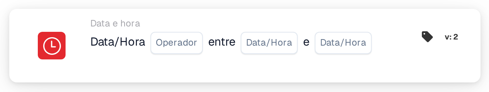

# Data ou hora

<figure><figcaption>
Versão 2
</figcaption></figure>

## Propósito:

Este cartão de fluxo de trabalho verifica se a data e a hora atuais se encontram dentro ou fora de um intervalo definido no cartão. Pode ser utilizado para limitar passos a determinadas horas, por exemplo ao horário de trabalho ou a uma janela de manutenção planeada.

## Componentes do cartão:

1. **Operador**
   * **Opções:**
     * **É:** A data e a hora atuais encontram-se dentro do intervalo.
     * **Não é:** A data e a hora atuais encontram-se fora do intervalo.
2. **Primeira data/hora**
   * **Descrição:** Um extremo do intervalo, como data e hora ou apenas como hora.
3. **Segunda data/hora**
   * **Descrição:** O outro extremo do intervalo.

## Funcionalidade:

* **Avaliação da condição:** Quando o fluxo de trabalho chega ao cartão, este obtém a data e a hora atuais em UTC e verifica se se encontram entre os dois valores do cartão. O valor mais antigo é utilizado como início, pelo que a ordem dos dois campos não importa.
  * Um valor apenas com uma hora (por exemplo `09:00`) é utilizado com a data de hoje, pelo que o intervalo se repete todos os dias.
  * O início e o fim pertencem ao intervalo: exatamente à hora de início ou de fim, **É** é verdadeiro.
  * Um intervalo que atravessa a meia-noite pode ser introduzido apenas com horas, por exemplo de `22:00` a `04:00`. O cartão verifica então, todos os dias, o período das 22:00 às 04:00, incluindo as horas exatas de início e de fim.
  * Com datas completas em dois dias diferentes (por exemplo de `2026-11-01 22:00` a `2026-11-02 04:00`), o cartão verifica todo o período do primeiro ao segundo momento, incluindo o início e o fim.
* **Execução da ação:**
  * **Condição Verdadeira:**\
    Se a condição for cumprida, o fluxo de trabalho continua com os cartões seguintes.
  * **Condição Falsa:**\
    Se não for cumprida, o fluxo de trabalho para com uma condição não cumprida.
* **Dados em falta:** Se faltar um dos dois valores no cartão, o cartão não avalia a condição e comunica a entrada em falta no registo do fluxo de trabalho.

## Configuração:

* O cartão pode ser adicionado como condição And a partir da categoria **Data e hora**. Em seguida, definem-se os dois valores e o operador. Todas as horas deverão ser introduzidas em UTC.
* **Exemplo:** Com **É**, `09:00` e `17:00`, o cartão é cumprido quando o fluxo de trabalho é executado entre as 09:00 e as 17:00 UTC de qualquer dia.

## Conclusão:

O cartão de fluxo de trabalho "Date or Time" torna o momento da execução numa condição do fluxo de trabalho. Os passos podem ser limitados a horas fixas ou a um único intervalo planeado sem alterar o fluxo de trabalho de cada vez.
