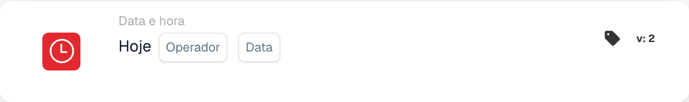

# Hoje

<figure><figcaption>
Campos do cartão na versão apresentada. Os campos ainda não estão configurados.
</figcaption></figure>

## **Propósito:**

Este cartão DocBits compara a data de hoje com uma data especificada, permitindo que os fluxos de trabalho sejam executados com base na relação entre a data atual e a data fornecida. É particularmente útil para automação baseada no tempo, gestão de prazos ou acionamento de tarefas agendadas.

## **Funcionalidade:**

* **Comparação de datas:** Este cartão avalia a data de hoje face a uma data especificada utilizando as seguintes condições:
  * **Igual a (=):** Verifica se a data de hoje corresponde à data especificada.
  * **Não é igual (≠):** Garante que a data de hoje é diferente da data especificada.
  * **Maior que (>):** Confirma que a data de hoje é posterior à data especificada.
  * **Maior ou Igual (≥):** Garante que a data de hoje é igual ou posterior à data especificada.
  * **Menor que (<):** Verifica se a data de hoje é anterior à data especificada.
  * **Menor ou igual (≤):** Garante que a data de hoje é igual ou anterior à data especificada.
* **Introdução da data:** Os utilizadores fornecem a data a comparar com a data de hoje.

## **Utilização:**

Este cartão é ideal para fluxos de trabalho que envolvem prazos, lembretes ou condições sensíveis ao tempo, assegurando que as ações são realizadas ou restringidas com base na data atual.

## **Exemplo de cenário:**

* Um utilizador configura o cartão para verificar se **hoje é superior a (>) "2024-11-15"**. Se a condição for cumprida, o fluxo de trabalho aciona uma notificação de seguimento para tarefas em atraso. Caso contrário, o fluxo de trabalho continua sem interrupção.

Ao utilizar o cartão "Today's Date Validation", as organizações podem automatizar processos baseados no tempo, cumprir prazos de forma eficiente e manter a precisão dos fluxos de trabalho.
