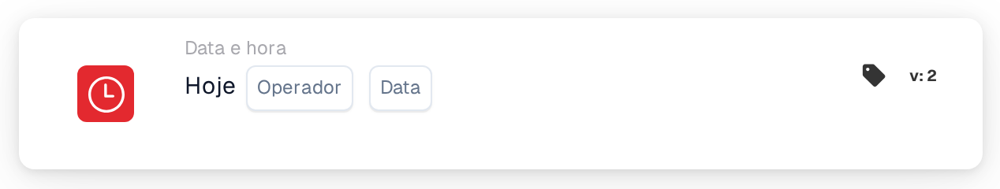

# Hoje

<figure><figcaption>
Versão 2
</figcaption></figure>

## Propósito:

Este cartão de fluxo de trabalho compara a data de hoje com uma data definida no cartão. Pode ser utilizado para regras que só deverão aplicar-se a partir de uma determinada data ou até ela, por exemplo uma alteração de processo a partir de uma data de início planeada.

## Componentes do cartão:

1. **Operador**
   * **Descrição:** Como a data de hoje é comparada com a data no cartão.
   * **Opções:**
     * **É igual a:** Hoje é a data no cartão.
     * **Não é igual a:** Hoje é qualquer outro dia.
     * **Maior que:** Hoje é posterior à data no cartão.
     * **Maior ou igual:** Hoje é a data no cartão ou uma data posterior.
     * **Menor que:** Hoje é anterior à data no cartão.
     * **Menor ou igual:** Hoje é a data no cartão ou uma data anterior.
2. **Data**
   * **Descrição:** A data com a qual o dia de hoje é comparado.

## Funcionalidade:

* **Avaliação da condição:** Quando o fluxo de trabalho chega ao cartão, este obtém a data atual em UTC e compara-a com a data no cartão através do operador. Só são comparadas as datas; as horas do dia são ignoradas. As datas do documento não têm qualquer papel.
* **Execução da ação:**
  * **Condição Verdadeira:**\
    Se a comparação for verdadeira, o fluxo de trabalho continua com os cartões seguintes.
  * **Condição Falsa:**\
    Se não for verdadeira, o fluxo de trabalho para com uma condição não cumprida.
* **Dados em falta:** Se não estiver definida nenhuma data no cartão, o cartão não avalia a condição e comunica a entrada em falta no registo do fluxo de trabalho.

## Configuração:

* O cartão pode ser adicionado como condição And a partir da categoria **Data e hora**. Em seguida, selecionam-se um operador e uma data.
* **Exemplo:** Com **Maior ou igual** e `2026-11-01`, o cartão é cumprido a partir de 1 de novembro de 2026 (UTC) e não é cumprido a 31 de outubro de 2026.
* Como a data é obtida em UTC, pode diferir da data local por volta da meia-noite: na Europa, pouco depois da meia-noite o cartão ainda vê o dia anterior; na América, à noite já vê o dia seguinte.

## Conclusão:

O cartão de fluxo de trabalho "Today" torna a data do calendário numa condição do fluxo de trabalho. Regras baseadas em datas, como uma data de início ou de fim de um processo, podem ser configuradas uma única vez e entram em vigor automaticamente.
