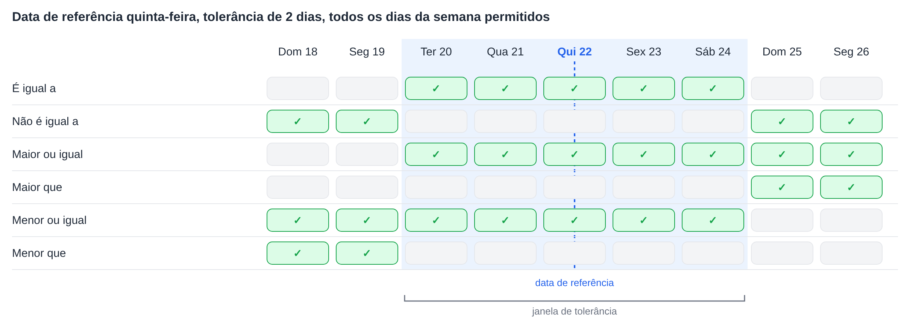
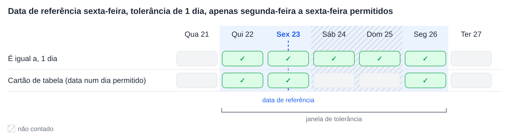
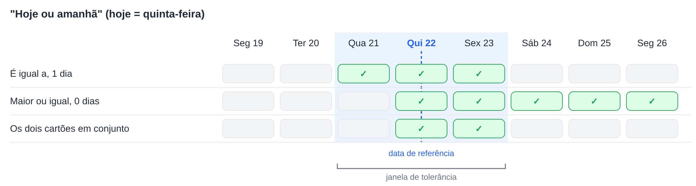

# Tolerâncias de data

Vários cartões de fluxo de trabalho comparam uma data com uma data de referência e aceitam uma tolerância de um determinado número de dias. Todos calculam a tolerância da mesma forma. Esta página explica esse cálculo, o significado de cada operador, como funcionam os **Dias de Tolerância Permitidos** e como combinar dois cartões para intervalos como "hoje ou amanhã".

Os cartões que utilizam este cálculo:

* [Table Date to Current Date](table/table-date-to-current-date.md) – uma data numa tabela do documento comparada com a data atual.
* [Promised delivery date for line items in table with promised delivery date](compare-with-purchase-order/promised-delivery-date-for-line-items-in-table-with-promised-delivery-date/README.md) – datas de entrega prometidas dos itens de linha comparadas com a data atual.
* [Promised Delivery Date on Purchase Order](compare-with-purchase-order/promised-delivery-date-on-purchase-order.md) – datas de entrega dos itens de linha comparadas com a data de entrega da ordem de compra.

## A janela de tolerância

A partir da data de referência, a tolerância é contada para trás e para a frente. O resultado é uma **janela de tolerância**: da data de início à data de fim, ambas incluídas.

* Com uma tolerância de **0 dias**, a janela é apenas a própria data de referência.
* Com uma tolerância de **2 dias**, a janela abrange 2 dias antes e 2 dias depois da data de referência.
* A **data atual** é a data nos servidores DocBits, que funcionam em **UTC**.

Cada operador compara a data com esta janela:

| Operador | Verdadeiro quando a data está … |
|---|---|
| **É igual a** | dentro da janela |
| **Não é igual a** | fora da janela |
| **Maior ou igual** | no **início** da janela ou depois |
| **Maior que** | depois do **fim** da janela |
| **Menor ou igual** | no **fim** da janela ou antes |
| **Menor que** | antes do **início** da janela |

A tolerância também alarga **Maior ou igual** e **Menor ou igual**: com 2 dias, **Maior ou igual** já aceita uma data 2 dias antes da data de referência.

<figure><figcaption>
Data de referência quinta-feira 22, tolerância de 2 dias: a janela vai de terça-feira 20 a sábado 24.
</figcaption></figure>

## Dias de Tolerância Permitidos

Os cartões que disponibilizam **Dias de Tolerância Permitidos** contam apenas os dias da semana selecionados quando a janela é calculada. Os dias da semana não selecionados são saltados na contagem, mas permanecem dentro da janela.

**Exemplo:** data de referência sexta-feira, tolerância de 1 dia, apenas segunda-feira a sexta-feira selecionados. A contagem para trás chega a quinta-feira. A contagem para a frente salta sábado e domingo e chega a segunda-feira. A janela vai de **quinta-feira a segunda-feira**.

**Table Date to Current Date** acrescenta mais uma verificação: a data na tabela só é aceite se também coincidir com um dos dias da semana selecionados. Um sábado dentro da janela não é, por isso, aceite por este cartão. Os outros dois cartões não têm esta verificação adicional.

<figure><figcaption>
Apenas são contados os dias de segunda-feira a sexta-feira, pelo que 1 dia depois de sexta-feira é segunda-feira.
</figcaption></figure>

## Exemplo: hoje ou amanhã

Um único cartão não consegue aceitar exatamente "hoje ou amanhã", porque a janela abrange sempre o mesmo número de dias em ambas as direções. Dois cartões, um a seguir ao outro, conseguem:

1. **É igual a** com tolerância de **1 dia** aceita ontem, hoje e amanhã.
2. **Maior ou igual** com tolerância de **0 dias** aceita hoje e todos os dias posteriores.

Restam apenas as datas que passam em ambos os cartões: **hoje e amanhã**.

<figure><figcaption>
Hoje é quinta-feira 22: em conjunto, os dois cartões aceitam quinta-feira 22 e sexta-feira 23.
</figcaption></figure>

Da mesma forma, podem ser construídos outros intervalos:

| Intervalo | Primeiro cartão | Segundo cartão |
|---|---|---|
| Hoje ou amanhã | **É igual a**, 1 dia | **Maior ou igual**, 0 dias |
| Ontem ou hoje | **É igual a**, 1 dia | **Menor ou igual**, 0 dias |
| De hoje até 3 dias depois | **É igual a**, 3 dias | **Maior ou igual**, 0 dias |
| Não hoje | **Não é igual a**, 0 dias | – |
| A partir de depois de amanhã | **Maior que**, 1 dia | – |

Quando apenas segunda-feira a sexta-feira estão selecionados como **Dias de Tolerância Permitidos**, "amanhã" numa sexta-feira é a segunda-feira seguinte.

## Conclusão

Todos os cartões de data com tolerância utilizam uma única janela em torno da data de referência. Saber onde a janela começa e termina torna claro o que cada operador aceita, e dois cartões em conjunto podem abranger intervalos que um único cartão não consegue.
