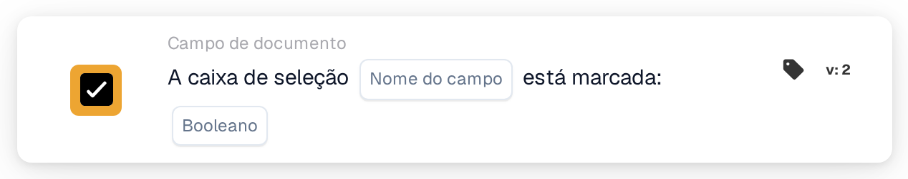

# A caixa de seleção está marcada

<figure><figcaption>
Versão 2
</figcaption></figure>

## Propósito:

Este cartão de fluxo de trabalho verifica se um campo de caixa de seleção do documento está marcado ou desmarcado. Pode ser utilizado para que um fluxo de trabalho só continue depois de ter sido definido um indicador no documento, por exemplo um indicador de revisão.

## Componentes do cartão:

1. **Nome do campo**
   * **Descrição:** O nome técnico do campo de caixa de seleção do documento.
   * **Detalhe:** O campo deverá ser um campo de caixa de seleção (booleano) do tipo de documento.
2. **Booleano**
   * **Descrição:** O estado que a caixa de seleção deverá ter.
   * **Opções:**
     * **Verdadeiro:** A caixa de seleção deverá estar marcada.
     * **Falso:** A caixa de seleção deverá estar desmarcada.

## Funcionalidade:

* **Avaliação da condição:** Quando o fluxo de trabalho chega ao cartão, este lê o valor atual do campo no documento e compara-o com **Booleano**. O cartão não acompanha o campo ao longo do tempo e não o altera.
  * Um valor de caixa de seleção vazio conta como desmarcado.
  * Se não for selecionado nenhum valor em **Booleano**, o cartão verifica se a caixa de seleção está desmarcada.
  * Se o campo não for um campo de caixa de seleção, o cartão regista isso no registo do fluxo de trabalho e compara o seu valor na mesma.
* **Execução da ação:**
  * **Condição Verdadeira:**\
    Se o estado da caixa de seleção corresponder a **Booleano**, o fluxo de trabalho continua com os cartões seguintes.
  * **Condição Falsa:**\
    Se não corresponder, o fluxo de trabalho para com uma condição não cumprida.
* **Dados em falta:** Se o campo não existir no documento, o cartão não avalia a condição. Comunica que o campo não foi encontrado no documento, o que é um resultado diferente de uma caixa de seleção desmarcada.

## Configuração:

* O cartão pode ser adicionado como condição And a partir da categoria **Campo de documento**. Em seguida, introduz-se o nome técnico do campo de caixa de seleção em **Nome do campo** e seleciona-se **Verdadeiro** ou **Falso**.
* Pode ser utilizado **Test Card** no menu do cartão do Workflow Builder para verificar a configuração num documento com a caixa marcada, num com a caixa desmarcada e num sem o campo.

## Conclusão:

O cartão de fluxo de trabalho "Checkbox is checked" transforma uma caixa de seleção do documento numa condição do fluxo de trabalho. Assim, um fluxo de trabalho pode aguardar um passo manual, como uma revisão concluída, antes de as ações seguintes serem executadas.
