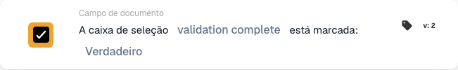

# A caixa de seleção está marcada

## Quando e onde utilizar este cartão

Utilize esta condição quando uma ação seguinte depender de uma caixa de seleção no documento. Por exemplo, permita que uma fatura prossiga apenas depois de o respetivo indicador de verificação estar marcado.

No editor de fluxos de trabalho, adicione o cartão em **E… → Campo de documento**. O cartão compara o valor do campo quando o fluxo é executado; não monitoriza continuamente um campo do ERP nem altera a caixa de seleção.

## Pré-requisitos

O tipo de documento deve ter um campo booleano para esta caixa de seleção. Utilize o identificador técnico exato. Este exemplo utiliza `validation_complete`; substitua-o pelo campo correspondente da sua organização.

## Configurar o cartão

1. Escolha **A caixa de seleção … está marcada** em **Campo de documento**.
2. Introduza `validation_complete` em **Nome do campo** e confirme o valor.
3. Selecione **Verdadeiro** em **Booleano** para exigir uma caixa marcada. Selecione **Falso** para verificar que não está marcada.

## Exemplo prático: prosseguir após a verificação

**Quando utilizar:** uma fatura requer uma verificação prévia e o processo regista a sua conclusão em `validation_complete`.

**Onde colocar:** nas condições de **E…**, antes da ação seguinte configurada em **Então…**. Configure separadamente essa ação e o evento que inicia o fluxo de trabalho.

**Configuração do exemplo:** campo `validation_complete`, comparação **Verdadeiro** (`true`), cartão versão 2.

<figure><figcaption>
Exemplo com a versão 2: validation complete comparado com Verdadeiro.
</figcaption></figure>

Os resultados esperados para esta configuração são:

| Valor do campo no documento | Resultado da condição |
| --- | --- |
| Caixa existente e marcada (`true`) | A condição é satisfeita. |
| Caixa existente e não marcada (`false`) | A condição não é satisfeita. |
| Caixa existente com um valor vazio (`None`) | Tratada como não marcada; a condição não é satisfeita. |
| Campo ausente do documento | `NOT_FOUND_IN_DOCUMENT`; este caso é diferente de uma caixa existente não marcada. |

Se selecionar **Falso**, uma caixa existente não marcada satisfaz a condição e uma caixa marcada não a satisfaz. Um campo ausente continua a produzir um resultado de erro distinto.

## Verificar antes da ativação

Verifique se o campo escolhido é booleano e pertence ao tipo de documento utilizado. Teste um documento com a caixa marcada, outro com a caixa não marcada e um documento em que o campo esteja ausente. Verifique o resultado do cartão e o percurso seguinte do fluxo em cada caso.

Este cartão verifica o estado da caixa de seleção; o processo anterior deve definir o indicador de verificação. Marcá-lo automaticamente sem efetuar a verificação não demonstra que esta tenha sido realizada.
