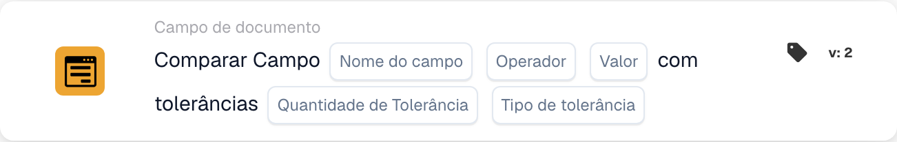

# Compare Campo com tolerâncias

<figure><figcaption>
Campos do cartão na versão apresentada. Os campos ainda não estão configurados.
</figcaption></figure>

## Quando utilizar este cartão

Utilize esta condição para comparar um campo numérico do documento com uma referência fixa, permitindo um desvio definido. Por exemplo, um montante total pode corresponder à referência 100 se a diferença não ultrapassar 5.

## Onde encontrar o cartão

No editor de workflows padrão, adicione um cartão em **E**, abra **Campo de documento** e selecione a comparação de um campo com uma referência e tolerâncias. O exemplo seguinte utiliza a versão 2.

## Definições

Utilize um campo numérico configurado na sua organização. O valor do campo, a referência e a tolerância são avaliados numericamente. Utilize unidades consistentes.

| Definição | Significado |
| --- | --- |
| Nome do campo | O campo configurado, por exemplo `total_amount`. |
| Operador | A comparação: `eq`, `neq`, `gt`, `ge`, `lt` ou `le`. |
| Valor de referência | O número fixo com o qual o campo é comparado. |
| Tolerância | O desvio numérico permitido. |
| Tipo de tolerância | **Valor** (`value`) para um montante absoluto ou **Por cento** (`percent`) para um desvio relativo. |

Com uma referência positiva de 200, uma tolerância percentual de 5 permite um desvio de 10. Uma tolerância absoluta de 5 permite um desvio de 5. Verifique os limites relevantes para o operador e os valores escolhidos.

## Como a tolerância altera a comparação

Com referência **100** e tolerância absoluta **5**, o limite inferior é **95** e o superior é **105**.

| Operador | A condição é satisfeita quando o valor do campo… |
| --- | --- |
| `eq` (=) | Está entre 95 e 105, incluindo ambos os limites. |
| `neq` (≠) | É inferior a 95 ou superior a 105. |
| `gt` (>) | É superior a 105. |
| `ge` (≥) | É pelo menos 95. |
| `lt` (<) | É inferior a 95. |
| `le` (≤) | É no máximo 105. |

O cartão devolve o resultado de uma condição. Os passos seguintes dependem do evento que inicia o workflow, das outras condições e das ações configuradas.

<!-- workflow-card-complete-example-20261021 condition_docfield_operator_value_tolerances -->

## Exemplo prático

1. Selecione o campo numérico configurado **Montante total** (`total_amount`).
2. Selecione **É igual a** (`eq`).
3. Introduza a referência **100** e a tolerância **5**.
4. Selecione o tipo de tolerância **Valor** (`value`).

| Valor do campo | Diferença absoluta em relação a 100 | Resultado esperado |
| --- | --- | --- |
| 103 | 3 | Condição satisfeita. |
| 110 | 10 | Condição não satisfeita. |
| 95 ou 105 | 5 | Condição satisfeita: a comparação de igualdade inclui os limites de tolerância. |

Estes são os resultados de cálculo esperados para uma configuração de exemplo. Não foi executado nenhum workflow para este exemplo.

## Antes de ativar a regra

Verifique um caso que satisfaça a condição, um que não a satisfaça e os limites com dados de teste adequados. Investigue separadamente campos em falta, valores não numéricos e erros de configuração. Consulte o registo de execução para verificar os valores, o operador, a tolerância e o resultado realmente utilizados.

Se ambos os montantes vierem de campos do documento, utilize o cartão separado para [comparar dois campos com tolerância](compare-two-fields-with-tolerance.md).
