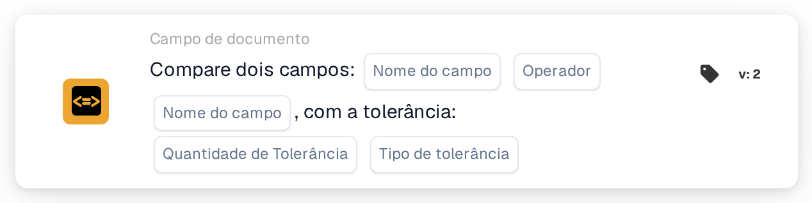

# Compare dois campos com tolerância

<figure><figcaption>
Versão 2
</figcaption></figure>

## **Propósito:**

Este cartão de fluxo de trabalho foi concebido para automatizar ações comparando os valores de dois campos de documento especificados, com a capacidade adicional de aplicar um valor de tolerância. Esta funcionalidade permite que o sistema considere uma margem de erro (tolerância) ao comparar valores de campos, possibilitando uma tomada de decisões mais flexível dentro dos fluxos de trabalho.

## **Componentes do cartão:**

1. **Nome do campo (1)**
   * **Descrição:** Especifica o primeiro campo de documento a comparar.
   * **Detalhe:** Tem de corresponder ao identificador exato do primeiro campo dentro do documento.
2. **Operador**
   * **Descrição:** Define o tipo de comparação a realizar entre os dois campos.
   * **Opções:**
     * **Igual a (=):** Verifica se os valores dos dois campos são iguais.
     * **Não é igual (≠):** Garante que os valores dos dois campos são diferentes.
     * **Maior que (>):** Confirma que o valor do primeiro campo é superior ao do segundo campo.
     * **Maior ou Igual (≥):** Valida que o valor do primeiro campo é igual ou superior ao do segundo campo.
     * **Menor que (<):** Verifica se o valor do primeiro campo é inferior ao do segundo campo.
     * **Menor ou igual (≤):** Garante que o valor do primeiro campo é inferior ou igual ao do segundo campo.
3. **Nome do campo (2)**
   * **Descrição:** Especifica o segundo campo de documento a comparar com o primeiro campo.
   * **Detalhe:** Deve corresponder ao identificador exato do segundo campo dentro do documento.
4. **Valor de tolerância**
   * **Descrição:** Define a margem de erro aceitável para a comparação.
   * **Detalhe:** O valor de tolerância é um valor numérico que indica a diferença máxima permitida entre os dois valores de campo para que a comparação seja considerada verdadeira.
5. **Tipo de tolerância**
   * **Descrição:** Especifica a unidade de medida do valor de tolerância.
   * **Opções:**
     * **Valor:** A tolerância é um valor absoluto, ou seja, os dois campos podem diferir pelo valor de tolerância especificado.
     * **Percent:** A tolerância é calculada como uma percentagem do valor do segundo campo, permitindo uma margem de erro relativa.

## **Funcionalidade:**

* **Avaliação da condição:** O sistema avalia se os valores dos dois campos especificados cumprem a condição de comparação, considerando a tolerância definida. Se a diferença absoluta ou relativa entre os dois campos estiver dentro da tolerância, a condição é considerada verdadeira.
* **Execução da ação:**
  * **Condição Verdadeira:**\
    Se os valores dos dois campos, após considerar a tolerância, corresponderem à condição de comparação, o sistema aciona as ações associadas. Estas ações podem incluir o avanço do fluxo de trabalho, a atualização de registos, o acionamento de alertas ou a ativação de determinadas operações.
  * **Condição Falsa:**\
    Se os valores dos dois campos, após considerar a tolerância, não corresponderem à condição especificada, podem ser executadas ações alternativas ou nenhuma ação, consoante a configuração do fluxo de trabalho.

## **Configuração:**

* Os utilizadores configuram o cartão selecionando os dois campos a comparar a partir de uma lista de campos disponíveis no sistema. O operador é selecionado a partir de uma lista pendente de opções de comparação disponíveis. Os utilizadores introduzem o valor de tolerância e escolhem o tipo de tolerância (value ou percent).

## **Conclusão:**

O cartão de fluxo de trabalho "Compare Two Fields with Tolerance" é uma ferramenta poderosa para comparar campos de documento tendo em conta desvios admissíveis nos dados. Ao aplicar tolerância às comparações de campos, este cartão acrescenta flexibilidade ao fluxo de trabalho, permitindo-lhe lidar com variações de dados do mundo real. Melhora a tomada de decisões, apoia a validação de dados e reforça a automação global do fluxo de trabalho.

<!-- workflow-card-practical-example-20261021 -->

## Exemplo prático

**Quando usar:** Aceite uma pequena diferença entre um valor extraído e um valor calculado separadamente.

**Configuração:** Selecione os campos numéricos `net_total` e `calculated_total`, comparação de igualdade e uma tolerância absoluta de `5`. Use os valores `103` e `100`.

**Resultado esperado e contra-exemplo:** A diferença é `3`, portanto está dentro da tolerância. Com `110` e `100`, a diferença é `10` e a condição de igualdade com tolerância falha.

Esta é uma configuração ilustrativa e resultado esperado. Utilize campos, usuários e grupos configurados em sua organização de teste; não é uma afirmação de que este exemplo foi executado.
